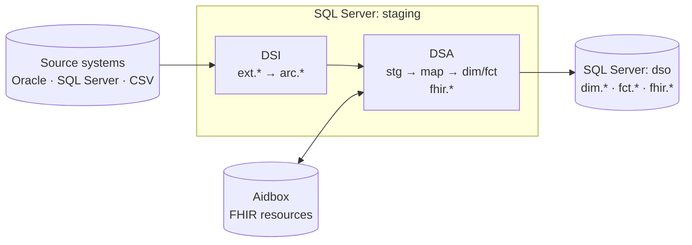

# Healthpipe

[](https://github.com/enversion-journl/healthpipe/actions/workflows/ci.yml)
[](LICENSE)
[](https://github.com/enversion-journl/healthpipe/releases/latest)

Healthpipe is an ETL platform for teams that build a healthcare data warehouse. It extracts data from clinical and administrative source systems and keeps a full archive of each source. It loads FHIR resources into a FHIR server, builds a dimensional model of dimensions and facts, and delivers the finished tables to a separate database. [Dagster](https://dagster.io/) orchestrates each step as an asset.

The pipeline has three layers. DSI (Data Staging In) extracts each source and archives it, DSA (Data Staging Area) builds the FHIR resources and the dimensional model, and DSO (Data Staging Out) delivers the finished tables. The [glossary](etl/docs/README.md#glossary) explains the other terms.

The repository contains a devcontainer that runs the full stack on Docker: Dagster, SQL Server, Oracle, PostgreSQL and the Aidbox FHIR server.

**Contents:** [Requirements](#requirements) · [Quick start](#quick-start) · [Install without the devcontainer](#install-without-the-devcontainer) · [Run your first pipeline](#run-your-first-pipeline) · [Services](#services) · [Architecture](#architecture) · [Project structure](#project-structure) · [Documentation](#documentation) · [Troubleshooting](#troubleshooting) · [Versioning](#versioning) · [Contributing and security](#contributing-and-security) · [License](#license)

## Requirements

The devcontainer supplies these versions:

| Component | Version | Source |
|---|---|---|
| Python | 3.12 | `requires-python` in `pyproject.toml` |
| Dagster | 1.13.18 | `pyproject.toml` and `uv.lock` |
| Microsoft SQL Server | 2022 | `mcr.microsoft.com/mssql/server:2022-latest` |
| Oracle Database Free | latest `full-faststart` image | `gvenzl/oracle-free:full-faststart` |
| PostgreSQL | 17 | `postgres:17` (Dagster metadata) |
| Aidbox | 2508, database 17.5 | `healthsamurai/aidboxone:2508`, `healthsamurai/aidboxdb:17.5` |
| Docker | Docker Desktop or Docker Engine with Compose | `.devcontainer/docker-compose.yml` |

You also need [VS Code](https://code.visualstudio.com/) with the [Dev Containers extension](https://marketplace.visualstudio.com/items?itemName=ms-vscode-remote.remote-containers). On macOS Apple Silicon, install Rosetta for the x86 images: `softwareupdate --install-rosetta`.

## Quick start

1. Clone the repository and create the environment file:

   ```bash
   git clone https://github.com/enversion-journl/healthpipe.git
   cd healthpipe
   cp .env.template .env
   ```

   The devcontainer does not start without the root `.env`, because `docker-compose.yml` loads it with `env_file`. The default values work. The FHIR server runs in development mode without a license. Set `AIDBOX_LICENSE` only if your Aidbox features need one, and get a free development license from the [Aidbox portal](https://aidbox.app/). To change the database images, credentials or names, see `.devcontainer/.env.template`.

2. Open the repository in VS Code. Press `Ctrl+Shift+P` and select **Dev Containers: Reopen in Container**. On the first start, the container installs the locked dependencies and creates the empty databases.

3. Open a terminal in the devcontainer and start Dagster:

   ```bash
   uvx --from rust-just just dev
   ```

   The devcontainer has no `just` binary, so `uvx` downloads and runs it. If you install `just` (for example `brew install just`), run `just dev`. Open the Dagster UI at http://localhost:3000.

4. To build the full data-warehouse schema, materialize the `full_infrastructure_setup` job in the Dagster UI.

## Install without the devcontainer

Use this path when you have your own SQL Server, Oracle, PostgreSQL and FHIR servers. You need [uv](https://docs.astral.sh/uv/) and [just](https://just.systems/).

```bash
cp .env.template .env
just install
export DAGSTER_HOME=$(pwd)/.devcontainer/dagster_home
just dev
```

Before `just install`, set the connection details of your servers in `.env`. The [configuration reference](etl/docs/configuration.md) describes each variable. `just install` runs `uv sync --locked --extra dev` and installs the pre-commit hooks. `just dev` sets `PYTHONPATH` to `etl` and starts the Dagster UI at http://localhost:3000. [CONTRIBUTING.md](CONTRIBUTING.md#development-setup) gives the full setup.

## Run your first pipeline

The [example source](examples/example_source/README.md) loads made-up data into the devcontainer SQL Server. Then it runs the user dimension `dim.ILSBruger` of ILS, the logistics source system, through the layers DSI, DSA and DSO. Run this command in a devcontainer terminal, from the repository root:

```bash
uvx --from rust-just just example
```

The target loads the data, sets two values in `.env` and runs two `dagster asset materialize` commands. Each command ends with `RUN_SUCCESS`. Then the DSO table `dim.ILSBruger` contains five users and the unknown member `-1`. The [example README](examples/example_source/README.md) explains each step, gives the query of the result and shows the recorded output.

## Services

When the devcontainer runs:

- **Dagster web UI**: http://localhost:3000
- **FHIR server (Aidbox)**: http://localhost:8888
- **SQL Server**: `mssql:1433` (user `sa`, password from `MSSQL_SA_PASSWORD` in `.env`)
- **PostgreSQL**: `postgres:5432` (Dagster metadata)
- **Oracle**: `oracle:1521` (port `1522` on the host)

## Architecture

- **Dagster**: ETL orchestration and data-pipeline management
- **Microsoft SQL Server**: the `staging` database (DSI and DSA) and the `dso` database (DSO)
- **Oracle**: IFDB, the clinical source system
- **PostgreSQL**: Dagster metadata storage
- **Aidbox (FHIR)**: FHIR resource store



DSI extracts each source 1:1 into `ext.*` and merges it into the archive `arc.*`. DSA reads the archive and builds the FHIR resources and the dimensional model. DSO copies the finished tables to the `dso` database.

### FHIR (Aidbox) connectivity

The FHIR server runs in the docker-compose stack. The Dagster code reads:

- `FHIR_SERVER_URL` (default `http://fhir-server:8888` in the devcontainer)
- `FHIR_CLIENT_USERNAME` and `FHIR_CLIENT_PASSWORD` (set in `.env`)

## Project structure

```
.
├── etl/                   # Dagster application code (assets, jobs, resources)
│   ├── infrastructure/    # DW schema (ddl/) and setup assets
│   └── docs/              # Documentation
├── examples/              # Example source data for a first pipeline run
├── .devcontainer/         # Devcontainer configuration (compose, Dockerfile, startup scripts)
└── infrastructure/        # Code-server Dockerfiles and build scripts
```

## Documentation

- [Documentation index](etl/docs/README.md): the architecture, the implementation guides and the runbooks.
- [Glossary](etl/docs/README.md#glossary): DSI, DSA, DSO, DFM, DQA and the other terms.
- Guides for each layer: [DSI](etl/docs/implementation/dsi_etl_guide.md), [FHIR](etl/docs/implementation/fhir_etl_guide.md) and [SQL/DWH](etl/docs/implementation/sql_etl_guide.md).
- [Operations guide](etl/docs/operations.md): logs, health checks, errors and backup.
- [Configuration reference](etl/docs/configuration.md): each variable of `.env`.

The primary documentation in [`etl/docs/basismodel/`](etl/docs/basismodel/) is in Danish, because the platform serves Danish healthcare. The reference documentation is mostly in English. Some code comments are in Danish.

## Troubleshooting

1. **Port conflicts**: make sure that the ports `3000`, `8888` and `1522` are free (`lsof -i :3000` on macOS and Linux).
2. **Container start problems**: examine the logs and restart the stack:
   ```bash
   docker compose -f .devcontainer/docker-compose.yml logs
   docker compose -f .devcontainer/docker-compose.yml restart
   ```
3. **Database connection problems**: wait for the SQL Server and Oracle health checks to pass. On the first start, this can take 30 to 60 seconds. Make sure that the connection settings in `.env` are correct.
4. **Apple Silicon (macOS arm64)**: the default image `mcr.microsoft.com/mssql/server:2022-latest` is x86 only and can fail under emulation. Microsoft publishes no arm64 SQL Server image. If the `mssql` container does not start, set `MSSQL_IMAGE` (an arm64-compatible image) and `MSSQL_PLATFORM=linux/arm64` in `.devcontainer/.env`. PostgreSQL, Oracle and the FHIR server run natively.

### Useful commands

```bash
docker ps                                                      # running containers
docker logs <container-name>                                   # container logs
docker exec -it <container-name> /bin/bash                     # shell into a container
docker compose -f .devcontainer/docker-compose.yml ps          # compose services
```

## Versioning

While the major number is 1, a release with a **Breaking:** entry increases the minor number, for example from 1.0.8 to 1.1.0. All other releases increase the patch number, for example from 1.0.8 to 1.0.9. [CHANGELOG.md](CHANGELOG.md) lists the changes of each release and marks each breaking change with **Breaking:**.

## Contributing and security

Contributions are welcome. Read [CONTRIBUTING.md](CONTRIBUTING.md) before you open a pull request against `main`. Every commit needs a DCO sign-off (`git commit -s`). The maintainers carry a merged pull request into the next release, as [How a Release Replaces the Tree](CONTRIBUTING.md#how-a-release-replaces-the-tree) describes.

The `justfile` has the targets `install`, `lint`, `format`, `test`, `test-integration`, `typecheck`, `validate`, `dev` and `example`. Run `just` to list them. [Development Setup](CONTRIBUTING.md#development-setup) describes each target.

Do not report a vulnerability in a public issue. Report it privately, as [SECURITY.md](SECURITY.md) describes.

## License

Healthpipe uses the GNU Affero General Public License v3.0 or later (AGPL-3.0-or-later). See [LICENSE](LICENSE).
