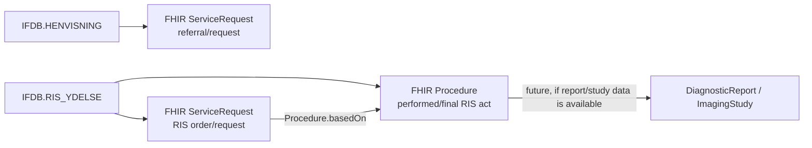

<!--
  SPDX-FileCopyrightText: 2026 Enversion Journl ApS
  SPDX-License-Identifier: AGPL-3.0-or-later

  This file is part of Healthpipe. See the LICENSE file in the project
  root for the full AGPL-3.0 license text.
-->

# US-FHIR-05: IFDB to FHIR ServiceRequest Implementation Plan

Status: implemented on `feature/us-fhir-05-servicerequest` for tasks 27552
and 27553.

Branch for implementation work: `feature/us-fhir-05-servicerequest`.

This plan replaces the earlier flat-table idea. Do not implement a new
`fhir.RIS_Ydelse` table and do not add a `ris_ydelse_view.json` SQL-on-FHIR
view. RIS_YDELSE belongs in the FHIR model as request/order data in
`ServiceRequest`, with the already-existing performed/final RIS representation
remaining in `Procedure`.

## Final Modeling Decision

Implement `ServiceRequest` for the request side of US-FHIR-05.

The decision is closed for this branch:

- `IFDB.HENVISNING` becomes FHIR `ServiceRequest`.
- `IFDB.RIS_YDELSE` also becomes FHIR `ServiceRequest` for the radiology
  request/order lifecycle.
- Existing `IFDB.RIS_YDELSE -> Procedure` remains the performed/final act side.
- Existing RIS `Procedure` resources must be linked back to the corresponding
  RIS `ServiceRequest` with `Procedure.basedOn`.
- The SQL/DSO landing table is `fhir.ServiceRequest`, exposed through
  `vw_fhir.ServiceRequest`.
- Raw `RIS_YDELSE.XML` is not written to `ServiceRequest` or the
  `fhir.ServiceRequest` flat table. Parse only the approved service code fields.

FHIR rationale:

- HL7 FHIR R4B defines `ServiceRequest` as a request for diagnostic
  investigations, treatments, operations, or other services to be performed:
  https://hl7.org/fhir/R4B/servicerequest.html
- The same page says `ServiceRequest` is a proposal, plan, or order that can
  result in `Procedure`, `Observation`, `DiagnosticReport`, `ImagingStudy`, or
  similar resources.
- HL7 FHIR R4B `Procedure.basedOn` explicitly points to the request for the
  procedure and supports `ServiceRequest`:
  https://hl7.org/fhir/R4B/procedure-definitions.html#Procedure.basedOn
- HL7 FHIR R4B `DiagnosticReport` captures the report/result and connects to the
  request through request resources such as `ServiceRequest`:
  https://hl7.org/fhir/R4B/diagnosticreport.html
- HL7 FHIR R4B `ImagingStudy.basedOn` references the request fulfilled,
  including `ServiceRequest`: https://hl7.org/fhir/R4B/imagingstudy.html
- DK Core has a Danish `ServiceRequest` profile for requesting services such as
  diagnostic investigations and treatments:
  https://hl7.dk/fhir/core/StructureDefinition-dk-core-person-servicerequest.html
- DK Core also contains a Danish referral example modeled as `ServiceRequest`:
  https://hl7.dk/fhir/core/ServiceRequest-HenvisningFraLageTilSygehus.html

Therefore, the correct model is:



## What New Data Is Brought In

The US-FHIR-05 source scope is:

| Source table | New or existing extraction | Target FHIR resource | Grain |
| --- | --- | --- | --- |
| `IFDB.HENVISNING` | New extraction module | `ServiceRequest` | One row per `HENVISNING.OBJEKT_ID` |
| `IFDB.HENVISNING_HISTORIK` | New extraction module | Enrichment on `ServiceRequest` | Latest/relevant state for same `HENVISNING_ID` |
| `IFDB.REFERRALINFORMATION` | New extraction module | Enrichment on `ServiceRequest` | Joined through EpisodeOfCare when unique/safe |
| `IFDB.RIS_YDELSE` | Already extracted in `DSI/extract/IFDB/ris_ydelse.py` | `ServiceRequest` and existing `Procedure` | One ServiceRequest per requested RIS service group |

Data lands in the platform like other FHIR resources:

1. DSI extracts source rows from IFDB Oracle.
2. DSA builds FHIR R4B `ServiceRequest` resources and posts/upserts them to the
   FHIR/Aidbox resource store.
3. SQL-on-FHIR flattens `ServiceRequest` into `fhir.ServiceRequest`.
4. DSO sync publishes `fhir.ServiceRequest` through the existing sync pattern.
5. `vw_fhir.ServiceRequest` is a pass-through reporting view over
   `fhir.ServiceRequest`.

No data lands in `fhir.RIS_Ydelse`.

## Existing Codebase Facts

Relevant current state in the repository:

- `DSI/extract/IFDB/ris_ydelse.py` already extracts `IFDB.RIS_YDELSE`, including
  the columns from the business screenshot.
- `DSA/FHIR/Procedure/Procedure_IFDB_RisYdelse.py` already builds `Procedure`
  resources from finalized RIS rows.
- That Procedure code only includes `FINAL_REPORT` and `MODIFIED_REPORT` as
  performed/final RIS procedures.
- Known non-final states such as `BOOKED`, `ORDERED`,
  `ORDERED_AWAITING_ACK`, `EXECUTED`, `PRELIMINARY_REPORT`, and `REJECTED`
  are skipped by the Procedure transform.
- That skip behavior is correct for `Procedure`, but it is exactly why
  US-FHIR-05 must add `ServiceRequest` for the request/order side.
- `utils/fhir/identifier_systems.py` already has
  `SYSTEM_IFDB_RIS_YDELSE = "urn:source:ifdb:ris_ydelse"`.
- `utils/fhir/fhir_validator.py` already allows `ServiceRequest`, but the
  implementation must still add indexes, assets, SQL-on-FHIR config, DDL, DSO
  sync, and lineage.

## Scope for This Branch

In scope:

- Add IFDB extraction assets for `HENVISNING`, `HENVISNING_HISTORIK`, and
  `REFERRALINFORMATION`.
- Reuse the existing `RIS_YDELSE` extraction asset.
- Add a new FHIR `ServiceRequest` module and assets for daily, monthly, and
  full-load flows.
- Build `ServiceRequest` from `HENVISNING`.
- Build `ServiceRequest` from `RIS_YDELSE`.
- Refactor the RIS XML service-code extraction helper out of
  `Procedure_IFDB_RisYdelse.py` so both Procedure and ServiceRequest use the
  same parsing logic.
- Add `Procedure.basedOn` from RIS Procedure to the corresponding RIS
  ServiceRequest.
- Add `fhir.ServiceRequest` DDL, `servicerequest_view.json`,
  SQL-on-FHIR assets, DSO sync config, `vw_fhir.ServiceRequest`, and lineage.
- Add unit and integration tests that prove the resource mapping, registration,
  indexes, and flat-table shape.

Out of scope:

- No new `fhir.RIS_Ydelse` physical table.
- No `vw_fhir.RIS_Ydelse` view.
- No `ris_ydelse_view.json`.
- No raw `RIS_YDELSE.XML` persistence in `ServiceRequest` or
  `fhir.ServiceRequest`.
- No first-version implementation of `DiagnosticReport` or `ImagingStudy`.
- No full audit/event model for every `HENVISNING_HISTORIK` row.
- No new Organization/Practitioner master-data pipeline unless an existing
  identifier can resolve the reference safely.

## Source Profiling Summary

Committed profile data shows:

| Table | Rows | Columns | PK | FK |
| --- | ---: | ---: | --- | --- |
| `HENVISNING` | 3,092,561 | 55 | `OBJEKT_ID` | `PATIENT_ID -> PATIENT_OPLYSNINGER_COLUMNA.PATIENT_ID` |
| `HENVISNING_HISTORIK` | 6,804,458 | 36 | `HENVISNING_ID, ORDNING` | `HENVISNING_ID -> HENVISNING.OBJEKT_ID`; `DIAGNOSE_ID -> PAS_DIAGNOSE.OBJEKT_ID` |
| `REFERRALINFORMATION` | 6,196,353 | 18 | none in profile | `OBJECT_ID -> EPISODE_OF_CARE.OBJECT_ID` |
| `RIS_YDELSE` | 10,946,589 | 27 | `OBJEKT_ID` | `PATIENT_ID -> PATIENT_OPLYSNINGER_COLUMNA.PATIENT_ID` |

`MAPRIS_YDELSE` is mentioned in the work item text but is not present in the
committed table profiles. Implementation targets the actual profiled table
`IFDB.RIS_YDELSE`. Add a comment in the PR description that `MAPRIS_YDELSE`
was interpreted as the RIS-ydelse semantic area, not a separate source table.

## DSI Extraction Work

Add new files:

- `dagster_etl/DSI/extract/IFDB/henvisning.py`
- `dagster_etl/DSI/extract/IFDB/henvisning_historik.py`
- `dagster_etl/DSI/extract/IFDB/referralinformation.py`

Update:

- `dagster_etl/DSI/extract/IFDB/__init__.py`

Do not add another `RIS_YDELSE_CONFIG`; reuse the existing one.

Extraction config decisions:

| Source | Entity name | Partition column | Notes |
| --- | --- | --- | --- |
| `IFDB.HENVISNING` | `henvisning` | `OPDATERET_TID` | Source has both event dates and update time; use update time for deltas. |
| `IFDB.HENVISNING_HISTORIK` | `henvisning_historik` | `BESLUT_TIDSPUNKT` | Event-time delta. Monthly/full load catches late changes. |
| `IFDB.REFERRALINFORMATION` | `referralinformation` | `REFERRAL_DATE` | Event-time delta because profile has no update timestamp. Monthly/full load catches late changes. |
| `IFDB.RIS_YDELSE` | `ris_ydelse` | existing `OPDATERET_TID` | Already implemented. |

Minimum column lists:

`HENVISNING`:

- `OBJEKT_ID`
- `MODTIDSPUNKT`
- `SLETTET`
- `PATIENT_ID`
- `EPISODE_OF_CARE_ID`
- `HENVISNINGSDATO`
- `AFSENDELSESDATO`
- `SLUTDATO`
- `MODTAGET`
- `STATUS_KODE`
- `STATUS_KODETEKST`
- `TYPE_KODE`
- `TYPE_KODETEKST`
- `INDKALDELSESPRIORIT_KODE`
- `INDKALDELSESPRIORIT_KODETEKST`
- `HENVISNINGSMAADE_KODE`
- `HENVISNINGSMAADE_KODETEKST`
- `REFERRAL_PURPOSE`
- `HENVIST_TIL_AFDELING_SORKODE`
- `HENVIST_FRA_AFDELING_SORKODE`
- `AFSENDER_AFDELING_SORKODE`
- `BEHANDLER_AFDELING_SORKODE`
- `OPDATERET_TID`

`HENVISNING_HISTORIK`:

- `HENVISNING_ID`
- `ORDNING`
- `HANDLING`
- `BESLUT_TIDSPUNKT`
- `FRA_KODE`
- `FRA_KODETEKST`
- `STATUS_KODE`
- `STATUS_KODETEKST`
- `TIL_AFDELING_SORKODE`
- `MODTAGETDATO`
- `VISITATIONSDATO`
- `VENTEGRUPPE`
- `EKSPERTOMRAADE`
- `TREATMENTRIGHT`
- `FAELLESVISITATION`
- `DIAGNOSE_ID`

`REFERRALINFORMATION`:

- `OBJECT_ID`
- `REFERRAL_ORG_CODE`
- `REFERRAL_ORG_NAME`
- `REFERRAL_ORG_ORGCODE`
- `REFERRAL_ORG_SORCODE`
- `PRACTITIONER_NUMBER`
- `PRACTITIONER_NAME`
- `INSTITUTION_CODE`
- `INSTITUTION_NAME`
- `INSTITUTION_ORGCODE`
- `INSTITUTION_SORCODE`
- `REFERRAL_TYPE_CODE`
- `REFERRAL_TYPE_TEXT`
- `REFERRAL_REASON_CODE`
- `REFERRAL_REASON_TEXT`
- `FREECHOICE_CODE`
- `FREECHOICE_TEXT`
- `REFERRAL_DATE`

## FHIR Identifier Systems and Indexes

Add:

```python
SYSTEM_IFDB_HENVISNING_ID = "urn:source:ifdb:henvisning"
```

Use the existing RIS identifier system:

```python
SYSTEM_IFDB_RIS_YDELSE = "urn:source:ifdb:ris_ydelse"
```

Add identifier indexes:

```python
("ServiceRequest", SYSTEM_IFDB_HENVISNING_ID)
("ServiceRequest", SYSTEM_IFDB_RIS_YDELSE)
```

Add `ServiceRequest` to:

- `TXID_BTREE_RESOURCES`
- `SOF_TS_RESOURCES`

Files:

- `dagster_etl/utils/fhir/identifier_systems.py`
- `dagster_etl/utils/fhir/index_config.py`
- `dagster_etl/infrastructure/assets/fhir_ifdb_infrastructure.py` if any
  resource-specific assumptions exist there.

## ServiceRequest Transform

Add files:

- `dagster_etl/DSA/FHIR/ServiceRequest/__init__.py`
- `dagster_etl/DSA/FHIR/ServiceRequest/ServiceRequest_IFDB.py`

Update:

- `dagster_etl/DSA/FHIR/assets.py`

Assets:

- `fhir_service_request_daily_ifdb`
- `fhir_service_request_monthly_ifdb`
- `fhir_service_request_full_load_ifdb`

Resource dependencies:

- Patient must be available for `ServiceRequest.subject`.
- EpisodeOfCare should be available for local EpisodeOfCare extension.
- Encounter should be available for RIS `ServiceRequest.encounter`.
- Existing RIS Procedure asset should run after RIS ServiceRequest once
  `Procedure.basedOn` is added.

### HENVISNING Mapping

| IFDB source | FHIR target | Decision |
| --- | --- | --- |
| `HENVISNING.OBJEKT_ID` | `ServiceRequest.identifier` | system `SYSTEM_IFDB_HENVISNING_ID`, value normalized `OBJEKT_ID` |
| `HENVISNING.PATIENT_ID` | `ServiceRequest.subject` | required Patient reference by `SYSTEM_IFDB_PATIENT_ID` |
| `HENVISNING.EPISODE_OF_CARE_ID` | local EpisodeOfCare extension | use existing `EXTENSION_EPISODE_OF_CARE`; ServiceRequest has no native EOC field |
| `HENVISNING.STATUS_KODE/STATUS_KODETEKST` | `ServiceRequest.status` plus source-status extension | map only approved values; unmapped values become `unknown` and are preserved |
| `HENVISNING.SLETTET` | `ServiceRequest.status` and `isDeleted` extension | truthy means `entered-in-error` and `build_is_deleted_extension(1)` |
| `HENVISNING.HENVISNINGSDATO` | `ServiceRequest.authoredOn` | first choice |
| `HENVISNING.AFSENDELSESDATO` | `ServiceRequest.authoredOn` fallback | use when `HENVISNINGSDATO` is empty |
| `HENVISNING.SLUTDATO` | `ServiceRequest.occurrencePeriod.end` | preserve as end/date boundary, not as report result |
| `HENVISNING.INDKALDELSESPRIORIT_*` | `ServiceRequest.priority` | map to DK Core/FHIR allowed values only: `routine` or `asap`; otherwise omit and preserve source |
| `HENVISNING.TYPE_*` | `ServiceRequest.category` | local coding/display until DK code mapping is confirmed |
| `HENVISNING.HENVISNINGSMAADE_*` | extension/source meta | do not overload `code` in first version |
| `HENVISNING.REFERRAL_PURPOSE` | source-meta extension | do not expose as clinical free text in first implementation |
| `HENVIST_TIL_*` SOR fields | `ServiceRequest.performer` | Organization reference by SOR when a SOR code exists |
| `HENVIST_FRA_*` / `AFSENDER_*` SOR fields | `ServiceRequest.requester` | Organization reference by SOR when a SOR code exists |

`ServiceRequest.intent` for `HENVISNING` is `proposal` in the first
implementation. This aligns with the DK Core referral example. If Region
Syddanmark later wants internal accepted referrals to be `order`, that should be
a separate mapping change backed by source value analysis.

### HENVISNING_HISTORIK Enrichment

Do not emit one `ServiceRequest` per history row.

Use history rows to enrich the primary HENVISNING ServiceRequest:

- Select deterministic latest row by `HENVISNING_ID`, then highest
  `BESLUT_TIDSPUNKT`, then highest `ORDNING`.
- Preserve latest history `HANDLING`, `STATUS_*`, `FRA_*`, `VISITATIONSDATO`,
  `VENTEGRUPPE`, `EKSPERTOMRAADE`, `TREATMENTRIGHT`, and
  `FAELLESVISITATION` in a compact source-meta extension.
- If `DIAGNOSE_ID` is populated and a PAS Diagnosis/Condition reference exists,
  add it to `reasonReference`; otherwise preserve only the source ID.

Full audit modeling belongs in a later `Provenance`/`Task` story.

### REFERRALINFORMATION Enrichment

`REFERRALINFORMATION.OBJECT_ID` references `EPISODE_OF_CARE.OBJECT_ID`, not
`HENVISNING.OBJEKT_ID`.

Implementation:

- Build an enrichment lookup by `OBJECT_ID`.
- Join to HENVISNING through `HENVISNING.EPISODE_OF_CARE_ID`.
- If more than one referralinformation row exists for the same `OBJECT_ID`,
  choose the newest `REFERRAL_DATE` deterministically and log a fan-out metric.
- Use SOR-coded organization fields for `requester` only when they can be
  represented as a stable Organization identifier.
- Preserve non-resolved referral organization/type/reason/free-choice fields in
  a source-meta extension.

### RIS_YDELSE Mapping

RIS_YDELSE is both:

- a request/order lifecycle source for `ServiceRequest`
- a performed/final act source for existing `Procedure`

Implementation rules:

- Emit RIS `ServiceRequest` for RIS rows with a Patient reference, including
  order-like states that Procedure skips.
- ServiceRequest grain follows FHIR's one-request-per-service principle:
  one ServiceRequest per parsed RIS XML `<service>` group.
- Identifier values must match the existing Procedure grain:
  `f"{OBJEKT_ID}:{element_nummer}"` with `SYSTEM_IFDB_RIS_YDELSE`.
- If XML cannot be parsed but the row has request/order state, emit one
  conservative ServiceRequest with identifier `f"{OBJEKT_ID}:1"`, no raw XML,
  `code` omitted, and source state/type preserved in source-meta extension.
- `Procedure.basedOn` must reference the same identifier system/value.

| IFDB source | FHIR target | Decision |
| --- | --- | --- |
| `RIS_YDELSE.OBJEKT_ID` + XML service number | `ServiceRequest.identifier` | system `SYSTEM_IFDB_RIS_YDELSE`, value `OBJEKT_ID:element_nummer` |
| `RIS_YDELSE.PATIENT_ID` | `ServiceRequest.subject` | required Patient reference |
| `RIS_YDELSE.ENCOUNTER_ID` | `ServiceRequest.encounter` | optional Encounter reference by existing Encounter identifier system |
| `RIS_YDELSE.EPISODE_OF_CARE_ID` | local EpisodeOfCare extension | existing `EXTENSION_EPISODE_OF_CARE` |
| `RIS_YDELSE.STATE` | `ServiceRequest.status` | see status mapping below |
| `RIS_YDELSE.TYPE` | `ServiceRequest.category` or source-meta extension | use local coding/display until RIS value semantics are confirmed |
| XML `<service><kode>` | `ServiceRequest.code` | parse approved code only, normalize like Procedure |
| XML `<tillaegskode>` | `ServiceRequest.orderDetail` | only when `code` exists |
| `PERIOD_START/PERIOD_END` | `ServiceRequest.occurrencePeriod` | requested/planned period if present |
| `UDFOERT_TIDSPUNKT` | not a ServiceRequest performed time | belongs to Procedure |
| `UDFOERT_ADMENHED_*` / `STAMAFD_*` | `performer` / source-meta | SOR reference where available |
| `SLETTET` | status and isDeleted extension | truthy means `entered-in-error` |
| `IGNORED`, `LPR3_IGNORED` | source-meta extension | do not silently drop unless product owner approves filtering |
| `XML` | not persisted raw | parse code/orderDetail only |

RIS `ServiceRequest.intent` is `order`.

RIS status mapping:

| `RIS_YDELSE.STATE` | `ServiceRequest.status` | Reason |
| --- | --- | --- |
| `ORDERED` | `active` | Active order/request |
| `ORDERED_AWAITING_ACK` | `active` | Active order awaiting acknowledgement |
| `BOOKED` | `active` | Scheduled but not fulfilled |
| `EXECUTED` | `completed` | Request has been performed |
| `PRELIMINARY_REPORT` | `active` | Work/reporting is not final |
| `FINAL_REPORT` | `completed` | Fulfilled request |
| `MODIFIED_REPORT` | `completed` | Fulfilled request with modified final report |
| `REJECTED` | `revoked` | Request rejected/cancelled |
| unknown non-empty value | `unknown` | Preserve source state in extension and emit metric |
| `SLETTET` truthy | `entered-in-error` | Overrides state |

## Procedure BasedOn Change

Update:

- `dagster_etl/DSA/FHIR/Procedure/Procedure_IFDB_RisYdelse.py`

When building each RIS Procedure, add:

```python
basedOn=[
    Reference(
        type="ServiceRequest",
        identifier=Identifier(
            system=SYSTEM_IFDB_RIS_YDELSE,
            value=identifier_value,
        ),
    )
]
```

This is a logical (identifier) reference at build time. It must use the exact
same `identifier_value` as the RIS Procedure and RIS ServiceRequest — which
means `OBJEKT_ID` must be passed through `normalize_oracle_id` on **both** sides
(Oracle NUMBER columns arrive as floats, so a raw `12345.0` would not match the
ServiceRequest's normalized `12345`).

The `basedOn` field is registered in `RIS_YDELSE_NESTED_REFERENCE_CONFIGS`
(`field_path="basedOn"`, `{SYSTEM_IFDB_RIS_YDELSE: "ServiceRequest"}`,
`is_required=False`), so `prepare_resources_for_upsert` resolves it to a literal
`ServiceRequest/<id>` reference — consistent with `subject`/`encounter`. The RIS
ServiceRequest asset is an upstream `dep` of the Procedure asset, so the target
exists by resolution time; if it cannot be resolved the identifier reference is
kept. Cross-resource value equality is covered by
`tests/unit/test_ris_ydelse_procedure_based_on.py` using a numeric `OBJEKT_ID`.

## SQL-on-FHIR and DSO Landing

Add:

- `dagster_etl/DSA/FHIR/SqlOnFhir/view_definitions/servicerequest_view.json`
- `dagster_etl/DSA/FHIR/SqlOnFhir/ServiceRequest.py`
- `dagster_etl/data_lineage/fhir/fhir_servicerequest.yml`

Update:

- `dagster_etl/DSA/FHIR/SqlOnFhir/__init__.py`
- `dagster_etl/DSA/FHIR/utils/sql_on_fhir/sof_utils.py`
- `dagster_etl/infrastructure/ddl/tables/fhir/01_tables.sql`
- `dagster_etl/infrastructure/ddl/views/fhir/01_vw_fhir.sql`
- `dagster_etl/DSO/load/sync_configs.py`
- `dagster_etl/DSO/load/sync_fhir.py`

Create only:

- `fhir.ServiceRequest`
- `vw_fhir.ServiceRequest`

Recommended initial flat table:

| Column | Source/FHIR path |
| --- | --- |
| `service_request_id` | `id` |
| `identifier_system` | `identifier[0].system` |
| `identifier_value` | `identifier[0].value` |
| `patient_id` | `subject.id` |
| `episode_of_care_id` | `extension(EXTENSION_EPISODE_OF_CARE).valueReference.id` |
| `encounter_id` | `encounter.id` |
| `status` | `status` |
| `intent` | `intent` |
| `priority` | `priority` |
| `category_code` | `category.coding.code` |
| `category_display` | `category.coding.display` |
| `code` | `code.coding.code` |
| `code_display` | `code.coding.display` or `code.text` |
| `authored_on` | `authoredOn` |
| `occurrence_start` | `occurrencePeriod.start` |
| `occurrence_end` | `occurrencePeriod.end` |
| `requester_id` | `requester.id` |
| `performer_id` | first `performer.id` |
| `source_table` | source-meta extension |
| `is_deleted` | `extension(urn:fhir:isDeleted).valueInteger` |
| `last_updated` | Aidbox/FHIR resource `ts` |
| `created_at` | Aidbox/FHIR resource `cts` |

DDL:

- Primary key: `service_request_id`
- Index: `patient_id`
- Index: `episode_of_care_id`
- Index: `encounter_id`
- Index: `identifier_system, identifier_value`
- Index: `last_updated`

## Status and Code Safety

Do not guess source code semantics that are not verified.

Implementation must include:

- A status mapper with explicit handling for deleted rows.
- RIS state mapping exactly as listed above.
- HENVISNING status mapping that defaults to `unknown` for unmapped source
  values and preserves the source status in an extension.
- A unit test fixture with representative source statuses.
- Log metrics for unmapped status/type/priority values.
- No hard failure on a new source code unless strict validation is explicitly
  enabled for a controlled run.

Priority mapping:

- DK Core reduces priority usage to `routine` and `asap` in the Danish context.
- Map only source values that are known to mean elective/routine or acute/asap.
- Preserve all other source priority values in source-meta extension.

Code mapping:

- RIS XML `<kode>` is the best first source for `ServiceRequest.code`.
- HENVISNING `TYPE_*` starts as `category`, not `code`, unless source profiling
  proves that it identifies the concrete requested service.
- `REFERRAL_PURPOSE` is preserved only in source metadata in the first
  implementation. Do not expose it as `reasonCode.text` without a later data
  governance decision.

## Implementation Checklist

- [x] Add `SYSTEM_IFDB_HENVISNING_ID` and ServiceRequest index specs.
- [x] Add HENVISNING, HENVISNING_HISTORIK, and REFERRALINFORMATION DSI extraction
   modules and register them.
- [x] Move RIS XML service parsing to a shared helper and keep existing Procedure
   behavior unchanged.
- [x] Add `ServiceRequest_IFDB.py` with HENVISNING and RIS builders.
- [x] Add ServiceRequest asset registration.
- [x] Add RIS Procedure `basedOn` logical references.
- [x] Add SQL-on-FHIR `servicerequest_view.json` and asset.
- [x] Add `fhir.ServiceRequest` DDL and `vw_fhir.ServiceRequest`.
- [x] Add DSO sync config for `fhir.ServiceRequest`.
- [x] Add lineage for `fhir_servicerequest.yml`.
- [x] Add focused unit and integration tests.
- [x] Run focused test suite.

## Test Plan

Added unit tests:

- `dagster_etl/tests/unit/test_servicerequest_transforms.py`
- `dagster_etl/tests/unit/test_servicerequest_pipeline_registration.py`
- `dagster_etl/tests/unit/test_ris_ydelse_procedure_based_on.py`
- Existing RIS regression tests continue to cover Procedure behavior and XML
  handling.

Required test cases:

- HENVISNING with `OBJEKT_ID` and `PATIENT_ID` emits one ServiceRequest.
- HENVISNING with `SLETTET` emits `entered-in-error` and isDeleted extension.
- HENVISNING without `PATIENT_ID` is skipped or rejected consistently with
  existing required-reference behavior.
- HENVISNING_HISTORIK latest-row selection is deterministic.
- REFERRALINFORMATION fan-out is deterministic and logs a metric.
- RIS `ORDERED` emits active ServiceRequest.
- RIS `BOOKED` emits active ServiceRequest.
- RIS `FINAL_REPORT` emits completed ServiceRequest and existing Procedure.
- RIS `REJECTED` emits revoked ServiceRequest and no completed Procedure.
- RIS Procedure has `basedOn` pointing to the same
  `SYSTEM_IFDB_RIS_YDELSE` identifier as its ServiceRequest.
- Raw `RIS_YDELSE.XML` is not present in ServiceRequest output or
  `fhir.ServiceRequest` flat output.
- Re-running the same source rows updates existing resources and does not create
  duplicates.

Focused commands:

```bash
python -m pytest \
  dagster_etl/tests/unit/test_servicerequest_transforms.py \
  dagster_etl/tests/unit/test_ris_ydelse_procedure_based_on.py \
  dagster_etl/tests/unit/test_servicerequest_pipeline_registration.py \
  dagster_etl/tests/unit/test_procedure_pipeline_registration.py \
  dagster_etl/tests/unit/test_ris_ydelse_lossless.py \
  dagster_etl/tests/unit/test_ris_ydelse_skipped_dependency_pin.py \
  dagster_etl/tests/integration/fhir_ifdb/test_dsi_extraction_configs.py
```

Regression commands:

```bash
python -m pytest dagster_etl/tests/unit/test_ris_ydelse_lossless.py
python -m pytest dagster_etl/tests/unit/test_ris_ydelse_skipped_dependency_pin.py
```

Latest local result: 58 passed, 30 skipped. The skipped tests are opt-in FHIR
IFDB integration tests that require `RUN_FHIR_IFDB_INTEGRATION_TESTS=true` and
FHIR server configuration.

## Acceptance Criteria

Implementation is done only when all of the following are true:

- `ServiceRequest` resources are created for HENVISNING rows.
- `ServiceRequest` resources are created for RIS_YDELSE request/order rows.
- Existing RIS Procedure creation still works for finalized RIS rows.
- RIS Procedures contain `basedOn` references to RIS ServiceRequests.
- There is no `fhir.RIS_Ydelse` table.
- There is no `vw_fhir.RIS_Ydelse` view.
- There is no `ris_ydelse_view.json`.
- `fhir.ServiceRequest` exists with DDL, SQL-on-FHIR view definition, DSO sync,
  and lineage.
- Raw RIS XML is not exposed through ServiceRequest.
- Unknown source values are preserved in source metadata and surfaced through
  metrics instead of being guessed.
- Focused unit/integration tests pass.

## Known Residual Risks

- `HENVISNING_HISTORIK` and `REFERRALINFORMATION` have event-time partition
  columns (`BESLUT_TIDSPUNKT` / `REFERRAL_DATE`) independent of HENVISNING's
  `OPDATERET_TID`. To avoid dropping enrichment when a processed henvisning's
  latest history/referral-info falls outside the partition window, the
  daily/monthly assets backfill it via a key-scoped Oracle fetch in
  `_backfill_enrichment_from_oracle` (chunked IN on exactly the henvisning /
  episode ids the co-partition extracts missed). Full-load already holds the
  complete snapshot, so it skips the backfill. Residual: a henvisning whose
  *own* row is not re-extracted in a window will not be reprocessed until the
  next change or a monthly/full-load run.
- `REFERRALINFORMATION` has no primary key in the committed profile. The
  transform must handle fan-out deterministically.
- Existing RIS Procedure code currently preserves raw XML in a Procedure
  extension. This plan does not add raw XML to ServiceRequest. If raw XML should
  be removed from Procedure as well, that should be a separate cleanup decision
  because it changes existing behavior.
- HENVISNING source status/type/priority values need profiling-backed mapping
  tests. Until each value is approved, default to safe FHIR values and preserve
  source values in extensions.
