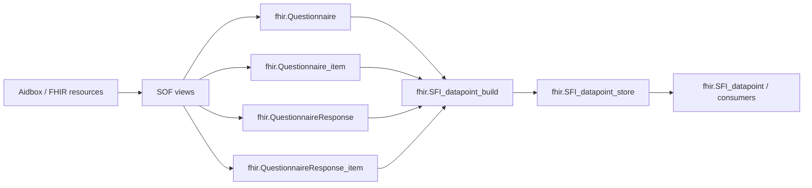

<!--
  SPDX-FileCopyrightText: 2026 Enversion Journl ApS
  SPDX-License-Identifier: AGPL-3.0-or-later

  This file is part of Healthpipe. See the LICENSE file in the project
  root for the full AGPL-3.0 license text.
-->

# Plan: Robust QR -> SFI join-key og datapunkt-kæde

**Status:** Implementeret på `feature/sfi-datapoint-performance` (migration
`20260608_qr_sfi_join_key_hardening.sql` + preflight i
`refresh_sfi_datapoint.py`). Én bevidst afvigelse fra planen: preflight-default
er `skip`, ikke `fail` — se note i Fase 6. Verifikationsqueries, runbook og
rollback-procedure i dette dokument er fortsat de autoritative.

## Problem

Der er et kædebrud i QR-grenen: `QuestionnaireResponse` og
`QuestionnaireResponse_item` kan være loadet, uden at der kommer rækker ud af
`fhir.SFI_datapoint_build` og dermed `fhir.SFI_datapoint_store`.

Det må ikke løses ved kun at tvinge `questionnaire_canonical` og
`questionnaire_version` til at være udfyldt. Det rigtige problem er en
end-to-end kontrakt:

- QR-headeren skal pege deterministisk på et questionnaire-canonical.
- Version skal bevares, hvis den findes, men må gerne være `NULL`, hvis
  canonical-reference er uversioneret.
- Alle relevante `Questionnaire` og `Questionnaire_item` rækker skal være
  loadet, før QR-datapunkter bygges.
- `QuestionnaireResponse_item.link_id` skal kunne matche et
  `Questionnaire_item.link_id`.
- Kun SFI-relevante questionnaire-items (`element_system = 'urn:dk:ifdb:sfi'`)
  må blive til SFI-datapunkter.
- Silent drops skal opdages som datakvalitetsfejl, ikke først som tomme
  dashboards eller mærkelige Dagster-tal.

## Permanent mål

- Ingen tab af SFI-relevante QR-items i transformationen fra FHIR til
  `SFI_datapoint_store`.
- En stabil join-key kontrakt på tværs af SOF extraction, DSO-tabeller,
  views, incremental refresh og reconciliation.
- Driftssikre DQ-gates, der måler faktisk joinbarhed og output, ikke kun
  om enkelte felter er non-null.
- En model der virker for alle questionnaires: versionerede, uversionerede,
  nye, ændrede og historiske.
- Daglige kørsler skal være inkrementelle, men en reconciliation skal kunne
  genopbygge korrekt output uden manuel reparation.

## Designprincipper

- Join-key er en kontrakt, ikke en beregning gemt i sidste led.
- Canonical er obligatorisk for QR med `questionnaire`; version er nullable.
- Vi må aldrig opfinde en version for at få en DQ-check grøn.
- Fallback i views er et safety-net og en målekilde, ikke den primære
  forretningslogik.
- DQ skal fejle på risiko for tab, men den skal skelne mellem gyldige
  uversionerede questionnaires og reelle databrud.
- Rebuild/reconciliation er en kontrolleret operation, ikke en del af normal
  daglig refresh.

## Målarkitektur



QR-grenen er kun sund, hvis alle led herunder holder:

1. `QuestionnaireResponse.questionnaire` kan normaliseres til canonical og
   eventuelt version.
2. Den normaliserede QR-reference findes i `Questionnaire` /
   `Questionnaire_item`.
3. QR-item `link_id` matcher et questionnaire-item `link_id`.
4. Questionnaire-item har SFI mapping via `element_system = 'urn:dk:ifdb:sfi'`.
5. `SFI_datapoint_build` producerer mindst de forventede rækker.
6. `SFI_datapoint_store` er reconcilet efter schema/view/backfill ændringer.

## Scope

- `dagster_etl/DSA/FHIR/SqlOnFhir/view_definitions/questionnaire_response_view.json`
- `dagster_etl/DSA/FHIR/utils/sql_on_fhir/sof_utils.py`, hvis SOF laget ikke
  kan udtrykke split af canonical/version rent i view definition.
- `dagster_etl/infrastructure/ddl/tables/fhir/01_tables.sql`
- `dagster_etl/infrastructure/ddl/migrations/<ny_migration>.sql`
- `dagster_etl/infrastructure/ddl/views/fhir/01_vw_fhir.sql`
- `dagster_etl/DSO/load/refresh_sfi_datapoint.py`
- `dagster_etl/tests/unit/test_sfi_sof_views.py`
- `dagster_etl/tests/unit/test_refresh_sfi_datapoint.py`
- `dagster_etl/tests/unit/test_sfi_datapoint_store_contract.py`

## Implementeringsplan

### Fase 1 - Definer canonical/version kontrakten

Indfør én fælles kontrakt for `QuestionnaireResponse.questionnaire`:

- Hvis `questionnaire = '<canonical>|<version>'`:
  - `questionnaire_canonical = '<canonical>'`
  - `questionnaire_version = '<version>'`
- Hvis `questionnaire = '<canonical>'`:
  - `questionnaire_canonical = '<canonical>'`
  - `questionnaire_version = NULL`
- Hvis `questionnaire IS NULL`:
  - begge afledte felter er `NULL`
  - rækken kan ikke indgå i QR -> SFI og skal tælles som DQ issue, hvis den
    ellers forventes SFI-relevant.

Version må ikke gøres obligatorisk globalt. Det er en gyldig tilstand, at både
QR-reference og Questionnaire er uversioneret.

### Fase 2 - Persistér join-key i QR-headeren

Opdater SOF extraction for `QuestionnaireResponse`, så de afledte kolonner
persistes i `fhir.QuestionnaireResponse`:

- `questionnaire_canonical`
- `questionnaire_version`

Hvis SQL-on-FHIR view definition ikke kan splitte strengen sikkert, skal split
ske i den generiske SOF load/merge pipeline som en eksplicit, testet
post-projection for netop `QuestionnaireResponse`.

Vigtigt: nye og ændrede QR-rækker skal altid opdatere både rå
`questionnaire`, canonical og version i samme merge. Ellers kan daglig
incremental ende med en halv-opdateret join-key.

### Fase 3 - Migration og historisk backfill

Lav en idempotent migration, som:

- tilføjer `questionnaire_canonical` og `questionnaire_version`, hvis de mangler
  i eksisterende miljøer.
- backfiller begge felter fra `questionnaire`.
- opretter/retter indeks på
  `(questionnaire_canonical, questionnaire_version)` med relevante includes.
- må ikke overskrive eksisterende non-null værdier, hvis de allerede matcher
  den afledte værdi.
- skal kunne køres flere gange uden sideeffekt.

Backfill logik:

```sql
UPDATE qr
SET
    questionnaire_canonical =
        CASE
            WHEN qr.questionnaire IS NULL THEN NULL
            WHEN CHARINDEX(N'|', qr.questionnaire) > 0
                THEN LEFT(qr.questionnaire, CHARINDEX(N'|', qr.questionnaire) - 1)
            ELSE qr.questionnaire
        END,
    questionnaire_version =
        CASE
            WHEN qr.questionnaire IS NULL THEN NULL
            WHEN CHARINDEX(N'|', qr.questionnaire) > 0
                THEN SUBSTRING(
                    qr.questionnaire,
                    CHARINDEX(N'|', qr.questionnaire) + 1,
                    LEN(qr.questionnaire)
                )
            ELSE NULL
        END
FROM fhir.QuestionnaireResponse AS qr
WHERE
    qr.questionnaire IS NOT NULL
    AND (
        qr.questionnaire_canonical IS NULL
        OR qr.questionnaire_canonical <> CASE
            WHEN CHARINDEX(N'|', qr.questionnaire) > 0
                THEN LEFT(qr.questionnaire, CHARINDEX(N'|', qr.questionnaire) - 1)
            ELSE qr.questionnaire
        END
        OR ISNULL(qr.questionnaire_version, N'') <> ISNULL(CASE
            WHEN CHARINDEX(N'|', qr.questionnaire) > 0
                THEN SUBSTRING(
                    qr.questionnaire,
                    CHARINDEX(N'|', qr.questionnaire) + 1,
                    LEN(qr.questionnaire)
                )
            ELSE NULL
        END, N'')
    );
```

### Fase 4 - Sikr Questionnaire før QR

QR-output afhænger af `fhir.Questionnaire` og `fhir.Questionnaire_item`.
Derfor skal orchestration og dependencies sikre, at følgende er opdateret før
QR-datapunkt refresh:

- `fhir.Questionnaire`
- `fhir.Questionnaire_item`
- `fhir.QuestionnaireResponse`
- `fhir.QuestionnaireResponse_item`
- `codesystem.sfi_concept` / SFI properties
- `fhir.SFI_datapoint_build` view

Hvis Questionnaire eller Questionnaire_item mangler for en QR-reference, er
det ikke et QR-refresh problem; det er et upstream completeness problem og skal
rapporteres som sådan.

### Fase 5 - Hærd `SFI_datapoint_build`

Behold fallback fra `qr.questionnaire` i `SFI_datapoint_build`, men gør den
observerbar.

Måltilstanden er:

- primært join på persisted `questionnaire_canonical` og
  `questionnaire_version`.
- fallback kun hvis persisted felt mangler, så historik/partial deploys ikke
  taber data.
- DQ metadata skal tælle fallback-brug, så vi kan se, om pipeline stadig er
  afhængig af fallback.

Fallback skal ikke fjernes bare efter et par grønne kørsler. Den må først
strammes, hvis:

- alle miljøer er migreret.
- historik er backfilled.
- reconciliation er kørt.
- fallback usage er 0 over en aftalt periode.
- der findes alerts, hvis fallback usage kommer tilbage.

### Fase 6 - DQ preflight før refresh

Tilføj preflight i `refresh_sfi_datapoint.py`, der kører før delete/insert.
Den skal ikke kun tjekke null-felter; den skal måle faktisk joinbarhed.

> **Implementeret afvigelse:** Den shippede default er `skip`, ikke `fail`
> (`SFI_DATAPOINT_QR_PREFLIGHT_MODE` i `refresh_sfi_datapoint.py`). Preflighten
> kostede ~5,5 min pr. kørsel, og build-SQL'ens INNER JOIN forhindrer i
> forvejen, at ugyldige rækker skrives. `warn`/`fail` er opt-in via env-var,
> når man aktivt vil have join-diagnostik eller fail-fast (fx efter
> Questionnaire-reload). Bemærk: `skip` opdager IKKE silent under-emission
> fra en ufuldstændig `Questionnaire_item` — slå `warn` til ved mistanke.

Planens oprindelige fail-fast-rollout (historik):

- Standard mode er `fail`, så development stopper tydeligt, hvis QR -> SFI
  kæden er brudt.
- Fail-mode stopper før delete/insert, hvis der er risiko for silent drops.
- `SFI_DATAPOINT_QR_PREFLIGHT_MODE=warn` findes kun som nødventil til diagnose,
  hvis man aktivt vil lade en kørsel fortsætte.
- Warn-mode skal stadig emitte alle DQ metadata og skrive tydelige warnings.

Preflight skal emitte Dagster metadata for:

- `qr_total`
- `qr_with_questionnaire`
- `qr_missing_canonical`
- `qr_versioned_reference_count`
- `qr_missing_version_when_reference_is_versioned`
- `qr_questionnaire_reference_without_questionnaire`
- `qri_total`
- `qri_without_link_id`
- `qri_joinable_to_questionnaire_item`
- `qri_sfi_joinable`
- `qri_sfi_joinable_distinct_resources`
- `qr_fallback_key_usage`

Preflight må ikke tælle output ved at spørge `fhir.SFI_datapoint_build`.
Det ville bygge QR -> SFI outputtet en ekstra gang før selve refreshen og
doble den dyreste del af kørslen. Preflightens ansvar er join-key og
joinbarhed; selve `INSERT ... SELECT` er den autoritative materialisering.

I fail-mode stoppes run ved:

- `qr_missing_canonical > 0` for rækker med `questionnaire IS NOT NULL`.
- `qr_missing_version_when_reference_is_versioned > 0`.
- QR-referencer, der ikke findes i `fhir.Questionnaire`.

I warn-mode fortsætter run, men advarer ved de samme brud. Det er kun en
diagnoseindstilling, ikke den ønskede driftsdisciplin.

Advar, men fail ikke nødvendigvis, ved:

- uversionerede QR-referencer, hvor matching Questionnaire også er
  uversioneret.
- QR-rækker uden `questionnaire`, medmindre de forventes at være SFI-relevante.
- fallback usage > 0 i en overgangsperiode.

### Fase 7 - Begræns incremental QR candidate set

Den daglige incremental må ikke behandle alle QR-rækker som SFI-kandidater.
`changed_resources` for QR skal snævres ind til QR'er, hvor der enten:

- findes ændret QR-header eller QR-item siden watermark, og
- QR/QRI kan matche et SFI-relevant `Questionnaire_item`, eller
- QR tidligere havde output i `SFI_datapoint_store` og derfor skal kunne miste
  output ved ændring.

Det sidste punkt er vigtigt: hvis en QR ændrer questionnaire, link_id eller
mapping og mister datapunkter, skal scoped `DELETE + INSERT` stadig slette de
gamle rækker.

### Fase 8 - Gør daily/monthly apply direkte

Daily og monthly refresh må kun bruge en smal delta-keyset tabel:

- `#changed_resources(source_resource, source_resource_id, changed_at)`

De må ikke materialisere brede datapunkt-rækker i en `#delta_build` temp-tabel.
Det giver dobbelt I/O: først skrives millioner af datapunktrækker til tempdb,
og bagefter skrives de samme rækker til `fhir.SFI_datapoint_store`.

Apply-mønstret skal være:

```sql
DELETE tgt
FROM fhir.SFI_datapoint_store AS tgt
INNER JOIN #changed_resources AS cr
    ON cr.source_resource = tgt.source_resource
   AND cr.source_resource_id = tgt.source_resource_id;

INSERT INTO fhir.SFI_datapoint_store (...)
SELECT ...
FROM fhir.SFI_datapoint_build AS b
INNER JOIN #changed_resources AS cr
    ON cr.source_resource = b.source_resource
   AND cr.source_resource_id = b.source_resource_id;
```

Det er stadig delta-refresh. Deltaen er bare resource-keyset'et, ikke en bred
mellem-materialisering.

### Fase 9 - Bulk/reconciliation som batchvis resource-rebuild

Bulk/reconciliation må ikke bruge `TRUNCATE` eller global `MERGE` mod hele
`SFI_datapoint_build`. Den skal bruge samme semantik som daily/monthly
(`DELETE + INSERT` pr. resource), men køre over alle relevante resources i
kontrollerede batches.

Resource-keyset'et skal dannes fra unionen af:

- aktuelle SFI-observationer.
- aktuelle `QuestionnaireResponse` headers.
- aktuelle `QuestionnaireResponse_item` parents.
- eksisterende resources i `fhir.SFI_datapoint_store`.

Det sidste punkt er bevidst. Hvis en resource ikke længere giver datapunkter,
eller hvis den helt er forsvundet fra build-kilderne, skal reconciliation stadig
ramme den resource og slette gamle store-rækker.

Mønstret er:

```sql
-- 1. Byg smal global resource-liste.
SELECT ROW_NUMBER() OVER (ORDER BY source_resource, source_resource_id) AS row_id,
       source_resource,
       source_resource_id
INTO #reconcile_resources
FROM (... current sources UNION ALL existing store resources ...) AS grouped_resources;

-- 2. Kør i batches.
WHILE @batch_start <= @total_resources
BEGIN
    SELECT source_resource, source_resource_id
    INTO #batch_resources
    FROM #reconcile_resources
    WHERE row_id BETWEEN @batch_start AND @batch_end;

    BEGIN TRANSACTION;

    DELETE tgt
    FROM fhir.SFI_datapoint_store AS tgt
    INNER JOIN #batch_resources AS br
        ON br.source_resource = tgt.source_resource
       AND br.source_resource_id = tgt.source_resource_id;

    INSERT INTO fhir.SFI_datapoint_store (...)
    SELECT ...
    FROM fhir.SFI_datapoint_build AS b
    INNER JOIN #batch_resources AS br
        ON br.source_resource = b.source_resource
       AND br.source_resource_id = b.source_resource_id;

    COMMIT TRANSACTION;
END;
```

Reconciliation tager en session-level applock på
`fhir.SFI_datapoint_store.refresh`, så daily/monthly ikke kan skrive samtidig.
Batch-størrelsen styres med `SFI_DATAPOINT_RECONCILIATION_BATCH_SIZE` og falder
tilbage til `250000`, hvis den ikke er sat.

Konsekvensen er:

- ingen hel-tabel truncate.
- ingen global MERGE med dyr orphan-scan mod hele build view.
- ingen bred `#delta_build` med alle datapunktkolonner.
- store kan reparere historiske mangler og ressourcer, der har mistet output.
- slutbrugere ser ikke en tom tabel, men de kan se delvist reconcilet data mens
  batchkørslen er i gang.

Hvis vi senere kræver fuld atomar rebuild for slutbrugere, er næste niveau en
shadow-table/swap-model. Det er større infrastruktur end denne ændring og bør
ikke blandes ind i daily/monthly.

### Fase 10 - Reconciliation efter ændringen

Efter migration, view update og DQ preflight:

1. Kør infra/migrations.
2. Kør SOF extract/merge for Questionnaire og Questionnaire_item.
3. Kør SOF extract/merge for QuestionnaireResponse og
   QuestionnaireResponse_item.
4. Kør `dso_infra_views_fhir`.
5. Kør DQ preflight uden at skrive til store.
6. Kør `dso_reconcile_sfi_datapoint_store` for batchvis fuld reconciliation.
7. Kør daily incremental bagefter.
8. Sammenlign DQ metadata før/efter.
9. Hvis en diagnosekørsel midlertidigt har brugt warn-mode, fjern override igen,
   så default fail-fast er aktiv.

Det er reconciliation, der reparerer historisk tomt/manglende QR-output. Daily
incremental må ikke forventes at rette alle historiske problemer alene.

## Verifikationsqueries

### 1. Persisted QR key health

```sql
SELECT
    COUNT(*) AS qr_total,
    SUM(CASE WHEN questionnaire IS NOT NULL THEN 1 ELSE 0 END) AS qr_with_questionnaire,
    SUM(CASE
        WHEN questionnaire IS NOT NULL AND questionnaire_canonical IS NULL THEN 1
        ELSE 0
    END) AS missing_canonical,
    SUM(CASE
        WHEN questionnaire IS NOT NULL
         AND CHARINDEX(N'|', questionnaire) > 0
         AND questionnaire_version IS NULL THEN 1
        ELSE 0
    END) AS missing_version_when_reference_is_versioned,
    SUM(CASE
        WHEN questionnaire IS NOT NULL
         AND CHARINDEX(N'|', questionnaire) = 0
         AND questionnaire_version IS NULL THEN 1
        ELSE 0
    END) AS valid_unversioned_references
FROM fhir.QuestionnaireResponse;
```

### 2. QR references uden matching Questionnaire

```sql
WITH qr_ref AS (
    SELECT DISTINCT
        questionnaire_canonical,
        questionnaire_version
    FROM fhir.QuestionnaireResponse
    WHERE questionnaire_canonical IS NOT NULL
)
SELECT COUNT(*) AS qr_references_without_questionnaire
FROM qr_ref AS qr
WHERE NOT EXISTS (
    SELECT 1
    FROM fhir.Questionnaire AS q
    WHERE q.url = qr.questionnaire_canonical
      AND (
          q.version = qr.questionnaire_version
          OR (q.version IS NULL AND qr.questionnaire_version IS NULL)
      )
);
```

### 3. QR-items der kan joine til SFI Questionnaire_item

```sql
SELECT
    COUNT_BIG(*) AS qri_total,
    SUM(CASE WHEN qri.link_id IS NULL THEN 1 ELSE 0 END) AS qri_without_link_id,
    SUM(CASE WHEN qi.link_id IS NOT NULL THEN 1 ELSE 0 END) AS qri_joinable_to_questionnaire_item,
    SUM(CASE WHEN qi.element_system = N'urn:dk:ifdb:sfi' THEN 1 ELSE 0 END) AS qri_sfi_joinable
FROM fhir.QuestionnaireResponse_item AS qri
INNER JOIN fhir.QuestionnaireResponse AS qr
    ON qr.qr_id = qri.qr_id
LEFT JOIN fhir.Questionnaire_item AS qi
    ON qi.questionnaire_url = qr.questionnaire_canonical
   AND (
       qi.questionnaire_version = qr.questionnaire_version
       OR (qi.questionnaire_version IS NULL AND qr.questionnaire_version IS NULL)
   )
   AND qi.link_id = qri.link_id;
```

### 4. SFI build/store QR-output

```sql
SELECT
    N'build' AS source,
    COUNT_BIG(*) AS rows,
    COUNT(DISTINCT source_resource_id) AS qr_resources
FROM fhir.SFI_datapoint_build
WHERE source_resource = N'QuestionnaireResponse'
UNION ALL
SELECT
    N'store' AS source,
    COUNT_BIG(*) AS rows,
    COUNT(DISTINCT source_resource_id) AS qr_resources
FROM fhir.SFI_datapoint_store
WHERE source_resource = N'QuestionnaireResponse';
```

### 5. SFI-relevante QR-items uden output

```sql
WITH sfi_qri AS (
    SELECT DISTINCT
        qri.qr_id,
        qri.link_id,
        qri.item_key,
        qri.answer_index
    FROM fhir.QuestionnaireResponse_item AS qri
    INNER JOIN fhir.QuestionnaireResponse AS qr
        ON qr.qr_id = qri.qr_id
    INNER JOIN fhir.Questionnaire_item AS qi
        ON qi.questionnaire_url = qr.questionnaire_canonical
       AND (
           qi.questionnaire_version = qr.questionnaire_version
           OR (qi.questionnaire_version IS NULL AND qr.questionnaire_version IS NULL)
       )
       AND qi.link_id = qri.link_id
       AND qi.element_system = N'urn:dk:ifdb:sfi'
),
build_qri AS (
    SELECT DISTINCT
        source_resource_id AS qr_id,
        source_link_id AS link_id,
        source_item_key AS item_key,
        source_answer_index AS answer_index
    FROM fhir.SFI_datapoint_build
    WHERE source_resource = N'QuestionnaireResponse'
)
SELECT COUNT(*) AS sfi_relevant_qri_without_build_output
FROM sfi_qri AS s
WHERE NOT EXISTS (
    SELECT 1
    FROM build_qri AS b
    WHERE b.qr_id = s.qr_id
      AND b.link_id = s.link_id
      AND ISNULL(b.item_key, N'') = ISNULL(s.item_key, N'')
      AND ISNULL(b.answer_index, N'') = ISNULL(s.answer_index, N'')
);
```

## Testplan

- Unit-test: `questionnaire = canonical|version` persisterer canonical og version.
- Unit-test: `questionnaire = canonical` persisterer canonical og `NULL`
  version.
- Unit-test: version må ikke være obligatorisk, når reference er uversioneret.
- Unit-test: QR med version matcher kun Questionnaire_item med samme version.
- Unit-test: QR uden version matcher kun uversioneret Questionnaire_item.
- Unit-test: DQ preflight fejler på manglende canonical.
- Unit-test: DQ preflight fejler på versioneret reference uden persisted version.
- Unit-test: DQ preflight tæller missing Questionnaire og missing link_id.
- Contract-test: `SFI_datapoint_build` bruger persisted key primært og fallback
  som safety-net.
- Regression-test: QR-grenen producerer rækker i `SFI_datapoint_store` efter
  reconciliation.
- Regression-test: en QR, der mister SFI-items, får gamle store-rækker slettet
  via scoped `DELETE + INSERT`.

## Acceptkriterier

- `missing_canonical = 0` for QR-rækker med `questionnaire IS NOT NULL`.
- `missing_version_when_reference_is_versioned = 0`.
- Uversionerede questionnaires accepteres som gyldige, når Questionnaire-siden
  også er uversioneret.
- `qr_references_without_questionnaire = 0` for SFI-relevante QR-referencer.
- `sfi_relevant_qri_without_build_output = 0`, medmindre der findes en
  dokumenteret og accepteret datakvalitetsundtagelse.
- `SFI_datapoint_build` og `SFI_datapoint_store` har QR-output i samme
  størrelsesorden efter reconciliation.
- Daily incremental ændrer kun changed resources, men kan både tilføje,
  opdatere og fjerne QR-datapunkter korrekt.
- Dagster metadata viser candidate counts, joinable counts, output counts og
  fallback usage.

## Rollback og sikker drift

Rollback må ikke slette fallbacken eller gøre output dårligere.

Hvis ny persistering eller DQ gate giver uventet effekt:

- behold fallback i `SFI_datapoint_build`.
- slå DQ gate midlertidigt over i warn-only, hvis drift skal fortsætte.
- revert kun den konkrete persisterings-/preflight-ændring.
- kør reconciliation igen, når fejlen er rettet.
- sammenlign build/store QR-output før og efter.

## Beslutning

Den permanente løsning er ikke et `MERGE` i stedet for `DELETE + INSERT` i
store-leddet. Scoped `DELETE + INSERT` er stadig korrekt for en resource-scoped
materialisering, fordi en QR kan miste datapunkter, få nye datapunkter eller
ændre grain.

Den robuste løsning er derimod:

- korrekt persisted join-key.
- komplet Questionnaire/Questionnaire_item load før QR-refresh.
- DQ gates på faktisk joinbarhed.
- reconciliation efter schema/view/key ændringer.
- incremental refresh, der er snævret til reelle SFI-kandidater og tidligere
  materialiserede resources.
