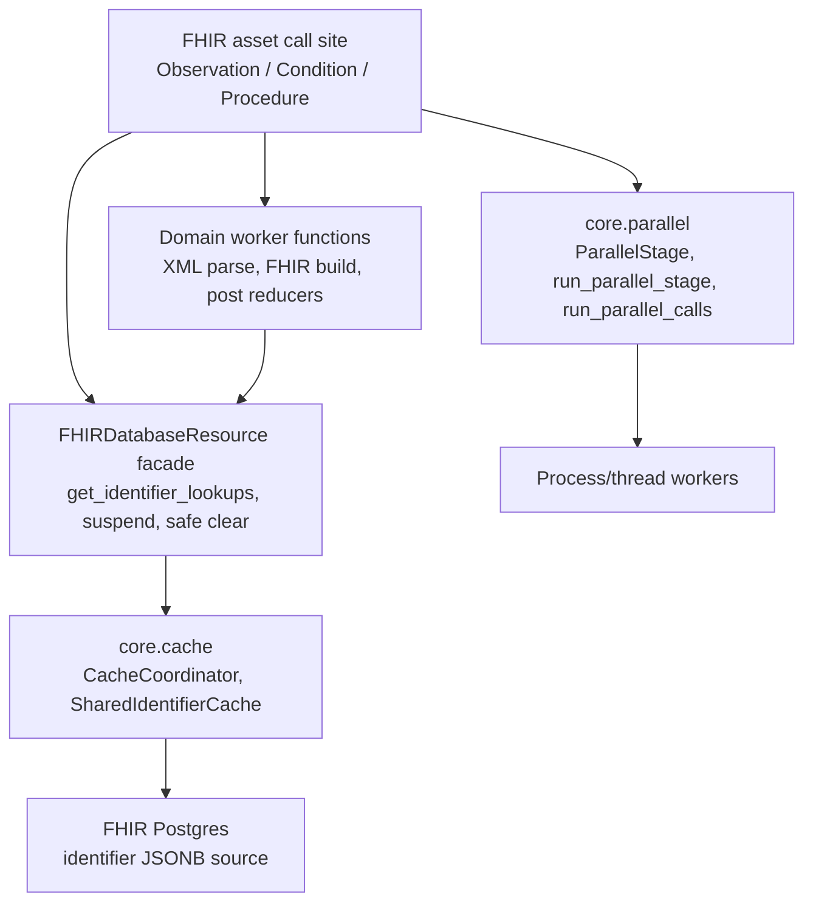
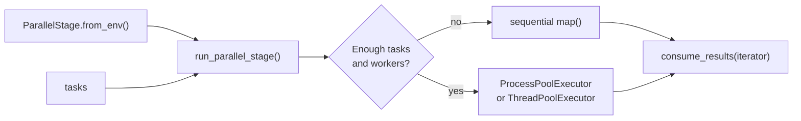
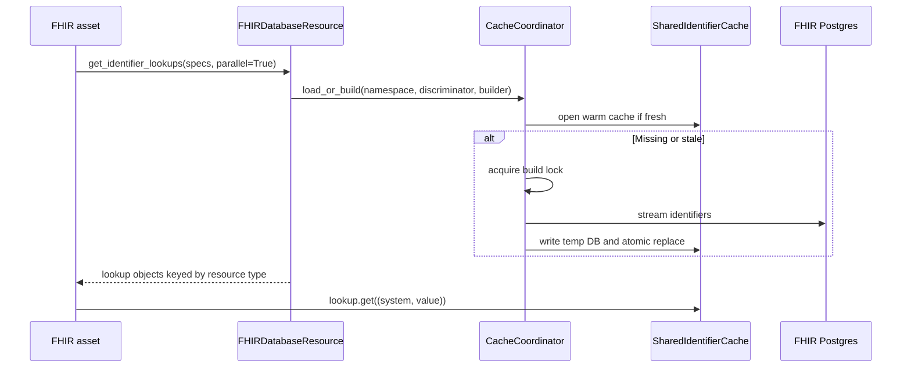
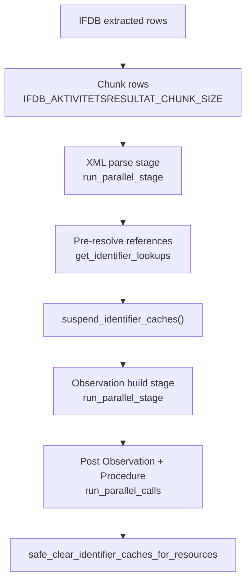
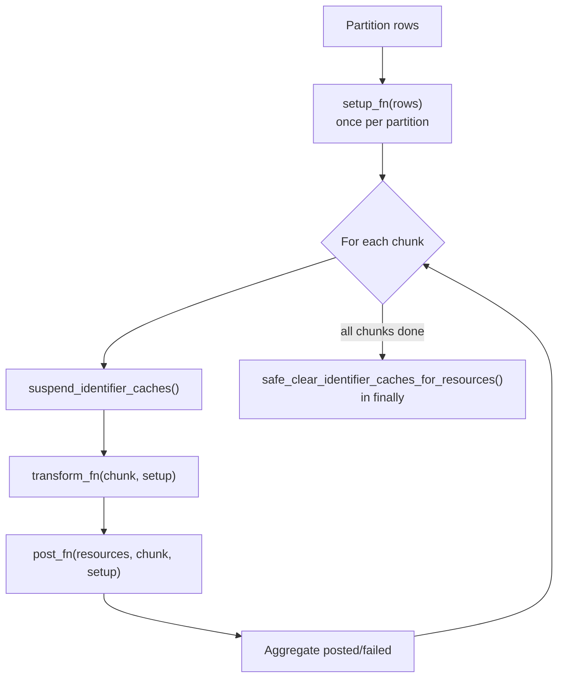

<!--
  SPDX-FileCopyrightText: 2026 Enversion Journl ApS
  SPDX-License-Identifier: AGPL-3.0-or-later

  This file is part of Healthpipe. See the LICENSE file in the project
  root for the full AGPL-3.0 license text.
-->

# Core Cache and Parallel Execution Architecture

**Status:** Active
**Date:** 2026-05-03
**Purpose:** Define the production contract for shared identifier caches and parallel worker execution in FHIR ETL call sites.

---

## 1. Executive Summary

The current branch has two core primitives for heavy FHIR ETL flows:

| Concern | Public API | Owner | Call-site responsibility |
|---------|------------|-------|--------------------------|
| Parallel stages | `core.parallel.ParallelStage`, `run_parallel_stage()` | `etl/core/parallel/` | Declare stage identity, env prefix, defaults, and the domain worker function |
| Small named fan-out | `core.parallel.ParallelCall`, `run_parallel_calls()` | `etl/core/parallel/` | Name each independent call and pass domain functions |
| Identifier lookup cache | `FHIRDatabaseResource.get_identifier_lookup(s)` | `etl/core/resources.py` backed by `etl/core/cache/` | Request resource-type/system lookups, then use `.get((system, value))` |
| Cache lifecycle | `suspend_identifier_caches()`, `safe_clear_identifier_caches_for_resources()` | `FHIRDatabaseResource` | Call before memory-heavy process pools and after resource mutations |

Call sites should not construct executors, parse parallel/cache env vars, create `CacheCoordinator`, or manipulate worker import paths directly. Those details belong in core.

---

## 2. Layering



The core libraries own reusable infrastructure. The asset owns only source-specific business semantics.

---

## 3. Parallel Execution Contract

`ParallelStage.from_env()` standardizes all stage knobs:

| Env var suffix | Meaning |
|----------------|---------|
| `_MAX_WORKERS` | Upper bound for workers |
| `_PARALLEL_THRESHOLD` | Minimum task count before parallel mode is used |
| `_CHUNKSIZE` | Process-pool map chunk size |
| `_MAX_LOGGED_ERRORS` | Domain error logging cap |

Malformed integer env vars fall back to defaults with minimum bounds. A bad env override must not break module import or Dagster code loading.



Memory-sensitive stages should pass `consume_results=`. The runner streams the executor iterator into the consumer and does not materialize a second full result list.

Correct call-site shape:

```python
XML_PARSE_STAGE = ParallelStage.from_env(
    stage_id="ifdb.observation.xml.lossless_parse",
    env_prefix="IFDB_XML_PARSE",
    default_max_workers=4,
    default_parallel_threshold=5_000,
    default_chunksize=200,
    mp_context=SPAWN_CONTEXT,
    before_parallel_start=SPAWN_IMPORTS,
)

run_parallel_stage(
    XML_PARSE_STAGE,
    tasks=tasks,
    worker_fn=_parse_xml_lossless_worker,
    logger=logger,
    consume_results=_consume,
)
```

---

## 4. Identifier Cache Contract

FHIR call sites use the `FHIRDatabaseResource` facade, not `CacheCoordinator` directly.



The cache file is immutable after build and opened read-only by workers. This keeps identifier resolution cheap across large partitions and avoids each worker loading a full Python dictionary.

Lifecycle methods:

| Method | Use |
|--------|-----|
| `get_identifier_lookup(resource_type, systems)` | Single lookup |
| `get_identifier_lookups(specs, parallel=True)` | Warm several lookups cleanly |
| `suspend_identifier_caches()` | Close SQLite connections before memory-heavy process pools |
| `safe_clear_identifier_caches_for_resources(types, reason=...)` | Invalidate after mutations without hiding the real job result |
| `log_identifier_lookup_status(label, lookups)` | Optional diagnostics via `FHIR_IDENTIFIER_CACHE_DIAG=1` |

### Dependency-resolver mutation contract

`batch_upsert_resources` invalidates the cache for the resource type it just
wrote. Call sites are still responsible for the *upstream* caches that the
dependency resolver may have mutated (Patient/Encounter/EpisodeOfCare creates,
CPR-bridge identifier appends).

The contract is: every CPO call site that invokes `resolve_missing_*` MUST
construct a `DependencyMutationReport`, pass it through, and clear after:

```python
from DSA.FHIR.utils.ifdb.dependency_resolver import (
    DependencyMutationReport, resolve_missing_patients,
)

mutation_report = DependencyMutationReport()
resolve_missing_patients(..., mutation_report=mutation_report)
if mutation_report.has_mutations():
    fhir_database.safe_clear_identifier_caches_for_resources(
        mutation_report.resource_types,
        reason="<asset> dependency resolution mutations",
    )
```

A blanket clear of every upstream cache is wasteful; threading the report
keeps invalidation precise (only mutated namespaces are rebuilt) without
hiding mutations from the cache.

---

## 5. Observation Aktivitetsresultat Flow

`DSA/FHIR/Observation/Observation_IFDB_Aktivitetsresultat.py` is the first heavy adopter because it combines large XML parsing, reference resolution, Observation build, and paired Observation/Procedure posting.



The call site still defines stage IDs, env prefixes, chunk defaults, type aliases, XML worker functions, and reducers. That is intentional: those are Observation-specific semantics. The infrastructure details are in core.

---

## 5b. Chunked transform+post pipeline (Pydantic CPO assets)

The four smaller IFDB CPO assets — Diagnose, PasDiagnose, AdminProc,
RIS Ydelse — share a different memory shape than
Aktivitetsresultat. They build standard Pydantic FHIR resources rather than
dicts, and the dominant memory cost is holding all transformed resources in
a single list before posting. On monthly partitions this can OOM the worker.

The `core.parallel.chunked_pipeline` module owns the orchestration:



The orchestrator deliberately owns *only* chunking, cache hygiene, and
metadata aggregation. FHIR domain rules — reference configs, identifier
systems, dependency resolution, ID resolution, direct DB upsert — stay in
the per-asset transform/post helpers. This keeps the helper free of
FHIR-specific knowledge and lets each asset evolve its post path
independently.

Distinct from the Oracle IN-clause chunking
(`DSA/FHIR/utils/ifdb/oracle_lookup.chunked_in_fetch[_grouped]`): that
helper splits an id list across multiple `WHERE id IN (...)` queries to
stay under Oracle's 1000-id limit. The transform+post chunker splits
already-extracted rows so the in-memory Pydantic resource list is
bounded. They are typically composed: setup_fn fetches lookups via
`chunked_in_fetch_grouped()`, then the chunked pipeline splits the row list
and runs transform+post per chunk.

Aktivitetsresultat is *not* migrated to this helper. It already had its own
dict-based chunked pipeline with a shared `ResolvedRefLookup` across chunks
and `invalidate_cache=False` per-chunk dict-upsert — semantics that don't
apply to the Pydantic CPO path.

---

## 6. What Belongs Where

| Code | Correct location | Reason |
|------|------------------|--------|
| Executor creation, fallback, threshold logic, chunked map execution | `etl/core/parallel/runner.py` | Shared runtime behavior |
| Chunked transform+post orchestration for IFDB CPO assets | `etl/core/parallel/chunked_pipeline.py` | Memory-bounded setup-once + per-chunk transform/post pattern |
| Parallel env parsing and stage policy objects | `etl/core/parallel/policy.py` | Shared configuration convention |
| Spawn import path setup | `etl/core/parallel/spawn.py` | Runtime plumbing |
| SQLite cache file format, locking, atomic publish | `etl/core/cache/` | Shared cache primitive |
| FHIRDatabaseResource public facade | `etl/core/resources.py` | Stable Dagster resource/import contract for assets and tests |
| FHIR identifier lookup and cache lifecycle implementation | `etl/core/fhir/identifier_lookup.py` | FHIR-specific orchestration backed by the generic `core.cache` primitive |
| FHIR direct upsert and Aidbox JSON implementation | `etl/core/fhir/direct_upsert.py`, `etl/core/fhir/aidbox_json.py` | Aidbox/PostgreSQL-specific write path delegated to by `FHIRDatabaseResource` |
| Oracle IN-clause chunking for source-side lookups | `DSA/FHIR/utils/ifdb/oracle_lookup.py` | Splits id list across queries to stay under Oracle's 1000-id WHERE IN limit |
| XML parse workers and FHIR resource builders | Resource asset/module | Domain-specific transform semantics |
| Stage IDs, env prefixes, chunk sizes | Resource asset/module | Operational tuning is stage-specific |
| IFDB source flag conversion such as `1/true/yes` | `DSA/FHIR/utils/ifdb/transforms.py` | Shared IFDB source normalization |

---

## 7. Current Call-Site Assessment

Files reviewed for Observation, Condition, Procedure, cache, and parallel usage:

| Area | Files | Assessment |
|------|-------|------------|
| Heavy Observation | `DSA/FHIR/Observation/Observation_IFDB_Aktivitetsresultat.py` | Acceptable core usage: no direct executor creation, no direct `CacheCoordinator`, result streaming is delegated to `run_parallel_stage()`. The remaining stage definitions and workers are domain-specific and can stay local. |
| Condition | `DSA/FHIR/Condition/*.py` | Diagnose and PasDiagnose use the same chunked transform+post call-site shape. IFDB flag conversion remains in `DSA/FHIR/utils/ifdb/transforms.py` while preserving the local `_is_true_flag` alias used by tests. |
| Procedure | `DSA/FHIR/Procedure/*.py` | AdminProc and RIS Ydelse use chunked transform+post; RIS XML helpers remain Procedure-specific and local. Cache cleanup and ID resolution stay behind `FHIRDatabaseResource` / shared posting helpers. |
| Core FHIR | `etl/core/fhir/`, `etl/core/resources.py` | Correct split: `resources.py` remains the public Dagster resource facade, while FHIR/Aidbox-specific lookup and upsert implementation lives in `core/fhir`. |
| Core cache | `etl/core/cache/` | Correct owner for generic cache file lifecycle. Malformed cache TTL env values use safe fallback through the FHIR facade. |
| Core parallel | `etl/core/parallel/` | Correct owner for executor behavior, streaming result consumption, env parsing, spawn setup, named call fan-out, and chunked transform+post orchestration. |

Recommended follow-up cleanup:

1. Consider an Observation-specific helper module for the largest Aktivitetsresultat reference-resolution/data-shaping classes if the asset grows further.
2. If more assets adopt process pools, add a convenience constructor that combines `ParallelStage.from_env()` with `configure_spawn_import_paths_for_file(__file__)` to reduce two more lines per asset.

---

## 8. Test Coverage

Current targeted coverage for this architecture lives in:

| Test file | Coverage |
|-----------|----------|
| `etl/tests/unit/test_core_parallel_runner.py` | Env fallback, threshold gating, streaming consumers, sequential fallback, named calls, spawn path setup |
| `etl/tests/unit/test_core_chunked_pipeline.py` | Setup-once + per-chunk transform+post + finally cleanup contract for `run_chunked_transform_post` |
| `etl/tests/unit/test_identifier_cache_optin.py` | Cache facade behavior, dict/SQLite backing changes, safe clear, diagnostics, malformed cache TTL fallback |
| `etl/tests/unit/test_aktivitetsresultat_parallel_parse.py` | Observation parse parity and stage integration |
| `etl/tests/unit/test_ris_ydelse_skipped_dependency_pin.py` | Pin: RIS dependency resolution operates on transformed Procedures, never on skipped raw rows |
| `etl/tests/unit/test_fhir_database_sharded_dict_upsert.py` | Direct DB post/upsert behavior around FHIR resource posting |
| `etl/tests/unit/test_fhir_database_batch_upsert_fallback.py` | Batch upsert fallback behavior |

For package-level quickstarts, see:

- `etl/core/parallel/README.md`
- `etl/core/cache/README.md`
