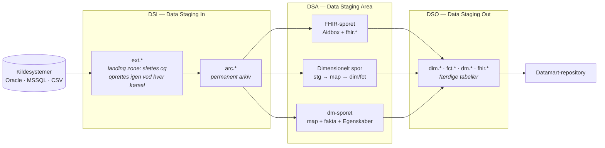

<!--
  SPDX-FileCopyrightText: 2026 Enversion Journl ApS
  SPDX-License-Identifier: AGPL-3.0-or-later

  This file is part of Healthpipe. See the LICENSE file in the project
  root for the full AGPL-3.0 license text.
-->

# 00 — Overblik over basismodellen

Dette er første kapitel i primærdokumentationen for basismodellen. Læs det før alt
andet: det forklarer, hvad vi bygger, hvilke lag data passerer igennem, og hvordan
du finder det kapitel, din opgave hører til.

Dokumentationen er skrevet på dansk. Tekniske begreber, der også hedder sådan i
koden (asset, checkpoint, MERGE, full load, delta, grain …), står på engelsk.

## Hvad er basismodellen?

Basismodellen er regionens fælles datagrundlag. Den henter data ud af
kildesystemerne, gør data ensartede og sporbare, og stiller resultatet til rådighed
som tabeller i DSO-databasen på datamartserveren.

Basismodellen laver **ikke** rapporter og **ikke** datamarter. Datamarterne bygges
ovenpå i et separat repository ud fra basismodellens tabeller.
Basismodellen laver selv et view oven på en tabel, når der er en grund til det —
ikke som standard for alle tabeller.

Grænsen er lettest at huske som en opdeling af logikken. Basismodellen ejer
**modelleringslogikken**: hvordan kildens data fortolkes, standardiseres og
modelleres til fælles, genbrugelige tabeller. Datamarterne ejer den
**rapportspecifikke forretningslogik**: opgørelsesregler, populationer og
afgrænsninger, der gælder én rapport eller ét fagområde. Er en regel fælles for
alle aftagere, hører den til her; gælder den kun én opgørelse, hører den til i
datamarterne.

## De tre lag

Data bevæger sig gennem tre lag. Navnene bruges hele vejen igennem koden, mapperne
og dokumentationen.

| Lag | Fuldt navn | Hvad det gør |
|---|---|---|
| **DSI** | Data Staging In | Henter data råt ud af kildesystemet og arkiverer det. Ingen fortolkning og ingen modellering. |
| **DSA** | Data Staging Area | Fortolker og modellerer data. Her ligger modelleringslogikken. |
| **DSO** | Data Staging Out | Flytter de færdige tabeller til DSO-databasen, hvor de er til rådighed for datamarterne. |

### DSI — fra kilde til arkiv

DSI har to skemaer:

- **`ext.*`** er en landing zone: tabellen bliver slettet og oprettet igen ved
  hver kørsel. Den er kun til for at have noget at MERGE ind i arkivet fra.
- **`arc.*`** er det permanente arkiv. Det er en 1:1-spejling af kildetabellen plus
  et par tekniske kolonner, og det er her historikken bor.

**Alle assets længere fremme i kæden (downstream) læser fra `arc.*` — aldrig fra
`ext.*`.** Arkivet er det sted, vi kan genkøre fra (replay): fordi historikken
ligger der, kan hele resten af platformen bygges op igen uden at genere
kildesystemet.

Se [02 — DSI: fra kilde til arkiv](02_DSI_kilde_til_arkiv.md).

### DSA — tre spor ud fra det samme arkiv

DSA læser fra arkivet og modellerer data. Der er tre spor, og valget mellem dem
afgøres af, hvad slags data der er tale om:

| Spor | Bruges når | Resultat | Kapitel |
|---|---|---|---|
| **FHIR-sporet** | Data er kliniske og beskrevet i HL7 FHIR (patient, kontakt, diagnose, procedure, observation …) | FHIR-ressourcer i Aidbox, fladet ud til `fhir.*`-tabeller | [03a](03a_DSA_arkiv_til_FHIR.md) + [03a1](03a1_DSA_FHIR_til_SQLonFHIR.md) |
| **Dimensionelt spor** | Data er transaktionelle, men ikke kliniske (økonomi, indkøb, lager, HR …) | Stjerneskema: `map.*`, `dim.*`, `fct.*` | [03b](03b_DSA_arkiv_til_dimensionel_model.md) |
| **dm-sporet** | Data er en færdigberegnet leverance udefra (fx fra Sundhedsdatastyrelsen eller Statens Serum Institut) | Datamart-tabeller: `map.*` + `dm.*`-fakta + `dm.*Egenskaber` | [03c](03c_DSA_arkiv_til_dmskema.md) |

En kilde kan godt bruge mere end ét spor. IFDB leverer fx både FHIR-ressourcer og
data til dimensioner.

### DSO — fra staging til datamartserveren

DSO flytter de færdige tabeller fra staging-databasen — den database, hvor DSI og
DSA arbejder — til DSO-databasen på datamartserveren. Dér er de til rådighed for datamart-teamet, som bygger
datamarter oven på dem i sikkerhedsdomænerne.

En tabel får ikke automatisk et view. Basismodellen laver et view, når der er en
grund til det: når den sikre læsning skal være standarden (fx at slettede rækker
er filtreret fra), når et opslag skal laves for den, der læser tabellen, eller når
persondata skal maskeres. Adgangsstyringen efter regionens sikkerhedsmodel (DPA)
lægges på i views per sikkerhedsdomæne; basismodellen leverer de
sikkerhedstabeller, modellen bruger. Se
[sikkerhedsmodel.md](../implementation/sikkerhedsmodel.md).

Se [04 — DSO: synkronisering til DSO](04_DSO_sync_til_DSO.md).

## To frameworks, du møder overalt

### DFM — Data Flow Management

DFM er checkpoint-mekanikken. Hvert lag skriver ned, hvor langt det nåede sidst
(`meta.DFMState`), så næste kørsel kun henter det nye. Det betyder også, at du kan
genkøre en periode eller et sæt id'er **uden** at flytte checkpointet — det er den
mekanisme, der bruges til at genkøre data, når noget skal rettes.

En kørsel har en *run mode*, som bestemmer, hvad den henter:

| Run mode | Henter |
|---|---|
| `delta` (standard) | Kun det, der er nyt siden checkpointet |
| `full_load` | Alt |
| `period` | En periode fra dato til dato — uden at flytte checkpointet |
| `ids` | Udvalgte id'er — uden at flytte checkpointet |

Uddybende (på engelsk): [dfm_design.md](../architecture/dfm_design.md) og
[dfm_operations_guide.md](../implementation/dfm_operations_guide.md).

### DQA — Data Quality Assurance

DQA er de automatiske datakvalitetstjek. Ét `DqaSubject` per tabel beskriver
tabellens grain og hvilke tjek der skal køre; tjekkene kører som Dagster asset
checks (tjek, der hører til et asset og kører i forbindelse med det), og
resultaterne lander i `dqa.Results`. Der ligger et tjek på hvert hop
mellem lagene — fx at alle nøgler fra kilden findes i arkivet, og at DSO matcher
DSA række for række.

Uddybende (på engelsk): [dqa/README.md](../architecture/dqa/README.md).

## Orkestrering: Dagster

Alt kører i Dagster. Tre begreber er nok til at komme i gang:

| Begreb | Sådan bruger vi det |
|---|---|
| **Asset** | Én tabel, ét load af en FHIR-ressource eller ét DDL-trin. Navngivet efter det, den producerer: `ext_ils_vare`, `arc_ils_vare`, `dim_Kreditor`. |
| **Group** | Den enhed jobs vælger på. Navngivet `{domæne}_{lag}`: `ils_archive`, `erp_staging`, `fhir_ifdb_dfm`. Alle navngivningsregler står i [navngivningsstandard_basismodel.md](../implementation/navngivningsstandard_basismodel.md). |
| **Job / schedule** | Et navngivet udvalg af groups, og en cron-tidsplan for det. Ligger i `jobs/` og `schedules/`. |

Et asset, der ikke er registreret i kædens `__init__.py`-filer, findes ikke set
fra Dagster. Dukker et nyt asset ikke op, er registreringen det første at tjekke.

Den daglige arbejdsgang (start Dagster, validér, materialisér) står i
[dagster_development.md](../implementation/dagster_development.md) (på engelsk).

## Hvor ligger koden?

| Mappe | Indhold |
|---|---|
| `etl/DSI/` | Extract og arkiv. `connectors/` er det fælles maskineri, `mssql/`, `oracle/`, `csv_files/` er konfiguration per kildetype. |
| `etl/DSA/FHIR/` | FHIR-transformationer, én mappe per ressourcetype, plus `SqlOnFhir/`. |
| `etl/DSA/SQL/` | SQL-transformationer grupperet efter artefakttype: `staging/`, `map/`, `dim/`, `fct/`, `dm/`. |
| `etl/DSO/load/` | Synkronisering til DSO-databasen. |
| `etl/infrastructure/ddl/` | Al DDL: `tables/`, `views/` og `migrations/`. |
| `etl/data_lineage/` | Lineage-dokumentation i YAML, én fil per tabel. |
| `etl/dqa/` | DQA-frameworket og konfigurationen per tabel. |
| `etl/docs/` | Dokumentation. Denne mappe (`docs/basismodel/`) er primærdokumentationen. |

Den fulde rundvisning ligger i
[repo_tour.md](../implementation/repo_tour.md) (på engelsk).

## Ordliste

| Begreb | Betydning |
|---|---|
| **Asset** | Dagsters betegnelse for noget, en kørsel laver — typisk en tabel — og koden, der laver det. *Materialisere* et asset betyder at køre det. |
| **Checkpoint** | Det sted, en tabel nåede til sidst. Næste kørsel henter kun det, der er kommet efter. |
| **Delta / full load** | At hente kun det nye siden checkpointet / at hente alt. |
| **Downstream / upstream** | Længere fremme / længere tilbage i kæden fra kilde til DSO. |
| **Grain** | Hvad én række i en tabel står for, fx "én række per kontakt". |
| **MERGE** | SQL-sætningen, der indsætter nye rækker og opdaterer eksisterende i én operation. |
| **Replay** | At hente data igen for en periode eller nogle id'er, fx for at rette en fejl. |
| **Staging-database / DSO-database** | Databasen, hvor DSI og DSA arbejder / databasen på datamartserveren, hvor de færdige tabeller stilles til rådighed. |
| **Lineage** | Dokumentationen af, hvor hver kolonne i en tabel kommer fra. |
| **Type 2-dimension** | En dimension, der gemmer historik: hver ændring giver en ny version af rækken. |
| **Sikkerhedsdomæne / DPA** | Et fagområde med egen adgangsstyring, fx `DPA_Aktivitet`. DPA er navnet på regionens sikkerhedsmodel. |
| **DSI / DSA / DSO** | De tre lag ovenfor: ind, bearbejdning, ud. |
| **ext / arc** | DSI's to skemaer: landing zone (slettes og oprettes igen ved hver kørsel) og permanent arkiv. |
| **pre_stg / stg** | DSA's forberedende lag: komplekse joins og dedublering (`pre_stg`), derefter én tabel per målentitet (`stg`). |
| **map** | Mapping-tabel fra forretningsnøgle (CleanCode) til entity key (`dw_ek_*`). |
| **dim / fct** | Dimensioner og facts i stjerneskemaet. |
| **dm** | Datamart-lag til færdigberegnede leverancer: slank fakta + `Egenskaber`-tabel med de beskrivende kolonner. |
| **CleanCode** | En standardiseret forretningsnøgle som tekst, fx `CVR_12345678`. Dannes i `pre_stg`-SQL og findes normalt ikke i `ext`/`arc`. |
| **dw_ek** | Entity key. Heltal, der entydigt identificerer en entitet (en kreditor, en borger). Værdien `-1` betyder "ukendt". |
| **dw_sk** | Surrogatnøgle. Peger på en bestemt *version* af en entitet i en type 2-dimension. Facts gemmer `dw_ek`; versionen slås op, når fact'en læses, via `dw_haendelsestidspunkt`. |
| **DFM** | Checkpoint-frameworket, der styrer hvad hver kørsel henter. |
| **DQA** | Frameworket til automatiske datakvalitetstjek. |
| **FHIR** | Standarden for kliniske data fra HL7 — den internationale organisation bag sundheds-it-standarder. Vi bruger version R4B og lagrer i Aidbox. |
| **SQL on FHIR (SoF)** | Udfladning af FHIR-ressourcer til almindelige SQL-tabeller (`fhir.*`) via ViewDefinitions. |
| **Aidbox** | Den FHIR-server, vi poster ressourcer til. |
| **IFDB** | Oracle-kildesystemet bag den elektroniske patientjournal (EPJ), som leverer de kliniske data. |
| **SOR / SHAK** | Registre over sundhedsvæsenets organisatoriske enheder. |

## Læserækkefølge

| Kapitel | Læs det når |
|---|---|
| **00 Overblik** (dette) | Altid først. |
| [01 Afklar behov](01_afklar_behov.md) | Du har fået en opgave og skal finde ud af, hvad den kræver. |
| [02 DSI: kilde til arkiv](02_DSI_kilde_til_arkiv.md) | Data skal ind i platformen. |
| [03a DSA: arkiv til FHIR](03a_DSA_arkiv_til_FHIR.md) | Data er kliniske og beskrevet i FHIR. |
| [03a1 DSA: FHIR til SQL on FHIR](03a1_DSA_FHIR_til_SQLonFHIR.md) | FHIR-ressourcerne skal flades ud til tabeller. |
| [03b DSA: arkiv til dimensionel model](03b_DSA_arkiv_til_dimensionel_model.md) | Data skal modelleres i stjerneskema. |
| [03c DSA: arkiv til dm-skema](03c_DSA_arkiv_til_dmskema.md) | Data er en færdigberegnet leverance udefra. |
| [04 DSO: sync til DSO](04_DSO_sync_til_DSO.md) | Resultatet skal ud til DSO-databasen. |
| [05 Udfyld dokumentation](05_udfyld_dokumentation.md) | Før du åbner din merge request. Altid. |
