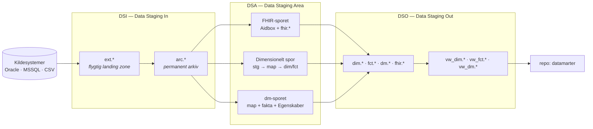

<!--
  SPDX-FileCopyrightText: 2026 Enversion Journl ApS
  SPDX-License-Identifier: AGPL-3.0-or-later

  This file is part of Healthpipe. See the LICENSE file in the project
  root for the full AGPL-3.0 license text.
-->

# 00 — Overblik over basismodellen

Dette er første kapitel i primærdokumentationen for basismodellen. Læs det før alt
andet: det forklarer, hvad vi bygger, hvilke lag data passerer igennem, og hvordan
du finder det kapitel, din opgave hører til.

Dokumentationen er skrevet på dansk. Tekniske begreber (asset, checkpoint, MERGE,
FHIR, watermark) står på engelsk, fordi de også hedder det i koden.

## Hvad er basismodellen?

Basismodellen er regionens fælles datagrundlag. Den henter data ud af
kildesystemerne, gør data ensartede og sporbare, og stiller resultatet til rådighed
i en rapporteringsdatabase.

Basismodellen laver **ikke** rapporter og **ikke** datamarter. Datamarterne bygges
ovenpå i et separat repository (`datamarter`) og læser kun de views, basismodellen
udstiller.

Grænsen er lettest at huske som en opdeling af logikken. Basismodellen ejer
**modelleringslogikken**: hvordan kildens data fortolkes, standardiseres og
modelleres til fælles, genbrugelige tabeller. `datamarter` ejer den
**rapportspecifikke forretningslogik**: opgørelsesregler, populationer og
afgrænsninger, der gælder én rapport eller ét fagområde. Er en regel fælles for
alle aftagere, hører den til her; gælder den kun én opgørelse, hører den til i
`datamarter`.

## De tre lag

Data bevæger sig gennem tre lag. Navnene bruges hele vejen igennem koden, mapperne
og dokumentationen.

| Lag | Fuldt navn | Hvad det gør |
|---|---|---|
| **DSI** | Data Staging In | Henter data råt ud af kildesystemet og arkiverer det. Ingen fortolkning og ingen modellering. |
| **DSA** | Data Staging Area | Fortolker og modellerer data. Her ligger modelleringslogikken. |
| **DSO** | Data Staging Out | Flytter det færdige resultat til rapporteringsdatabasen og udstiller views. |

### DSI — fra kilde til arkiv

DSI har to skemaer:

- **`ext.*`** er en flygtig landing zone. Tabellen bliver slettet og genskabt ved
  hver kørsel. Den er kun til for at have noget at MERGE fra.
- **`arc.*`** er det permanente arkiv. Det er en 1:1-spejling af kildetabellen plus
  et par tekniske kolonner, og det er her historikken bor.

**Alle downstream assets læser fra `arc.*` — aldrig fra `ext.*`.** Arkivet er vores
replay-punkt: fordi historikken ligger der, kan hele resten af platformen bygges
op igen uden at genere kildesystemet.

Se [02 — DSI: fra kilde til arkiv](02_DSI_kilde_til_arkiv.md).

### DSA — tre spor ud fra det samme arkiv

DSA læser fra arkivet og modellerer data. Der er tre spor, og valget mellem dem
afgøres af, hvad slags data der er tale om:

| Spor | Bruges når | Resultat | Kapitel |
|---|---|---|---|
| **FHIR-sporet** | Data er kliniske og beskrevet i HL7 FHIR (patient, kontakt, diagnose, procedure, observation …) | FHIR-ressourcer i Aidbox, fladet ud til `fhir.*`-tabeller | [03a](03a_DSA_arkiv_til_FHIR.md) + [03a1](03a1_DSA_FHIR_til_SQLonFHIR.md) |
| **Dimensionelt spor** | Data er transaktionelle, men ikke kliniske (økonomi, indkøb, lager, HR …) | Stjerneskema: `map.*`, `dim.*`, `fct.*` | [03b](03b_DSA_arkiv_til_dimensionel_model.md) |
| **dm-sporet** | Data er en færdigberegnet leverance udefra (fx SDS/SSI) | Datamart-tabeller: `map.*` + `dm.*`-fakta + `dm.*Egenskaber` | [03c](03c_DSA_arkiv_til_dmskema.md) |

En kilde kan godt bruge mere end ét spor. IFDB leverer fx både FHIR-ressourcer og
data til dimensioner.

### DSO — fra staging til rapportering

DSO flytter de færdige tabeller fra staging-databasen til rapporteringsdatabasen
(DSO/DPA) og udstiller dem gennem views. Views er stedet, hvor sikkerhedsmodellen
og de sidste opslag (fx versionsnøgler på type 2-dimensioner) lægges på.

Se [04 — DSO: synkronisering til DSO](04_DSO_sync_til_DSO.md).

## To frameworks, du møder overalt

### DFM — Data Flow Management

DFM er checkpoint-mekanikken. Hvert lag skriver ned, hvor langt det nåede sidst
(`meta.DFMState`), så næste kørsel kun henter det nye. Det betyder også, at du kan
genkøre en periode eller et sæt id'er **uden** at flytte checkpointet — det er den
mekanisme, driften bruger til at reparere data.

Fire run modes: `delta` (standard), `full_load`, `period` og `ids`.

Uddybende (endnu ikke oversat): [dfm_design.md](../architecture/dfm_design.md) og
[dfm_operations_guide.md](../implementation/dfm_operations_guide.md).

### DQA — Data Quality Assurance

DQA er de automatiske datakvalitetstjek. Ét `DqaSubject` per tabel beskriver
tabellens grain og hvilke tjek der skal køre; tjekkene kører som Dagster asset
checks, og resultaterne lander i `dqa.Results`. Der ligger et tjek på hvert hop
mellem lagene — fx at alle nøgler fra kilden findes i arkivet, og at DSO matcher
DSA række for række.

Uddybende (endnu ikke oversat): [dqa/README.md](../architecture/dqa/README.md).

## Orkestrering: Dagster

Alt kører i Dagster. Tre begreber er nok til at komme i gang:

| Begreb | Sådan bruger vi det |
|---|---|
| **Asset** | Én tabel, ét load af en FHIR-ressource eller ét DDL-trin. Navngivet efter det, den producerer: `ext_ils_vare`, `arc_ils_vare`, `dim_Kreditor`. |
| **Group** | Den enhed jobs vælger på. Navngivet `{domæne}_{lag}`: `ils_archive`, `erp_staging`, `fhir_ifdb_dfm`. |
| **Job / schedule** | Et navngivet udvalg af groups, og en cron-tidsplan for det. Ligger i `jobs/` og `schedules/`. |

Et asset, der ikke er eksporteret gennem kædens `__init__.py`-filer, findes ikke set
fra Dagster. Dukker et nyt asset ikke op, er eksporten det første at tjekke.

Den daglige arbejdsgang (start Dagster, validér, materialisér) står i
[dagster_development.md](../implementation/dagster_development.md).

## Hvor ligger koden?

| Mappe | Indhold |
|---|---|
| `etl/DSI/` | Extract og arkiv. `connectors/` er det fælles maskineri, `mssql/`, `oracle/`, `csv_files/` er konfiguration per kildetype. |
| `etl/DSA/FHIR/` | FHIR-transformationer, én mappe per ressourcetype, plus `SqlOnFhir/`. |
| `etl/DSA/SQL/` | SQL-transformationer grupperet efter artefakttype: `staging/`, `map/`, `dim/`, `fct/`, `dm/`. |
| `etl/DSO/load/` | Synkronisering til rapporteringsdatabasen. |
| `etl/infrastructure/ddl/` | Al DDL: `tables/`, `views/`, `migrations/`. |
| `etl/data_lineage/` | Lineage-dokumentation i YAML, én fil per tabel. |
| `etl/dqa/` | DQA-frameworket og konfigurationen per tabel. |
| `etl/docs/` | Dokumentation. Denne mappe (`docs/basismodel/`) er primærdokumentationen. |

Den fulde rundvisning ligger i
[repo_tour.md](../implementation/repo_tour.md) (endnu ikke oversat).

## Ordliste

| Begreb | Betydning |
|---|---|
| **DSI / DSA / DSO** | De tre lag ovenfor: ind, bearbejdning, ud. |
| **ext / arc** | DSI's to skemaer: flygtig landing zone og permanent arkiv. |
| **pre_stg / stg** | DSA's forberedende lag: komplekse joins og dedublering (`pre_stg`), derefter én tabel per målentitet (`stg`). |
| **map** | Oversættelsestabel fra forretningsnøgle (CleanCode) til entitetsnøgle (`dw_ek_*`). |
| **dim / fct** | Dimensioner og facts i stjerneskemaet. |
| **dm** | Datamart-lag til færdigberegnede leverancer: slank fakta + `Egenskaber`-tabel. |
| **CleanCode** | En standardiseret forretningsnøgle som tekst, fx `CVR_12345678`. Dannes i `pre_stg`-SQL og findes normalt ikke i `ext`/`arc`. |
| **dw_ek** | Entitetsnøgle. Heltal, der entydigt identificerer en entitet (en kreditor, en borger). Værdien `-1` betyder "ukendt". |
| **dw_sk** | Surrogatnøgle. Peger på en bestemt *version* af en entitet i en type 2-dimension. Opslag laves i view-laget for facts. |
| **DFM** | Checkpoint-frameworket, der styrer hvad hver kørsel henter. |
| **DQA** | Frameworket til automatiske datakvalitetstjek. |
| **FHIR** | HL7's standard for kliniske data. Vi bruger R4B og lagrer i Aidbox. |
| **SQL on FHIR (SoF)** | Udfladning af FHIR-ressourcer til almindelige SQL-tabeller (`fhir.*`) via ViewDefinitions. |
| **Aidbox** | Den FHIR-server, vi poster ressourcer til. |
| **IFDB** | Oracle-kildesystemet bag EPJ'en, som leverer de kliniske data. |
| **SOR / SHAK** | Registre over sundhedsvæsenets organisatoriske enheder. |

## Læserækkefølge

| Kapitel | Læs det når |
|---|---|
| **00 Overblik** (dette) | Altid først. |
| [01 Afklar behov](01_afklar_behov.md) | Du har fået en opgave og skal finde ud af, hvad den kræver. |
| [02 DSI: kilde til arkiv](02_DSI_kilde_til_arkiv.md) | Data skal ind i platformen. |
| [03a DSA: arkiv til FHIR](03a_DSA_arkiv_til_FHIR.md) | Data er kliniske og beskrevet i FHIR. |
| [03a1 DSA: FHIR til SQL on FHIR](03a1_DSA_FHIR_til_SQLonFHIR.md) | FHIR-ressourcerne skal flades ud til tabeller. |
| [03b DSA: arkiv til dimensionel model](03b_DSA_arkiv_til_dimensionel_model.md) | Data skal modelleres i stjerneskema. |
| [03c DSA: arkiv til dm-skema](03c_DSA_arkiv_til_dmskema.md) | Data er en færdigberegnet leverance udefra. |
| [04 DSO: sync til DSO](04_DSO_sync_til_DSO.md) | Resultatet skal ud til rapporteringsdatabasen. |
| [05 Udfyld dokumentation](05_udfyld_dokumentation.md) | Før du åbner din merge request. Altid. |
