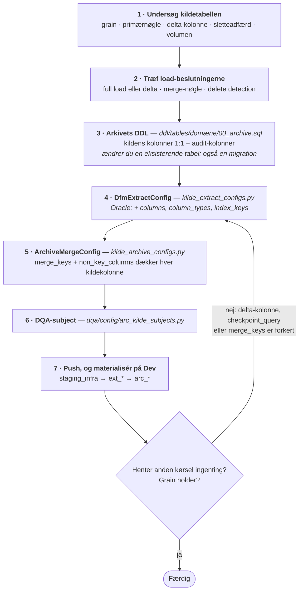

<!--
  SPDX-FileCopyrightText: 2026 Enversion Journl ApS
  SPDX-License-Identifier: AGPL-3.0-or-later

  This file is part of Healthpipe. See the LICENSE file in the project
  root for the full AGPL-3.0 license text.
-->

# 02 — DSI: fra kilde til arkiv

DSI er platformens indgang, som udfører to ting:

1. Henter data ud af kildesystemet.
2. Lægger dem i et permanent arkiv, som resten af platformen kan bygge på.

Kapitlet har to dele:

- **Del 1: Ny datakilde** — engangsarbejdet per kildesystem.
- **Del 2: Ny tabel** — det samme uanset om kilden er ny eller har kørt i årevis.

Er kildesystemet allerede sat op, spring til del 2.

## DSI-kontrakten — fem regler

Alt i dette kapitel følger af fem regler. Brydes en af dem, viser fejlen sig langt
downstream, og typisk som forkerte tal frem for som en fejlmeddelelse.

1. **`ext.*` er en landing zone, `arc.*` er permanent.** Hver kørsel sletter sin
   `ext`-tabel og opretter den igen. Kun MERGE'en ind i arkivet gemmer noget.
2. **Downstream assets læser `arc.*` — aldrig `ext.*`.** Intet staging-, FHIR- eller
   DQA-asset må referere `ext`. `ext` findes udelukkende som kilde til MERGE'en.
3. **Modelleringslogik hører ikke til i DSI.** Det typiske mønster er, at `arc.*` er en
   1:1-spejling af kildetabellen plus tekniske audit-kolonner: ingen omdøbning,
   ingen afledte kolonner, ingen CleanCodes, og ingen frafiltrering af rækker af
   faglige årsager. Modelleringslogikken begynder i `pre_stg`/`stg` eller i
   FHIR-transformationen.

   Undtagelserne er tekniske frem for faglige, og de skal begrundes i
   konfigurationen. Har kildetabellen ingen stabil primærnøgle, kan det være
   nødvendigt at konstruere en nøgle i arkivet — fx en `COALESCE` over de kolonner,
   der *er* stabile, eventuelt hashet hvis værdien ellers bliver meget lang — for at
   MERGE'en rammer den rigtige eksisterende række. Det er en teknisk nøgle, vi
   danner for at kunne arkivere korrekt; forretningsbetydningen ligger stadig i
   CleanCoden downstream.
4. **Én arkivtabel per kildetabel.** Joins der beriger eller denormaliserer hører
   til downstream.
5. **Arkivet bærer historikken.** Fordi `arc.*` har den fulde historik, kan ethvert
   downstream-lag bygges op igen uden at røre kildesystemet. Arkivet er samtidig
   det, der gør det muligt at opdage rækker, som er forsvundet fra kilden, og at
   afgøre hvad der er ændret, når kilden ikke selv har en brugbar delta-kolonne.

## Navngivning

| Element | Mønster | Eksempel |
|---|---|---|
| Landingstabel | `ext.{kilde}_{kildetabel}` | `ext.ils_vare`, `ext.ifdb_encounter` |
| Arkivtabel | `arc.{kilde}_{kildetabel}` | `arc.ils_vare`, `arc.sydax_afdeling` |
| Extract-asset | `ext_{måltabel}` | `ext_ils_vare` |
| Arkiv-asset | `arc_{måltabel}` | `arc_ils_vare` |
| Asset-group | `{kilde}_archive` | `ils_archive`, `sydax_archive` |
| DDL-fil | `infrastructure/ddl/tables/{domæne}/00_archive.sql` | |

Kildenavnet står **først** i tabelnavnet. To ældre afvigelser findes i koden
(`arc_{tabel}_ifdb` i `DSI/oracle/ifdb_archive.py` og `ext.{tabel}_ils` i
`DSI/mssql/ils.py`) — de skal ikke kopieres.

**Kildens egne navne bevares som kilden har stavet dem.** `ext`- og `arc`-tabeller
er en spejling: vi translittererer ikke og omdøber ikke kildens identifikatorer.
`ae`/`oe`/`aa`-reglen gælder de navne, vi selv giver. Kolonner **vi** selv
tilføjer (`dw_*`, afledte `*_uuid`/`*_noegle`) følger derimod
[navngivningsstandarden](../implementation/navngivningsstandard_basismodel.md).

## Faste kolonner på `arc.*`

Hver arkivtabel bærer kildens kolonner 1:1 plus:

```sql
[dw_timestamp_insert] DATETIME2 NOT NULL,     -- da rækken først nåede arkivet
[dw_timestamp_update] DATETIME2 NOT NULL,     -- da den sidst blev MERGE'et
[dw_is_deleted]       BIT NOT NULL DEFAULT 0  -- kun når delete detection er slået til
```

`ext.*` får ingen audit-kolonner ud over dem, extractoren selv tilføjer
(`SourceSystem`).

---

## Del 1: Ny datakilde

Resultatet er en tom, men fuldt tilkoblet kilde: en forbindelse, et sted til dens
DDL, konfigurationsmoduler, et job og en plads i DQA-frameworket.
Tabellerne kommer i del 2.

### 1. Få kilden koblet på, og få variabelnavnene

En ny datakilde kan ikke kobles på fra repoet alene. Selve forbindelsen —
MSSQL-connector, Oracle-database, filleverance eller hvad kilden kræver — sættes op
i **Nomad** — det system, der kører Dagster-deploymentet, og hvor dets environment
variables ligger. Første skridt
er derfor en aftale, ikke kode:

1. **Skaf oplysningerne hos systemejeren:** host, port, database, en **read-only**
   servicekonto, og bekræftelse på at der er netværksvej fra Dagster-miljøet. Noter
   hvilken type kildesystem det er — det afgør bibliotek i trin 3.
2. **En kollega med Nomad-skriveadgang kobler kilden på:** forbindelsen og dens
   credentials lægges ind som Nomad-variabler på Dagster-deploymentet, og du får
   besked om, **hvilke environment variables** resourcen skal læse.
3. **Du bruger de variabelnavne** i resourcen i trin 3 — hver værdi hentes med
   `dg.EnvVar("VARIABEL_NAVN")`.

Læg til sidst de samme variabelnavne i [`.env.template`](../../../.env.template) med
pladsholderværdier, grupperet under en kommentarhoved som de eksisterende kilder.
Filen er repoets dokumentation af, *hvilke* variabler kilden kræver — de rigtige
værdier findes kun i Nomad og bliver aldrig checket ind. **Commit aldrig rigtige
credentials**; pipelinen scanner historikken for hemmeligheder og persondata.

### 2. Beskriv kildens skema

Opret `etl/docs/source_systems/{kilde}/` med et skemaoverblik over kildesystemet:
hvilke tabeller findes, hvordan hænger de sammen, og hvad ved vi om systemets
adfærd. Mappen dokumenterer **kildesystemet**, ikke vores indlæsning — den dækker
derfor gerne også tabeller, vi (endnu) ikke henter.

Det er ikke pligtarbejde: det er her, den næste udvikler slår op for at vurdere en
tabel, vi ikke har rørt endnu.

### 3. Tilføj en Dagster-resource

Resources ligger i `etl/core/resources.py`. Kopiér mønstret, der passer til
forbindelsen:

| Kildetype | Kopiér | Bibliotek |
|---|---|---|
| On-prem MSSQL | `ILSMSSQLResource`, `SydaxMSSQLResource` | `pymssql` |
| Azure Synapse / cloud MSSQL | `KmdUddataMSSQLResource` | `mssql-python` |
| Oracle | `IFDBOracleResource` | `oracledb` |
| CSV / fildrop | `DSI/connectors/csv_files/` | — |

Adgangskoden skal blive ved med at være en `dg.EnvVar` (hentes først ved kørsel og
maskeres i logs); værdien kommer fra Nomad-variablen, ikke fra repoet. Synapse har
opstartsforsinkelse — giv assets en retry policy, som KMD gør.

Registrér derefter klassen i `resources`-dict'en i `etl/definitions.py`. Nøglen i
dict'en er både det, du sender som `source_resource_key` til extract-factoryen, og
det navn assets modtager forbindelsen på.

### 4. Beslut hvor arkivets DDL bor

`arc.*`-tabeller kræver håndskrevet DDL, der er checket ind. `ext.*` gør ikke:
extractoren dropper og genskaber tabellen ved hver kørsel — ud fra kildens skema
for databasekilder, og ud fra filens kolonner for CSV-kilder.

- **Kilden hører til et eksisterende domæne:** læg `CREATE TABLE`-blokkene i
  domænets arkivfil, fx `infrastructure/ddl/tables/erp/00_archive.sql`.
- **Kilden er sit eget domæne:** opret
  `infrastructure/ddl/tables/{kilde}/00_archive.sql` og tilføj et
  `staging_infra_{kilde}`-asset, der eksekverer mappen. Assettet registreres gennem
  kæden `infrastructure/assets/staging_infrastructure.py` →
  `infrastructure/assets/__init__.py` → `infrastructure/__init__.py`, og
  extract-assets peger på det med `deps=["staging_infra_{kilde}"]`.

En kilde, der kun bruges i DSI, skal **ikke** have en `dso_infra_*`-modpart —
`arc.*` ligger på staging-databasen og synkroniseres ikke til DSO.

### 5. Opret konfigurationsmodulerne

To moduler, ét per lag. De starter tomme på nær selve factory-kaldet; del 2 fylder
dem ud.

```
DSI/mssql/extract/{kilde}_extract_configs.py    # liste af DfmExtractConfig + factory-kald
DSI/mssql/archive/{kilde}_archive_configs.py    # liste af ArchiveMergeConfig + asset-factory
```

For en Oracle-kilde hedder modparterne `DSI/oracle/{kilde}_extract.py` og
`DSI/oracle/{kilde}_archive.py`.

**Skabeloner — kopiér disse filer frem for at skrive fra bunden:**

| Skabelon | Bruges til |
|---|---|
| `DSI/mssql/extract/sydax_extract_configs.py` | Extract-side for en MSSQL-kilde |
| `DSI/mssql/archive/sydax_archive_configs.py` | Arkiv-side, inkl. `_make_arc_asset()`-factoryen |
| `DSI/oracle/ifdb_extract.py` / `ifdb_archive.py` | Oracle-kilde |
| `DSI/csv_files/haiba.py` / `haiba_archive.py` | Fildrop/CSV-leverance |
| `DSI/csv_files/_sds_tar.py` | Fælles streaming af SDS' `tar.bz2`-leverancer (DRG, udredningsret, LPR3) |

SDS leverer som komprimerede tar-arkiver. Det maskineri, alle tre kilder deler —
streaming direkte fra tar uden udpakning, den chunkede `ExtWriter` med `discard()`
på fejlstien, `SDP_ExportLog` som kontroltotal, `ext`-DDL og værnet mod forkert
tegnkodning (mojibake) —
ligger i `_sds_tar.py`. Kildemodulerne (`drg.py`, `udredningsret.py`) beholder det
kildespecifikke: filnavnemønstre, per-række-vagter, leverancedetektion og
fejlbeskeder.

`_make_arc_asset()` udleder assettets navn, dets `ext_*`-afhængighed og dets tags
fra konfigurationen. Når den er på plads, er "tilføj en tabel" ét element i en liste
og intet andet.

Extract- og arkiv-assets hører til **samme group** (`{kilde}_archive`), så ét
job-udvalg dækker hele kilden.

### 6. Registrér assets

Assets når `definitions.py` gennem `__init__.py`-kæden:
`DSI/mssql/extract/__init__.py` (læg din liste ind i `all_factory_extract_assets`)
og `DSI/mssql/archive/__init__.py` (`all_archive_assets`). Er de to lister
opdateret, er der ikke mere at registrere.

### 7. Tilføj et job

Opret `jobs/{kilde}_jobs.py` med et `dg.define_asset_job`, der vælger gruppen
`{kilde}_archive`, og registrér det i `jobs/__init__.py`. Beslut derefter, hvordan
det kører i produktion: enten som del af den daglige kæde (fx ved at tilføje gruppen
i `jobs/erp_daily_dfm_jobs.py`) eller med sin egen `dg.ScheduleDefinition` under
`schedules/`.

### 8. Tilføj en DQA-plads

Arkivtabeller tjekkes af `archive_reconciliation`: hver aktuel kildenøgle skal findes
i `arc.*`, og arkivnøgler, der er forsvundet fra kilden, skal være markeret som
slettede frem for at stå tilbage som forældede.

Opret `dqa/config/arc_{kilde}_subjects.py` efter mønstret i
`dqa/config/arc_subjects.py`, og læg listen ind i `ALL_SUBJECTS` i
`dqa/config/__init__.py`. Sætter du `source="{kilde}"`, får kilden automatisk sine
egne anchor assets (de assets, DQA-tjekkene er knyttet til), sit eget ugentlige job
og sin egen tidsplan.

Tag `key_columns` **fra selve `ArchiveMergeConfig`-objektet** i stedet for at skrive
dem af. Det er dét, der forhindrer DQA i at glide fra arkivets faktiske grain, når
en merge-nøgle ændres.

### 9. Tilføj testfixtures

I `tests/conftest.py`: tilføj en mocket og en rigtig fixture for den nye resource
efter mønstret `mock_ils_mssql_resource` / `real_ils_mssql_resource`.

### Tjekliste — ny kilde

- [ ] Kilden er koblet på i Nomad, og variabelnavnene er modtaget fra en kollega med Nomad-skriveadgang
- [ ] `.env.template` opdateret med pladsholdere for de variabler, resourcen kræver
- [ ] `docs/source_systems/{kilde}/` oprettet
- [ ] Resource-klasse tilføjet i `core/resources.py` og registreret i `definitions.py`
- [ ] Besluttet hvor arkivets DDL skal ligge (eksisterende domæne, eller ny mappe + `staging_infra_{kilde}`)
- [ ] `{kilde}_extract_configs.py` og `{kilde}_archive_configs.py` oprettet
- [ ] Assets registreret gennem `__init__.py`-kæden
- [ ] `jobs/{kilde}_jobs.py` tilføjet og registreret; tidsplan besluttet
- [ ] `dqa/config/arc_{kilde}_subjects.py` oprettet og tilføjet `ALL_SUBJECTS`
- [ ] Testfixtures tilføjet
- [ ] Code location'en loader, og assets dukker op i Dagster-UI'et efter push

---

## Del 2: Ny tabel

Fem filer ændrer sig. Resten er undersøgelse.



### 1. Undersøg kildetabellen

Besvar de seks spørgsmål fra
[01 — Afklar behovet](01_afklar_behov.md#b-tilføjelse-til-eksisterende-datakilde):
grain, primærnøgle, modification timestamp, om timestampet opdateres ved *enhver*
ændring, hvordan sletninger repræsenteres, og hvor stor tabellen er.

Svarene bliver til konfigurationen i trin 4 og 5 — det er dér, valget registreres
varigt. Fandt du undervejs noget om **kildens** adfærd, som ikke fremgår af kildens
eget skema (fx at et modification timestamp ikke opdateres ved rettelser), hører
den iagttagelse til i `etl/docs/source_systems/{kilde}/`.

### 2. Træf de fire load-beslutninger

**Full load eller delta?**

| Vælg | Når |
|---|---|
| `is_full_load=True` | Små lookup-tabeller (under ca. 100.000 rækker), eller når der ikke findes et troværdigt modification timestamp. Enklere, og fejl retter sig selv: hver kørsel læser alt igen. |
| Delta | Store tabeller eller tabeller med meget ændring, hvor der findes et pålideligt modification timestamp. |

Bemærk: et *extract* med full load er ikke et *arkiv* med full load. Arkivet
MERGE'er under alle omstændigheder, så historikken bevares i begge tilfælde.

**Hvilken delta-kolonne?** `delta_column` til en almindelig kolonne,
`delta_expression` til noget udregnet, fx
`GREATEST([dw_audit_insert], [dw_audit_update])`. Sæt `checkpoint_type` til
`"datetime"` (standard) eller `"int"`, så det matcher. Tilføj `lookback_days=N`, hvis
kilden skriver rækker med et lidt forsinket timestamp — så genlæses et sikkert
vindue hver gang, og MERGE'en gør det harmløst.

**Hvad er merge-nøglen?** Den forretningsnøgle, der identificerer rækken gennem
hele dens levetid. Den skal være unik i kilden og stabil ved opdateringer. Den er
en `tuple` — en ét-element-tuple **skal have det afsluttende komma**
(`("prrowid",)`).

**Skal sletninger opdages?** Se [Sletninger](#sletninger).

### 3. Skriv arkivets DDL

Tilføj en `CREATE TABLE`-blok i kildens arkiv-DDL-fil: kildens kolonner 1:1 med
kildens typer, derefter audit-kolonnerne.

Regler for DDL'en:

- Beskyt hver `CREATE TABLE` med `IF NOT EXISTS`, og adskil blokke med `GO`.
- **Audit-kolonnerne skal stå i DDL'en** — de bliver ikke tilføjet automatisk. Se
  [Faste kolonner på `arc.*`](#faste-kolonner-på-arc). Til gengæld er det MERGE'en,
  der *udfylder* dem, så `dw_timestamp_insert` og `dw_timestamp_update` skal
  **ikke** med i `non_key_columns` (trin 5). Mangler en af dem i tabellen, fejler
  kørslen med "Invalid column name".
- Tilføj `[dw_is_deleted] BIT NOT NULL DEFAULT 0`. MERGE'en skriver kun i den, når
  delete detection er slået til — men har tabellen kolonnen fra starten, kan
  detektionen slås til senere uden en migration.
- **Ændrer du en eksisterende arkivtabel, skal ændringen ligge to steder** — i
  base-DDL'en her *og* i en migration under `infrastructure/ddl/migrations/`. Base-DDL
  er alt, en frisk database får; migrationen er alt, en eksisterende database får. Se
  [03b](03b_DSA_arkiv_til_dimensionel_model.md#migrationer).
- Tilføj ikke indexes ud over det, MERGE'en har brug for. Arkivet skrives langt
  oftere, end det læses direkte.

### 4. Tilføj extract-konfigurationen

Læg en `DfmExtractConfig` i kildens liste. Eksemplet er IFDB Encounter, som den
står i `DSI/oracle/ifdb_extract.py`:

```python
ENCOUNTER_EXTRACT_CONFIG = DfmExtractConfig(
    source_schema="IFDB",
    source_table="ENCOUNTER",
    target_table="ifdb_encounter",
    delta_column="IFDB_MODIFICATION_DATETIME",
    checkpoint_type="datetime",
    checkpoint_from=("arc", "ifdb_encounter"),
    columns=ENCOUNTER_COLUMNS,
    column_types=ENCOUNTER_COLUMN_TYPES,
    index_keys=("OBJECT_ID",),
    upper_bound_column="IFDB_MODIFICATION_DATETIME",
    flow_start_from=IFDB_TRANSFER_CEILING,
    description="IFDB Encounter (delta on IFDB_MODIFICATION_DATETIME).",
)
```

`checkpoint_from` peger på **arkivtabellen**, ikke på ext-tabellen. Checkpointet
skal afspejle det, der er blevet arkiveret varigt — ikke det, der blot blev
udtrukket. En kørsel, der henter data men fejler i MERGE'en, skal hente igen næste
gang. For et full load uden checkpoint sættes `checkpoint_from=None`.

**`columns` og `column_types` er Oracle-specifikke.** `columns` er obligatorisk for
en Oracle-kilde, og `column_types` bør angives, så `ext`-tabellen får ordentligt
dimensionerede kolonner. Uden dem bliver hver kolonne `NVARCHAR(MAX)`, som SQL
Server ikke kan indeksere — og arkivets MERGE bliver langsom.
`index_keys` er det clustered index, der lægges på `ext` efter load.

Bemærk hvordan de to hænger sammen i IFDB-modulet: `ENCOUNTER_COLUMNS` er udledt
af typedefinitionen (`tuple(ENCOUNTER_COLUMN_TYPES.keys())`), så kolonnelisten og
typerne ikke kan komme ud af trit. Kopiér det mønster frem for at vedligeholde to
lister.

**De sidste to felter styrer, hvor langt kørslen læser.** `flow_start_from` peger
på et fælles loft i `meta.DFMState`, som `dfm_ifdb_flow_start` skriver før
udtrækket; det bliver kørslens øvre grænse. `upper_bound_column` siger, hvilken
kolonne loftet gælder for. Resultatet for Encounter er:

```sql
IFDB_MODIFICATION_DATETIME > checkpoint  -- hvor vi slap
AND IFDB_MODIFICATION_DATETIME <= loft   -- overførselsloftet
```

IFDB har to ure: EPJ-tidspunktet, hvor rækken blev ændret i EPJ
(`EPJI_MODIFICATION_DATETIME`, `MODTIDSPUNKT`), og overførselstidspunktet, hvor IFDB
skrev den (`IFDB_MODIFICATION_DATETIME`, `OPDATERET_TID`, `UPDATE_TIME`). Derfor er
der to lofter: **overførselsloftet** (`IFDB_TRANSFER_CEILING`, Oracles `SYSDATE` ved
en færdig IFDB-cyklus) og **EPJ-loftet** (`IFDB_EPJ_CEILING`,
`MIN(MAX(JOB_LOG.SLUTTID))`). Begge grænser lægges på delta-kolonnen og mod loftet
på samme ur. Kun tabeller uden en overførselskolonne bruger EPJ-loftet.

Pointen er konsistens: alle IFDB-tabeller på samme ur læser op til det samme punkt, så de
FHIR-ressourcer, der bygges af flere tabeller, passer sammen. Et loft på et andet
ur end den nedre grænse ville dele en IFDB-cyklus i to eller læse forrige cyklus
igen ved hver kørsel.

Fuld feltreference: [dfm_extract_factory_guide.md](../implementation/dfm_extract_factory_guide.md).

### 5. Tilføj arkiv-konfigurationen

Modstykket for samme tabel, fra `DSI/oracle/ifdb_archive.py`:

```python
_ENCOUNTER_MERGE_KEY = ("OBJECT_ID",)
_ENCOUNTER_NON_KEY = tuple(c for c in ENCOUNTER_COLUMNS if c != "OBJECT_ID")

ENCOUNTER_ARCHIVE_CONFIG = ArchiveMergeConfig(
    source_schema="ext",
    source_table="ifdb_encounter",
    target_schema="arc",
    target_table="ifdb_encounter",
    merge_keys=_ENCOUNTER_MERGE_KEY,
    non_key_columns=_ENCOUNTER_NON_KEY,
    flow_start_key=ENCOUNTER_EXTRACT_CONFIG.used_ceiling_key,
    strategy="upsert",
    update_only_on_change=True,
    detect_deletes=False,
    source_delete_column="DELETED",
)
```

`merge_keys` + `non_key_columns` skal tilsammen nævne **hver eneste kildekolonne**,
arkivet bærer. Det, der udelades, bliver aldrig skrevet — og der kommer ingen
fejlbesked. Audit-kolonnerne hører derimod ikke med: MERGE'en tilføjer dem selv,
og nævner du dem her, forsøger den at læse dem fra `ext`, hvor de ikke findes.

Læg mærke til, at `non_key_columns` er udledt af den **samme** `ENCOUNTER_COLUMNS`,
som extract-konfigurationen bruger, minus merge-nøglen. Fordelen er konkret: en
kolonne, der tilføjes ét sted, kan ikke blive glemt det andet.

> Konfigurationerne i IFDB-modulerne er mønstret at kopiere — men **ikke**
> assetnavnene: `ifdb_archive.py` navngiver dem `arc_{tabel}_ifdb`, hvilket er en
> ældre afvigelse fra [navngivningen](#navngivning). Nye assets hedder
> `arc_{måltabel}`.

#### Hvor det nye checkpoint kommer fra

Efter MERGE'en skriver arkivet et nyt checkpoint. Værdien findes i denne
rækkefølge:

1. **`flow_start_key`** — læser det loft, extractet brugte, og bruger det som
   checkpoint. Extractet gemmer loftet i sin egen række i `meta.DFMState`
   (`used_ceiling_key`, dvs. rækken `dfm/<måltabel>_flow_start`), så en flow start i en senere
   kørsel ikke kan flytte det. Derfor
   ender arkivet præcis dér, hvor kørslen holdt op med at læse — næste delta-vindue
   hverken springer rækker over eller genlæser dem. IFDB bruger
   den — derfor har Encounter ingen `checkpoint_query`.
2. **`checkpoint_query`** — en SQL-forespørgsel, der udleder checkpointet af de
   data, der nu ligger i arkivet. Bruges af tabeller uden flow start, hvor
   positionen i stedet aflæses af delta-kolonnen. `arc.ils_vare` er et eksempel:

   ```sql
   SELECT CONVERT(NVARCHAR(50), MAX([sysdato]), 121) FROM [arc].[ils_vare]
   ```

   Pak altid datoer i `CONVERT(NVARCHAR(50), ..., 121)`. Et almindeligt `CAST` af en
   `datetime` giver format 0 (`Jun 23 2026 12:00AM`), som valideringen afviser — og
   kørslen fejler til allersidst, efter den dyre del.
3. **Ingen af delene** — så sættes checkpointet til `SYSDATETIME()`, altså
   kørselstidspunktet. Det er tilfældet for full load-tabeller, hvor extractet
   alligevel ikke bruger checkpointet til at afgrænse læsningen.

Valget mellem de to er ikke en smagssag. Har kilden et flow start, skal
checkpointet komme derfra — så bruger extract og arkiv det samme tal. Har den ikke,
må værdien aflæses af data med en `checkpoint_query`.

En `period`-kørsel med slutdato er undtagelsen: den låser checkpointet til
periodens slutning, så en historisk genindlæsning i bidder kan genoptages. Det
sker dog kun, hvis kørslen overhovedet må rykke checkpointet — og det må `period`
og `ids` som udgangspunkt ikke. Se
[dfm_operations_guide.md](../implementation/dfm_operations_guide.md).

#### Sletninger

Arkivet er platformens hukommelse, så en række, der forsvinder fra kilden, skal
håndteres bevidst.

| Situation | Konfiguration |
|---|---|
| Kilden laver hard delete, og extract er et **full load** | `detect_deletes=True` + `upstream_is_full_load=True` |
| Kilden har sin egen sletteflag-kolonne | `source_delete_column="DELETED"` |
| Rækker slettes aldrig | Behold standardværdierne |

Der er en sikkerhedsspærre indbygget:
`detect_deletes` genererer `WHEN NOT MATCHED BY SOURCE THEN ... dw_is_deleted = 1`,
hvilket kun er korrekt, hvis `ext` indeholder det **komplette** aktuelle rækkesæt.
Det gør den ikke ved en delta-kørsel, så MERGE-motoren slår delete detection fra ved
kørselstid og logger en advarsel. Ser du den advarsel på en tabel, du forventede
skulle markere sletninger, ligger fejlen i extract-konfigurationen — ikke i flaget.

Fuld flagreference: [archive_merge_options.md](../implementation/archive_merge_options.md).

### 6. Registrér og validér

- Ligger konfigurationen i listen, genereres assettet automatisk. Bekræft ved at
  assettet dukker op i din code location i Dagster-UI'et efter push.
- Har du lagt tabellen i en **ny** group, skal gruppen tilføjes et job-udvalg.
- Tilføj tabellen i kildens DQA-liste (`dqa/config/arc_{kilde}_subjects.py`).
- Lineage-YAML tilføjes **kun**, når tabellen ender i en DSO-synkroniseret
  `dim`/`fct`/`dm`/`fhir`-tabel. Arkiver dokumenteres ikke selvstændigt i lineage.

### 7. Kør og verificér

Push din branch, og materialisér i Dagster-UI'et på Dev — i din egen code location,
hvor assets bærer branch-navnet som postfix. Kør dem i rækkefølge:

1. `staging_infra_{kilde}` — opretter arkivtabellen
2. `ext_{kilde}_{tabel}` — henter fra kilden
3. `arc_{kilde}_{tabel}` — MERGE'er ind i arkivet

Eller materialisér hele gruppen `{kilde}_archive` på én gang fra asset-grafen.

Tjek derefter fem ting:

1. **Rækketal.** Ved full load skal `arc` matche kilden. Ved delta skal første
   kørsel have hentet alt, fordi checkpointet var tomt.
2. **Checkpointet er rykket.**
   ```sql
   SELECT * FROM [meta].[DFMState] WHERE [table_name] = 'ifdb_encounter';
   SELECT TOP 20 * FROM [meta].[DFMRunLog] ORDER BY [run_started_at] DESC;
   ```
   `DFMState`-rækken oprettes automatisk ved første kørsel — der er ikke noget at
   oprette i hånden.
3. **Anden kørsel gør intet.** Materialisér igen med det samme: extract skal hente
   ~0 rækker, og arkivet skal melde 0 indsat og 0 opdateret. MERGE'er anden kørsel
   alt igen, er delta-kolonnen eller checkpoint-forespørgslen forkert.
4. **Grain holder.**
   `SELECT COUNT(*), COUNT(DISTINCT <merge_keys>) FROM arc.ifdb_encounter` — de to
   tal skal være ens. Er de forskellige, matcher `merge_keys` ikke det faktiske
   grain, og enhver downstream-join vil dobbelttælle.
5. **Replay virker.** Kør én ad-hoc `period`- eller `ids`-kørsel, og bekræft at
   tabellens checkpoint **ikke** flyttede sig. Det er den mekanisme, der bruges
   til at genkøre data, når noget skal rettes — uden en fuld re-extract.

### 8. Test

En ny tabel er en tilføjelse til en konfigurationsliste og udløser ikke en unit
test — en test, der påstår at en konfigurationsværdi er lig en afskrevet kopi af sig
selv, fanger ingen fejl. Verifikationen i trin 7 og DQA-afstemningen er dét, der
dækker den.

Skriv en test, når tabellen tvang dig til at tilføje *logik*: et selvskrevet
`select_from_expr`, et ikke-oplagt delta-udtryk, eller et hook før MERGE'en.

### Tjekliste — ny tabel

- [ ] Grain, primærnøgle, delta-kolonne, sletteadfærd og volumen er undersøgt og skrevet ned
- [ ] `CREATE TABLE` tilføjet i arkivets DDL (plus en migration, hvis en eksisterende tabel er ændret)
- [ ] `DfmExtractConfig` tilføjet, med `checkpoint_from` pegende på **arc**-tabellen
- [ ] Kun Oracle: `columns`, `column_types`, `index_keys` er sat
- [ ] `ArchiveMergeConfig` tilføjet; `merge_keys` + `non_key_columns` dækker hver kolonne
- [ ] `checkpoint_query` bruger `CONVERT(..., 121)` — eller er udeladt ved full load
- [ ] Sletteadfærd er valgt bevidst
- [ ] Code location'en loader, og assets dukker op i Dagster-UI'et efter push
- [ ] Første kørsel loader alt, anden kørsel gør intet, grain-tjek består, replay flytter ikke checkpointet
- [ ] DQA-subject tilføjet

---

## Faldgruber

| Symptom | Årsag |
|---|---|
| Kørslen fejler til sidst med en checkpoint-valideringsfejl | `checkpoint_query` brugte `CAST` i stedet for `CONVERT(..., 121)` |
| Hver kørsel MERGE'er hele tabellen igen | Delta-kolonnen opdateres ikke ved ændring, eller `checkpoint_from` peger på `ext` i stedet for `arc` |
| Tallene er for høje downstream | `merge_keys` er ikke det faktiske grain — verificér med `COUNT(DISTINCT ...)` |
| En kolonne er altid NULL i `arc` | Den mangler i `non_key_columns` |
| `TypeError: merge_keys must be a tuple` | Manglende afsluttende komma i en ét-element-tuple |
| Delete detection "gør ingenting" | Slået fra ved en delta-kørsel — se advarslen i logs |
| Oracle-arkivets MERGE er ekstremt langsom | `column_types` mangler, så nøglekolonner blev `NVARCHAR(MAX)` og kan ikke indekseres |
| Id'er matcher ikke downstream efter Oracle-extract | Numerisk id blev til teksten `"123.0"` — tjek at kolonnen står i `column_types` |
| Assettet dukker ikke op i Dagster | Ikke registreret gennem `__init__.py`-kæden, eller konfigurationen blev aldrig lagt i listen |

## Videre herfra

Data ligger nu i arkivet. Vælg spor:

- Kliniske data i FHIR → [03a](03a_DSA_arkiv_til_FHIR.md)
- Transaktionelle data i stjerneskema → [03b](03b_DSA_arkiv_til_dimensionel_model.md)
- Færdigberegnet leverance udefra → [03c](03c_DSA_arkiv_til_dmskema.md)

Er kilden en **filleverance** — periodiske snapshots fra en myndighed, fx SDS — så
læs [reglerne for at hente en filleverance
ind](03c_DSA_arkiv_til_dmskema.md#regler-for-at-hente-en-filleverance-ind) i 03c
først. De gælder uanset hvilket spor du derefter vælger, også når kilden ender
dimensionelt.

Uddybende referencedokumentation (på engelsk):
[dfm_design.md](../architecture/dfm_design.md) (hvorfor DFM ser sådan ud),
[dsi_etl_guide.md](../implementation/dsi_etl_guide.md) (den engelske originaludgave
af dette kapitel med flere kodeeksempler).
