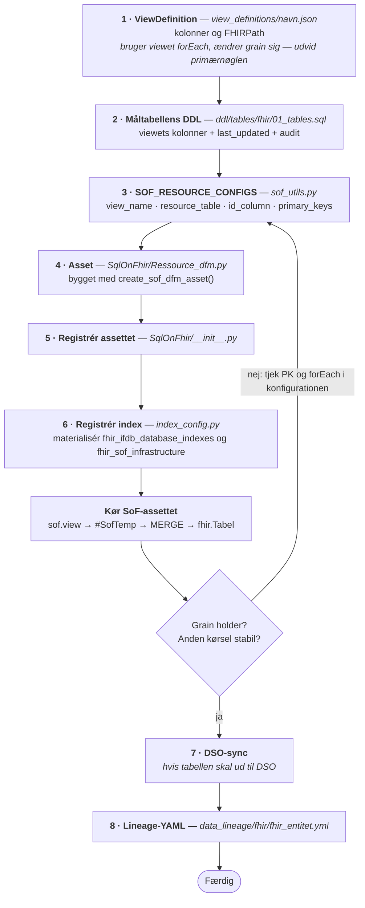

<!--
  SPDX-FileCopyrightText: 2026 Enversion Journl ApS
  SPDX-License-Identifier: AGPL-3.0-or-later

  This file is part of Healthpipe. See the LICENSE file in the project
  root for the full AGPL-3.0 license text.
-->

# 03a1 — DSA: fra FHIR til SQL on FHIR

FHIR-ressourcer er JSON-dokumenter. De er gode til at udveksle kliniske data og
mindre gode at rapportere på. Derfor projicerer vi dem ned i almindelige, flade
SQL-tabeller — `fhir.*` — som resten af platformen og datamarterne kan læse uden at
kende FHIR.

Standarden hedder **SQL on FHIR v2** (forkortet SoF). Den bygger på
**ViewDefinitions**: en JSON-fil, der beskriver hvilke kolonner en tabel skal have,
og hvor i ressourcen de findes.

Forudsætter [03a — arkiv til FHIR](03a_DSA_arkiv_til_FHIR.md).

## Flowet

```
FHIR-server (Aidbox)
      │  ViewDefinition PUT'es til Aidbox og $materialize kaldes
      ▼
sof.<view_name>   (PostgreSQL-view i Aidbox)
      │  SoF-asset streamer rækker via fetchmany
      ▼
#SofTemp          (temp-tabel i MSSQL, fyldt med bulkcopy)
      │  MERGE
      ▼
[fhir].<Tabel>    (MSSQL — det aftagerne læser)
```

Tre ting er værd at bemærke i det flow:

1. **Definitionen ligger i repoet, viewet lever i Aidbox.** ViewDefinition-filerne
   er checket ind under `DSA/FHIR/SqlOnFhir/view_definitions/`, og det er dem, der
   gælder. Infrastruktur-assettet `fhir_sof_infrastructure` lægger dem op på Aidbox
   og kalder `$materialize`, hvorefter viewet findes som `sof.<view_name>`. Ændrer du
   en definition i repoet, er det altså det asset, der skal køres igen — køres som
   del af `full_infrastructure_job`.
2. **Rækkerne streames.** Vi holder aldrig hele resultatsættet i Python.
3. **Der MERGE'es, ikke overskrives.** Måltabellen opdateres med MERGE på
   primærnøglen.

## Regler

- **Byg assettet med `create_sof_dfm_asset()`** fra
  `DSA/FHIR/utils/sql_on_fhir/sof_dfm_factory.py`. Factory'en kalder
  `extract_and_merge_sof_view()` i `sof_utils.py`, som er den eneste understøttede
  load-vej.
- **Materialisér ikke hele resultatsættet i Python** før indsættelse. Chunkede,
  hukommelsesbegrænsede indsættelser er kravet, ikke en optimering.
- **Læg et clustered index på `#SofTemp`s primærnøglekolonner før MERGE.** Uden det
  bliver MERGE'en langsom på store måltabeller.
- **Primærnøglekolonner må ikke være NULL.** Bruger viewet `forEachOrNull`, kan en
  nøglekolonne blive NULL — angiv den i `null_sentinel_columns`, så den erstattes med
  `''` før MERGE'en.
- **Ikke alt projiceres.** Nogle felter ligger bevidst kun i ressourcens JSON
  (personale, udførende afdeling er de klassiske eksempler). Vælger du ikke at
  projicere et felt, skal det stå i lineage-dokumentationen under
  `NonProjectedFhirFields` — ellers leder aftagerne efter en kolonne, der aldrig
  kommer.

## ViewDefinition-formatet

```json
{
  "resourceType": "ViewDefinition",
  "name": "encounter_view",
  "resource": "Encounter",
  "status": "active",
  "select": [
    {
      "column": [
        {"name": "encounter_id", "path": "id"},
        {"name": "patient_id", "path": "subject.id"}
      ]
    }
  ]
}
```

| Felt | Betydning |
|---|---|
| `name` | Viewets navn. Bliver `sof.<name>` i Aidbox og nøglen i `SOF_RESOURCE_CONFIGS`. |
| `resource` | Den FHIR-ressourcetype, der projiceres. |
| `select[].column[]` | De flade kolonner, udtrukket med FHIRPath i `path`. |
| `select[].forEach` / `forEachOrNull` | Udpakker arrays — én række per element. Forældrekolonner krydsjoines på. |
| `where[]` | FHIRPath-filtre, fx kun `CarePlan` i en bestemt kategori. |

`forEach` er stedet, hvor grain ændrer sig. Udpakker du et array, får du flere
rækker per ressource, og primærnøglen skal udvides tilsvarende. Gør du det ved et
uheld, dobbelttæller alle downstream-opgørelser.

## Registret `SOF_RESOURCE_CONFIGS`

Hver ViewDefinition skal registreres i `SOF_RESOURCE_CONFIGS` i `sof_utils.py`:

```python
"encounter_view": {
    "view_name": "encounter_view",
    "resource_table": "encounter",       # Aidbox' rå tabel (lowercase)
    "id_column": "encounter_id",         # kolonnen i viewet der matcher r.id
    "mssql_table": "Encounter",          # måltabellen [fhir].<Tabel>
    "primary_keys": ["encounter_id"],    # kolonner der MERGE'es på
},
```

Valgfri felter: `null_sentinel_columns` (se reglerne ovenfor),
`deduplicate_by_pk`, `dedup_tiebreak_columns` og `validation_trigger_column` til
komplekse flerrækkede views. Se de eksisterende indgange (fx
`patient_address_view`, `encounter_location_view`) for brugen.

## Sådan tilføjer du et nyt view

Diagrammet under [Flowet](#flowet) viser, hvor data løber. Dette viser, hvad **du**
laver, og i hvilken rækkefølge:



1. **ViewDefinition** i `DSA/FHIR/SqlOnFhir/view_definitions/<navn>.json`
2. **DDL** for måltabellen i `infrastructure/ddl/tables/fhir/01_tables.sql`
   (`[fhir]`-skemaet; kolonner fra viewet plus `last_updated`/`created_at` fra
   Aidbox og `dw_timestamp_insert`/`dw_timestamp_update`)
3. **En indgang** i `SOF_RESOURCE_CONFIGS`
4. **Asset** i `DSA/FHIR/SqlOnFhir/{Ressource}_dfm.py`, bygget med `create_sof_dfm_asset()`
5. **Registrér** assettet i `DSA/FHIR/SqlOnFhir/__init__.py`
6. **Registrér indexes** i `utils/fhir/index_config.py`
   (`SOF_TS_RESOURCES` for vinduesudtrækket) og materialisér
   `fhir_ifdb_database_indexes`
7. **DSO-sync**, hvis tabellen skal ud til DSO-databasen →
   [04 — DSO](04_DSO_sync_til_DSO.md)
8. **Lineage-YAML** i `data_lineage/fhir/fhir_<entitet>.yml` →
   [05 — Udfyld dokumentation](05_udfyld_dokumentation.md)

Skabelon: kopiér et eksisterende par — ViewDefinition + asset — fra en ressource med
samme form (fladt view uden `forEach`, eller flerrækket view med `forEach`).

## Navngivning

| Element | Mønster | Eksempel |
|---|---|---|
| Asset | `sof_{view_kortnavn}_dfm` | `sof_patient_dfm` |
| Group | `fhir_sof_dfm` | |
| Måltabel | `[fhir].<Ressource>` | `[fhir].[Encounter]` |

## Verificér

1. **Viewet findes i Aidbox:** `SELECT COUNT(*) FROM sof.<view_name>` giver et
   rimeligt tal. Er det 0, blev ViewDefinition ikke materialiseret — kør
   `fhir_sof_infrastructure`.
2. **Grain holder:**
   `SELECT COUNT(*), COUNT(DISTINCT <primary_keys>) FROM [fhir].[<Tabel>]` — de to
   tal skal være ens.
3. **Anden kørsel er stabil.** MERGE'en skal opdatere de samme rækker, ikke
   indsætte nye.
4. **Antal matcher FHIR-serveren** for de aktive (ikke-slettede) ressourcer. DQA's
   `source_reconciliation` og `fhir_server_reconciliation` tjekker netop det
   løbende — konfigurér dem for den nye tabel.

## Videre herfra

- Ud til DSO-databasen: [04 — DSO](04_DSO_sync_til_DSO.md)
- Dokumentation: [05](05_udfyld_dokumentation.md)

Uddybende (på engelsk):
[fhir_etl_guide.md, afsnittet om SQL on FHIR](../implementation/fhir_etl_guide.md#sql-on-fhir-sof----flattened-views-for-analytics).
