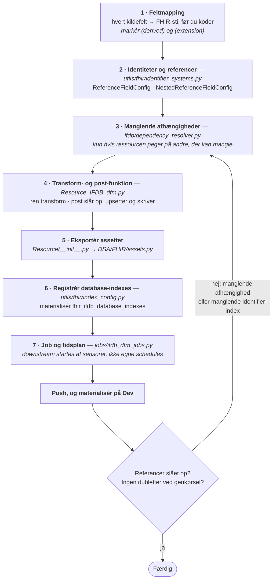

<!--
  SPDX-FileCopyrightText: 2026 Enversion Journl ApS
  SPDX-License-Identifier: AGPL-3.0-or-later

  This file is part of Healthpipe. See the LICENSE file in the project
  root for the full AGPL-3.0 license text.
-->

# 03a — DSA: fra arkiv til FHIR

Dette kapitel dækker de kilder, hvor data er kliniske og beskrevet i **HL7 FHIR**:
patienter, kontakter, forløb, diagnoser, procedurer, observationer,
spørgeskemasvar med videre.

Sporet har to trin. Dette kapitel er første trin — fra arkivet til FHIR-ressourcer
på FHIR-serveren. Andet trin, udfladningen til almindelige SQL-tabeller, står i
[03a1 — FHIR til SQL on FHIR](03a1_DSA_FHIR_til_SQLonFHIR.md).

## FHIR som model

FHIR er valgt som model for de kliniske data — en international standard, hvor
modellen for de svære ting (identiteter, referencer, koder, perioder) er lavet på
forhånd, og hvor grænsen for, hvad der er "en klinisk kendsgerning", ligger fast.

Prisen er, at FHIR er en dokumentmodel, ikke en tabelmodel. Ressourcerne ligger som
JSON på FHIR-serveren (Aidbox), og analyse foregår derfor på de flade tabeller, som
03a1 producerer — ikke direkte på JSON'en.

## Flowet

```
arc.*  ──▶  transform (Python)  ──▶  post til Aidbox  ──▶  [03a1] fhir.*-tabeller
             bygger ressourcen        slår referencer op
             ud fra kildens rækker    og skriver
```

Én pipeline opdaterer typisk én FHIR-ressourcetype.

## DFM: ét asset per entitet

FHIR-sporet kører på **DFM** — checkpoint-baseret delta, som resten af platformen.
Der er ét transform-og-post-asset per entitet:

| | |
|---|---|
| **Asset** | `fhir_server_{entitet}_dfm` |
| **Group** | `fhir_ifdb_dfm` |
| **Kilde** | Læser delta fra `arc.*` via checkpoint i `meta.DFMState` |
| **Replay** | Ændring af run mode ved kørselstid (`period`, `ids`) |

Assettet er ikke partitioneret. Skal en periode eller et sæt id'er køres igen, er
det en config-ændring i Launchpad — ikke en backfill. Se
[dfm_operations_guide.md](../implementation/dfm_operations_guide.md).

> `_dfm`-suffikset på filer og assets stammer fra migreringen væk fra et tidligere
> partitioneret mønster. Det er redundant nu og forsvinder i en oprydning, men det
> er stadig navnet i koden.

## To regler, du skal følge

Uanset hvilken ressource du bygger, gælder to regler for, hvordan data må komme ind
i FHIR. De er ikke til fri fortolkning: bryder du en af dem, bliver data uensartede
på tværs af kilder, og aftagerne kan ikke længere stole på en fælles læsning.

Arbejder du med en kilde, der bærer kliniske koder — diagnoser, procedurer,
tillægskoder — gælder desuden de valg, der står i
[appendikset](#appendiks-fortolkningsvalg-for-kode-bærende-ressourcer) nedenfor.

### 1. Frasortér aldrig i ingest — markér i stedet

Ingen kilderække smides væk i ingest-laget. Slettede registreringer bevares med et
sletteflag. Registreringer, der ikke skal indberettes, bevares med et flag. Koder
skrives som de blev registreret, uden gyldighedsfilter.

**Hvorfor:** en frasortering i ingest-laget kan ikke fortrydes downstream; en
markering kan altid filtreres.

Der er også et aftagerhensyn. Aftagerne har bygget rapporter på det, der lå i
basismodellen i går. Sletter vi bare rækken, forsvinder den sporløst — og en rapport,
der opdateres på delta, vil **aldrig** opdage det, for der er ingen ændring at hente.
Med en slettemarkering kommer forsvindingen derimod med som en ændring, aftageren kan
se og reagere på.

**Konsekvens for aftagerne:** enhver opgørelse skal filtrere aktivt. Man kan ikke
slutte fra "findes i tabellen" til "er en gældende registrering". Det skal fremgå af
dokumentationen af hver tabel.

### 2. Sletning skal fremgå af selve ressourcen

En kilderække, der bliver slettet, må ikke bare forsvinde fra FHIR-serveren.
Ressourcen bliver liggende og bliver **markeret** som slettet — det er den anden
halvdel af regel 1.

Markeringen er den samme extension på tværs af alle ressourcer, så aftagere kan
filtrere med ét udtryk:

```
extension.where(url='urn:fhir:isDeleted').valueInteger = 1
```

`0` betyder ikke slettet, `1` betyder slettet (kildens sletteflag, eller et
kvalitetstjek har konstateret at rækken ikke længere findes i kilden). For
`Encounter` og `EpisodeOfCare` sættes FHIR-`status` samtidig til `entered-in-error`.
Kode: `utils/fhir/is_deleted_extension.py`.

## Sådan bygger du en FHIR-pipeline



### 1. Lav en feltmapping først

Kortlæg hvert kildefelt til en FHIR-attribut, **før** du koder. Det behøver ikke
være pænt — en tabel i en scratch-fil rækker — men den skal være komplet nok til, at
du kan se, hvad der mangler. Et udsnit for Encounter kunne se sådan ud:

| Kildefelt i `arc.ifdb_encounter` | FHIR-sti | Note |
|---|---|---|
| `OBJECT_ID` | `identifier`, system `urn:source:ifdb:encounter_id` | Kildenøglen. Det er den, andre ressourcer slår kontakten op på |
| `PATIENT_ID` | `subject` | Reference — slås op til `Patient/<id>` ved posting |
| `STATUS_TEXT` | `status` | **(derived)** — kildens tekst skal mappes til FHIR's tilladte statusværdier |
| `PERIOD_START` | `period.start` | |
| `DELETED` | `extension[urn:fhir:isDeleted].valueInteger` | **(extension)** — se regel 2 |

- Markér afledte felter som **(derived)** og extensions som **(extension)**. Begge
  dele er noget, nogen skal kunne finde igen.
- Foretræk standard-FHIR-felter over extensions. En extension er en beslutning, der
  skal begrundes.
- Læs FHIR R4B-specifikationen for ressourcen igennem: hvilke felter er
  obligatoriske, og hvilke referencer skal slås op?

### 2. Planlæg identiteter og referencer

**Identifier systems** er centraliserede i `utils/fhir/identifier_systems.py`. Alle
URI'er skal komme derfra — ingen strenge skrevet direkte i transformationen:

```python
SYSTEM_CPR = "urn:dk:cpr"
SYSTEM_SOR = "https://sundhedsdatastyrelsen.dk/sor"
SYSTEM_IFDB_PATIENT_ID = "urn:source:ifdb:patient_id"
```

**Transformationen laver identifiers; posting slår dem op.** Transformationen skal
aldrig kende et FHIR-id — den skriver i praksis "patienten med IFDB-id 12345", og
posting finder ud af, hvilket FHIR-id den patient har, og skriver `Patient/<id>` ind
i referencen. Referencerne beskrives deklarativt:

- `ReferenceFieldConfig` til referencer på øverste niveau (fx `subject`).
- `NestedReferenceFieldConfig` til referencer inde i strukturer (fx
  `activity.detail.performer`), hvor målressourcetypen kan afhænge af identifier
  system.

Posting kalder derefter `resolve_and_apply_all_references()` — én gang, med
konfigurationen.

### 3. Håndtér manglende afhængigheder

En reference kan pege på en ressource, der endnu ikke findes på serveren.

Sig, at du poster Encounters. En kontakt peger på sin patient — men netop den patient
er ikke blevet ændret, siden vi sidst hentede fra IFDB, så den er aldrig blevet
posted. Opslaget af `Patient/<id>` finder ingenting, og kontakten ville ende med en
reference, der ikke kan bruges.

Løsningen er, at ressourcen trækker sin afhængighed med ind. Før referenceopslaget:
saml de patient-id'er, kontakterne peger på, tjek hvilke af dem der allerede findes
på serveren, hent de manglende fra arkivtabellen, transformér dem og post dem.
Derefter kan opslaget fortsætte som normalt.

Mekanikken ligger i `DSA/FHIR/utils/ifdb/dependency_resolver.py` —
`resolve_missing_patients()` og `resolve_missing_episodes_of_care()` gør netop det.

### 4. Skriv transform- og post-funktionen

Mønstret er to delte funktioner plus tynde assets omkring dem:

```python
def _transform_x_to_fhir(data, context) -> list[Resource]: ...

def _post_x_to_fhir(context, resources, fhir_database):
    resources = resolve_resource_ids_for_upsert(resources, fhir_database, ...)
    resolve_and_apply_all_references(resources, REFERENCE_CONFIGS, ..., fhir_database)
    return post_resources_direct(context, resources, fhir_database, ...)
```

Hold de to adskilt. Transformationen er ren: kildens rækker ind, FHIR-ressourcer ud,
ingen kald til serveren — det er den, du kan unit-teste. Posting ejer alt det, der
kræver serveren.

De tre kald i post-funktionen gør hver sin ting:

| Kald | Hvad det gør |
|---|---|
| `resolve_resource_ids_for_upsert` | Slår op, om ressourcen allerede findes på serveren — på dens egen identifier. Gør den det, genbruges dens FHIR-id, så kørslen opdaterer den eksisterende ressource i stedet for at oprette en dublet. |
| `resolve_and_apply_all_references` | Slår hver reference op — `subject`, `encounter`, … — og skriver det fundne FHIR-id ind i ressourcen. |
| `post_resources_direct` | Skriver hele batchen til FHIR-databasen. |

**Skabeloner:**

| Skabelon | Bruges til |
|---|---|
| `DSA/FHIR/Patient/Patient_IFDB_dfm.py` | Den enkleste ressource — start her |
| `DSA/FHIR/Encounter/Encounter_IFDB_dfm.py` | Ressource med referencer, der skal slås op |
| `DSA/FHIR/Procedure/Procedure_IFDB_RisYdelse_dfm.py` | Flere kildetabeller ind i samme ressourcetype |

**Filnavne:** `{Resource}_IFDB_dfm.py` når der kun er én kildetabel for kilden.
Fylder flere kildetabeller samme ressourcetype, indsættes kildetabellen:
`{Resource}_IFDB_{Kildetabel}_dfm.py` (fx `Procedure_IFDB_RisYdelse_dfm.py`,
`Condition_IFDB_Diagnose_dfm.py`). Ressourcemapper er PascalCase.

### 5. Registrér assettet

- Eksportér fra `DSA/FHIR/{Resource}/__init__.py`.
- Ressourcemappens `__init__.py` samler assets fra alle kildefiler.
- `DSA/FHIR/assets.py` samler alle ressourcemapper til `all_assets`, som
  `definitions.py` importerer.

### 6. Registrér database-indexes

Alle indexes står i `utils/fhir/index_config.py`. En ny ressource skal tilføjes de
relevante lister, og derefter skal infrastruktur-assettet
`fhir_ifdb_database_indexes` materialiseres igen.

| Liste | Hvad indexet gør for dig |
|---|---|
| `IDENTIFIER_UNIQUE_INDEX_SPECS` | Et **unikt** index på identifier-værdien. Det er både dét, der gør referenceopslag hurtige, og dét, der gør upsert idempotent: databasen afviser en dublet, hvis to kørsler forsøger at oprette den samme ressource. Mangler det, får du dubletter — og opslagene bliver langsommere, jo mere data der kommer. |
| `TXID_BTREE_RESOURCES` | Batch-upsert slår `MAX(txid)` op ved hver kørsel. Uden index er det en fuld scanning af ressourcetabellen hver gang. |
| `SOF_TS_RESOURCES` | SQL on FHIR henter ressourcer i tidsvinduer på `ts`. Uden index skal hele ressourcetabellen scannes, hver gang et SoF-view opdateres. |

Der oprettes ikke GIN-indexes på FHIR-JSON'en. De tre ovenstående er hele
indexsættet.

### 7. Job og tidsplan

Jobs ligger i `etl/jobs/ifdb_dfm_jobs.py` og dækker hele DFM-kæden: arkiv → FHIR →
SoF → DSO-sync. Tidsplanen ligger i `schedules/ifdb_dfm_schedules.py`, hvor kun
base-jobbet er cron-styret — downstream DFM-assets startes af sensorer fra det, ikke
af egne tidsplaner.

## Verificér

1. **Ressourcerne findes på serveren** med det forventede antal, og en stikprøve
   ser rigtig ud i JSON.
2. **Referencerne er slået op.** En reference, der stadig kun er en identifier, betyder
   at målressourcen ikke fandtes — tjek `dependency_resolver` og caches.
3. **Idempotens.** Kør igen med det samme: der må ikke opstå dubletter. Upsert
   afhænger af det unikke identifier-index — mangler indexet, opdager du det her.
4. **Sletteflag.** En kilderække med sletteflag skal give
   `urn:fhir:isDeleted = 1` (og `entered-in-error` for `Encounter`/`EpisodeOfCare`).
5. **Antallet må gerne overstige kilderækkerne.** Én registrering kan blive både en
   procedure og en observation, og en operation med deloperationer bliver 1+N
   ressourcer. Bekræft at forholdet er det forventede — ikke at tallene er lige.

## Appendiks: fortolkningsvalg for kode-bærende ressourcer

Disse valg gælder de ressourcer, der bærer kliniske koder — diagnoser, procedurer,
observationer og deres tillægskoder. Du behøver dem ikke for at komme i gang, men du
skal kende dem, før du transformerer en kilde med koder. Den fulde begrundelse for
hvert valg står i [beslutningsloggen](../contracts/beslutningslog_principper.md).

### Kliniske kendsgerninger står for sig selv

Diagnoser, procedurekoder og tillægskoder er selvstændige ressourcer i deres eget
domæne. Andre ressourcer peger på dem med referencer eller via child-tabeller. En
henvisningsdiagnose bliver altså en `Condition` — ikke et felt på henvisningen.

Det koster et join for aftageren, men til gengæld findes hver klinisk kendsgerning
ét sted, uanset hvem der refererer til den.

### `userSelected` markerer kildens hovedkode

En kode ligger i FHIR i et `CodeableConcept`, som kan bære **flere** `coding`-poster
for den samme kendsgerning. FHIR har et standardflag, `userSelected`, der betyder
"det er den her kode, kilden faktisk valgte".

Det bruger vi til at skelne hovedkode fra tillægskoder. En registrering i kilden har
én hovedkode (fx selve diagnosen) og nul eller flere tillægskoder. Vi sætter
`userSelected = true` på hovedkoden og lader tillægskoderne stå umarkerede. De flade
tabeller læser så markøren: hovedkode-kolonnen tager den `coding`, hvor markøren er
sand, og tillægskode-tabellen tager resten.

Alternativet var at lade rækkefølgen bestemme ("den første kode er hovedkoden"). Det
blev forkastet, fordi rækkefølgen kan ændre sig.

**Faldgrube, når du skriver filteret på tillægskoder:** det skal formuleres som
"markøren er fraværende **eller** falsk" — ikke som "forskellig fra sand". Er feltet
slet ikke sat, giver en sammenligning hverken sandt eller falsk, men et tomt
resultat, og tillægskode-tabellen bliver tom.

### Diagnosekoder kanoniseres til SKS-D; andre koder gør ikke

Primære diagnosekoder føres til dansk SKS-D-form: præfiks strippes, og er koden ren
ICD-10 (`J44`), præfikses den med `D` (`DJ44`). Reglen er idempotent og bruges af
**alle** diagnoseproducenter, så samme kildekode giver samme resultat uanset vej.

Tillægskoder, procedurekoder og ydelseskoder kanoniseres **ikke** — de får kun
præfikset strippet og beholder deres eget kodesystem. Mange tillægskoder er slet ikke
ICD-10; blandt dem ATC-lægemiddelkoder.

**Konsekvens:** skel altid på kodesystem, ikke kun på kode. To koder kan se ens ud og
betyde noget forskelligt.

### Værdier, der ikke kan fortolkes, bliver ikke koder

En værdi, der ikke matcher en gyldig kodeform, bliver ikke en kode. For nogle kilder
postes ressourcen alligevel med den rå værdi som fritekst. Man får altså ikke skrald
i kodefelterne, men der findes rækker med tom kode.

## Videre herfra

- Flad ressourcerne ud til analysetabeller:
  [03a1 — FHIR til SQL on FHIR](03a1_DSA_FHIR_til_SQLonFHIR.md)
- Dokumentér lineage og de fortolkningsvalg, du traf:
  [05 — Udfyld dokumentation](05_udfyld_dokumentation.md)

Uddybende referencedokumentation:

- [beslutningslog_principper.md](../contracts/beslutningslog_principper.md) — de
  bærende principper og de fem delrapporter (dansk)
- [fhir_etl_guide.md](../implementation/fhir_etl_guide.md) — den engelske
  originaludgave med flere kodeeksempler
- [core_cache_parallel_execution.md](../architecture/core_cache_parallel_execution.md)
  — identifier-caches og parallel eksekvering
- [codesystem_conceptmap_guide.md](../implementation/codesystem_conceptmap_guide.md)
  — CodeSystem og ConceptMap (organisationshierarkier)
