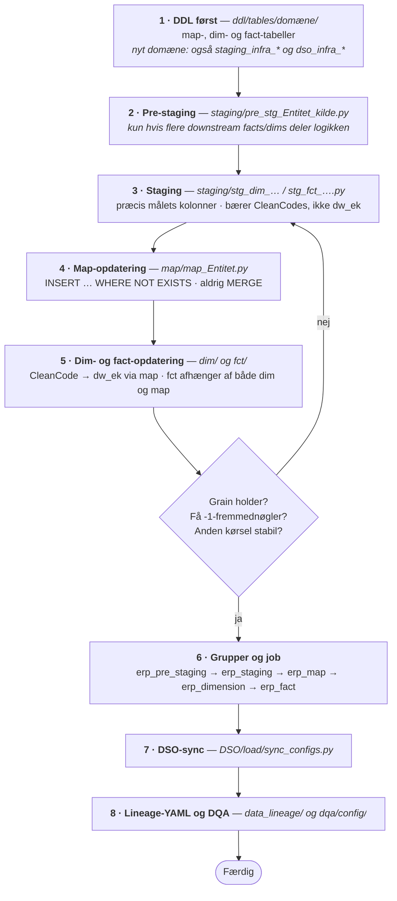

<!--
  SPDX-FileCopyrightText: 2026 Enversion Journl ApS
  SPDX-License-Identifier: AGPL-3.0-or-later

  This file is part of Healthpipe. See the LICENSE file in the project
  root for the full AGPL-3.0 license text.
-->

# 03b — DSA: fra arkiv til dimensionel model

Dette kapitel dækker de kilder, der **ikke** er beskrevet i HL7 FHIR, men som skal
modelleres dimensionelt: økonomi, indkøb, lager, HR og lignende transaktionelle
data.

Resultatet er et stjerneskema: facts med målbare hændelser, dimensioner med
beskrivende attributter, og nøgler der binder dem sammen.

Forudsætter [02 — DSI: fra kilde til arkiv](02_DSI_kilde_til_arkiv.md).

## Lagene

```
arc.*  ──▶  stg.pre_*  ──▶  stg.dim_* / stg.fct_*  ──▶  map.*  ──▶  dim.* / fct.*
            komplekse         én tabel per            nøgle-        de færdige
            joins, dedup,     målentitet              tildeling     tabeller
            CleanCodes
```

`pre_stg` er **valgfrit**, og formålet med det er genbrug: når flere downstream
facts og dimensioner har brug for den samme logik, defineres den ét sted frem for at
blive gentaget i hver staging-tabel. Er der ingen logik at dele, læser staging-laget
direkte fra `arc.*`, og kæden bliver
`arc.* ──▶ stg.dim_*`/`stg.fct_* ──▶ map.* ──▶ dim.*`/`fct.*`. Flere af de
eksisterende dimensioner er bygget den vej.

| Lag | Læser fra | Skriver til | Ansvar |
|---|---|---|---|
| **pre_stg** (valgfrit) | `arc.*` | `stg.pre_*` | Logik, som flere downstream facts/dimensioner deler — defineret ét sted |
| **stg** | `stg.pre_*` eller `arc.*` | `stg.dim_*`, `stg.fct_*` | Én tabel per målentitet, med præcis de kolonner målet skal have |
| **map** | `stg.dim_*`, `stg.fct_*` | `map.*` | Mapper CleanCode til entity key (`dw_ek_*`) |
| **dim / fct** | `stg.*` og `map.*` | `dim.*`, `fct.*` | MERGE ind i de færdige tabeller med opslåede nøgler |

**Skemaregler, der ikke må brydes:**

- **`ext.*` og `stg.*` er transiente lag.** De implementeres typisk som DROP +
  CREATE ved hver kørsel, så intet i dem er varigt. `arc.*` og `map.*` er de
  vedvarende lag.
- **Læs aldrig `ext.*`.** Rå data læses fra `arc.*`.
- **`stg.*` er klargøringstabeller.** `stg.pre_*`, `stg.dim_*` og `stg.fct_*` holder
  de rækker, der er lige ved at blive skrevet ind i `map`, `dim` eller `fct` — formet
  præcis som måltabellen skal have dem. De er et mellemled på vej mod målet, ikke et
  sted at parkere kildedata: udtrukne kildetabeller hører til i `ext`/`arc`.
- **Berigende joins hører ikke til i DSI.** De hører til i DSA — i `pre_stg`, hvis
  logikken skal deles, ellers i `stg` — hvor de læser fra de enkelte
  `arc.*`-tabeller.

## De tre nøglebegreber

Kender du disse tre, giver resten af kapitlet sig selv.

### CleanCode — den standardiserede forretningsnøgle

En CleanCode er en tekststreng, der entydigt identificerer en forretningsentitet på
tværs af kilder. Fx bliver et CVR-nummer til `CVR_12345678`, og en finanskonto til
`KONTOPLAN_4711`.

CleanCodes dannes inline i den SQL, der læser arkivet — i `pre_stg` hvis kilden går
den vej, ellers i `stg` — med CASE/CONCAT-udtryk. De hører normalt ikke hjemme i
`ext.*`/`arc.*` (undtagelsen er beskrevet i
[02 — DSI-kontrakten](02_DSI_kilde_til_arkiv.md#dsi-kontrakten--fem-regler)):

```sql
CASE
    WHEN kred.juridisk_enhed IS NOT NULL AND LTRIM(RTRIM(kred.juridisk_enhed)) <> ''
    THEN 'CVR_' + LTRIM(RTRIM(kred.juridisk_enhed))
    ELSE NULL
END AS clean_code_Kreditor
```

De kanoniske forretningsregler for hver CleanCode er dokumenteret i
`DSA/SQL/staging/clean_codes.py`. For nogle af dem findes SQL-udtrykket allerede som
en delt hjælpefunktion — fx `sql_cvr_cleancode_from_column()` i
`utils/sql/tax_id_sql.py`, som `stg_dim_Kreditor` bruger. Genbrug dem frem for at
skrive udtrykket igen.

Danner to steder den samme CleanCode forskelligt, går opslaget i map-tabellen galt —
og resultatet er `-1`-nøgler, ikke en fejlmeddelelse.

Navngivning: `clean_code_<Tabel>[_<rolle>]`, fx `clean_code_Kreditor`.

> To ældre varianter findes stadig i koden: `CleanCode_*` (præfiks) og
> `*_CleanCode` (suffiks). Genkend dem, brug dem aldrig i ny kode, og omdøb dem
> **ikke** lejlighedsvist. Retter du i en eksisterende kæde, skal navnene være
> konsistente hele vejen (pre_stg-alias → stg-kolonne → joins i MapUpd/DimUpd/FctUpd);
> en halv omdøbning viser sig som "Invalid column name" ved kørsel, ikke ved import.

### dw_ek — entity key

`dw_ek_<Tabel>` er et heltal, der entydigt identificerer en entitet: én kreditor, én
kontoplan, én borger. Den tildeles i map-tabellen ved første møde med en CleanCode
og holdes stabil derefter.

Værdien **`-1` betyder "ukendt"**. En tabels egen `dw_ek` er dens primærnøgle; de
`dw_ek`-kolonner, der peger på en *anden* entitet, er fremmednøgler. Fremmednøglerne
har `DEFAULT -1`, så en række aldrig går tabt, bare fordi opslaget ikke fandt noget.
Det er mest udbredt i facts, men dimensioner har det også — fx `dim.Aftale`, der
bærer `dw_ek_Kreditor`. Hvor ofte sentinelen bruges, overvåges af DQA-tjekket
`sentinel_rate`.

### dw_sk — versionsnøglen

`dw_sk_<Tabel>` findes kun i type 2-dimensioner (fx `dim.Borger`), hvor vi gemmer
historik. Hvor `dw_ek` peger på entiteten, peger `dw_sk` på en bestemt *version* af
entiteten inden for et gyldighedsinterval (`dw_valid_from` / `dw_valid_to`).

**Facts gemmer `dw_ek`, ikke `dw_sk`.** Versionen slås først op, når fact'en
læses — i et view i DSO eller i datamarten — ved hjælp af `dw_haendelsestidspunkt`
på fact-rækken. Det gør historiske
opdateringer af dimensionen langt enklere: entiteten er stabil, versionerne kan
ændre sig.

## Faste kolonner

| Kolonne | Hvor | Formål |
|---|---|---|
| `dw_timestamp_insert` | Alle tabeller | Hvornår rækken først blev indsat |
| `dw_timestamp_update` | Alle tabeller | Hvornår rækken sidst blev opdateret |
| `dw_haendelsestidspunkt` | Facts | Hændelsens tidspunkt — bruges til at slå `dw_sk` op i type 2-dimensioner |
| `dw_is_deleted` | Facts og type 2-dimensioner | Soft delete-flag |
| `dw_valid_from` / `dw_valid_to` | Type 2-dimensioner | Versionens gyldighedsinterval |

## Navngivning

Følger [navngivningsstandarden](../implementation/navngivningsstandard_basismodel.md). Kort
fortalt fra arkivet og downstream:

| Element | Regel | Eksempel |
|---|---|---|
| Tabeller | PascalCase, ental for dimensioner | `dim.Kreditor`, `fct.Postering` |
| Kolonner | snake_case — men PascalCase på den del, der refererer et tabelnavn | `posteringsbeloeb`, `dw_ek_Organisation` |
| Forretningsnøgler | `bk_<navn>`, med kildens kolonnenavn som udgangspunkt | `bk_finanskonto_id` |
| CleanCodes | `clean_code_<Tabel>[_<rolle>]` | `clean_code_Kreditor` |
| Nøgler | `dw_ek_<Tabel>[_<rolle>]`, `dw_sk_<Tabel>` | `dw_ek_Dato_bogfoering` |
| Danske bogstaver | `ae`/`oe`/`aa` i identifikatorer — men almindeligt dansk med æ/ø/å i SQL-kommentarer | `posteringsbeloeb` |

## Sådan bygger du kæden



### 1. DDL først

Opret map-, dim- og fact-tabellerne i `infrastructure/ddl/tables/{domæne}/`.
Er domænet nyt, skal DDL-mappen også registreres som et infrastruktur-asset
(både `staging_infra_*` og `dso_infra_*`, da dim/fct skal synkroniseres til DSO).

### 2. Pre-staging — kun hvis logikken skal deles

Dette trin er valgfrit. Brug det, når **flere** downstream facts eller dimensioner
har brug for den samme logik — samme joins, samme dedublering, samme
CleanCode-dannelse. Så ligger den ét sted i
`DSA/SQL/staging/pre_stg_<Entitet>_<kilde>.py`, der læser `arc.*` og skriver
`stg.pre_*`, frem for at være gentaget i hver staging-tabel.

Skal logikken kun bruges af én staging-tabel, så læg den dér og spring trinnet over.
Kompleksitet alene er ikke grunden til et pre_stg-lag — genbrug er.

Filtrér på `dw_timestamp_update` fra arkivet, så du kun behandler nye og ændrede
rækker. Det gælder både her og i trin 3, alt efter hvor arkivet læses.

### 3. Staging

`DSA/SQL/staging/stg_dim_<Entitet>_<kilde>.py` eller `stg_fct_*`. Skriver
`stg.dim_*` / `stg.fct_*`.

**Staging-tabellen definerer kontrakten:** den skal indeholde præcis de kolonner,
måltabellen har brug for — hverken flere eller færre. Det er dét, der gør resten af
kæden mekanisk.

En staging-tabel indeholder typisk:

```sql
clean_code_<Tabel>                     -- entitetens egen CleanCode (grain)
bk_<nøgle>                             -- forretningsnøgle(r) til sporbarhed
clean_code_<RelateretTabel>[_<rolle>]  -- CleanCodes til opslag i map-tabeller
<attributter>                          -- for dimensioner
<mål>                                  -- for facts
dw_haendelsestidspunkt                 -- for facts med type 2-relationer
```

Bemærk: staging bærer **CleanCodes**, ikke `dw_ek`-værdier. Opslaget sker først i
map-/fact-opdateringen.

### 4. Map-opdatering

`DSA/SQL/map/map_<Entitet>.py`. Map-tabeller er **insert-only**:

```sql
INSERT INTO [map].[Entitet] (clean_code_Entitet, dw_timestamp_insert, dw_timestamp_update)
SELECT source.clean_code_Entitet,
       CAST(SYSDATETIME() AS datetime2(0)),
       CAST(SYSDATETIME() AS datetime2(0))
FROM [stg].[dim_entitet] source
WHERE NOT EXISTS (
    SELECT 1 FROM [map].[Entitet] m
    WHERE m.clean_code_Entitet = source.clean_code_Entitet
);
```

- **Brug aldrig MERGE til ren nøgletildeling.** `INSERT ... WHERE NOT EXISTS` er
  mønstret. MERGE eller UPDATE er kun tilladt, når map-tabellen faktisk skal opdatere
  en ikke-nøglekolonne — og undtagelsen skal begrundes i assettets docstring.
- Map-tabeller indeholder kun `dw_ek_*`, `clean_code_*` og `bk_*`-kolonner.

### 5. Dimensions- og fact-opdatering

`DSA/SQL/dim/` og `DSA/SQL/fct/`. Her MERGE'es fra staging ind i måltabellen, og
CleanCodes oversættes til `dw_ek` via map-tabellerne.

**Fact-opdateringer skal afhænge af både dimensions- og map-opdateringen.** Ellers
kan en fact-række få en `dw_ek`, der peger på en dimensionsrække, som endnu ikke
findes.

### 6. Grupper og job

Assets lægges i lag-grupper, som den daglige kæde vælger på:
`erp_pre_staging` → `erp_staging` → `erp_map` → `erp_dimension` → `erp_fact` →
`erp_dso_sync`.

### 7. DSO-sync

Se [04 — DSO](04_DSO_sync_til_DSO.md).

### 8. Lineage og DQA

Lineage-YAML er **obligatorisk** for alle DSO-synkroniserede `dim.*` og `fct.*`.
Se [05 — Udfyld dokumentation](05_udfyld_dokumentation.md).

## Migrationer

To ting skal være på plads, hver gang du ændrer en tabel, der allerede findes i et
miljø.

**1. DDL'en skal altid afspejle tabellens nuværende tilstand.** Base-DDL'en under
`infrastructure/ddl/tables/{domæne}/` er alt, en frisk database får — migrationerne
bliver stemplet som gennemførte uden at køre, når en ny server sættes op. Omdøber en
migration derfor en kolonne, skal `CREATE TABLE` omdøbe den med. Ellers får det nye
deployment en anden tabel end de eksisterende miljøer. Migration og DDL skal derfor
være i samme commit.

**2. Både migration og DDL skal være idempotente** — de skal kunne køres igen uden
at fejle og uden at gøre skade:

- **Migrationen** tjekker, at tabellen faktisk står i den tilstand, der migreres
  *fra*, før den transformerer. Er ændringen allerede lavet, gør filen ingenting.
- **DDL'en** pakker `CREATE`-statements i `IF NOT EXISTS`, så en gentagen kørsel ikke
  falder over "there is already an object named …".

Verificér det ved at køre `staging_migrations` **to gange i træk**: anden kørsel skal
lykkes. Anden gang springer trackeren (`meta.MigrationHistory`) filen over, men
pointen er, at filen også skal være harmløs, hvis tracker-rækken bliver ryddet og
filen kører igen.

### Faldgruber i migrationer

Disse får den første kørsel til at fejle eller til ikke at gøre noget — uden en fejlbesked:

- **Pak kolonne-guards i et tabel-eksistenstjek.** `COL_LENGTH` og `sys.columns`
  svarer også "findes ikke" for en tabel, der slet ikke er der — et bart
  kolonne-guard bliver til en `ALTER TABLE` mod et manglende objekt.
- **DDL, der tilføjer en kolonne, og DML, der bruger den, skal ligge i hver sin
  `GO`-batch.** SQL Server parser hele batchen, før den eksekverer.
- **Brug dynamisk SQL (`EXEC(N'...')`) til DML, der rører kolonner, som andre
  migrationer omdøber.** Migrationer kører i tidsrækkefølge, så det er ikke en senere
  migration, der er problemet — det er, at *denne* fil skal kunne køre igen på et
  tidspunkt, hvor skemaet er nået videre. `IF EXISTS`-guards hjælper ikke: T-SQL
  validerer kolonnenavne ved compile-time for hele batchen, også i grene der aldrig
  eksekveres.
- **Brug aldrig CURSOR eller procedurale batches** — de bliver droppet uden en fejlbesked, og
  trackeren registrerer så en kørsel, der ikke har gjort noget, som gennemført.
- **Navngiv altid DEFAULT-constraints eksplicit**
  (`CONSTRAINT [DF_<Tabel>_<kolonne>] DEFAULT …`). Et auto-navngivet constraint får et
  genereret navn per database og kan derfor ikke droppes forudsigeligt — og en kolonne
  kan ikke droppes, før dens DEFAULT er væk. Møder du en i en ældre tabel, må navnet
  slås op i `sys.default_constraints` først.
- **Migrationen skal kunne køre rent (eller gøre ingenting) mod både staging- og
  DSO-databasen.**

Fuld gennemgang med eksempler:
[sql_etl_guide.md, afsnittet SQL Migration Patterns](../implementation/sql_etl_guide.md#sql-migration-patterns).

## Fire performance-regler

1. **Pak aldrig en indekseret kolonne ind i en funktion.**
   `LTRIM(RTRIM(m.clean_code_Entitet))` i en JOIN slår index-seek fra og tvinger en
   fuld tabelscanning. Rens data ved skrivning (i map-INSERT'en), så læsning kan bruge
   indexet direkte.
2. **Giv temp-tabellen en unik clustered nøgle på join-kolonnen før MERGE.** Det er
   dét, der lader SQL Server vælge en merge join frem for nested loop eller hash mod
   en stor måltabel.

   Opret helst tabellen med nøglen fra starten — `CREATE TABLE #Temp (... , PRIMARY
   KEY CLUSTERED (nøgle))` og derefter `INSERT` — frem for `SELECT ... INTO #Temp`
   efterfulgt af `CREATE UNIQUE CLUSTERED INDEX`. For et clustered index *er*
   datarækkerne i sorteret orden, så lægges det på bagefter, skrives temp-tabellen
   én gang som heap og derefter om igen. På en lille temp-tabel mod en stor måltabel
   er den ekstra skrivning oftest billigere end den dårligere join-plan, men den er
   gratis at undgå, når du selv styrer DDL'en. Flere af de eksisterende assets
   bruger stadig `SELECT INTO`-formen.
3. **Brug `UNION ALL` frem for `UNION`** i insert-only map-loads.
   `NOT EXISTS` plus primærnøglen håndterer allerede dubletter; `UNION`s implicitte
   `DISTINCT` koster en unødig sortering af hele mængden.
4. **Indeksér korrelerede subqueries.** Kører en subquery mod en stor tabel per
   række i den ydre forespørgsel, skal join-kolonnen have et nonclustered index med
   passende INCLUDE-kolonner.

Efter batch-MERGE fragmenteres indexes. `erp_index_maintenance`-assettet genopbygger
hvert indeks med mindst 1.000 sider og mere end 30 % fragmentering, med fill factor 90.
Intet job vælger assettet, så det kører kun, når det materialiseres manuelt.

## Verificér

1. **Kæden materialiserer** hele vejen: `arc` → `pre_stg` → `stg` → `map` → `dim` →
   `fct`.
2. **Grain holder** på staging-tabellen:
   `SELECT COUNT(*), COUNT(DISTINCT clean_code_<Tabel>) FROM stg.<tabel>`.
3. **Nøgleopslaget virker.** Tæl hvor mange rækker der står med `-1` på hver
   `dw_ek`-fremmednøgle. Er andelen høj, dannes CleanCode'en forskelligt i pre_stg og
   i map-opslaget.
4. **Ingen dubletter i map.** `clean_code_*` er primærnøgle — men tjek også, at den
   samme forretningsentitet ikke er kommet ind under to forskellige CleanCodes.
5. **Anden kørsel er stabil:** samme rækketal, ingen nye `dw_ek`-værdier.
6. **Direkte SQL, ikke kun asset-metadata.** Integrationstest og verifikation skal
   spørge databasen, ikke nøjes med at læse Dagsters metadata.

## Faldgruber

| Symptom | Årsag |
|---|---|
| Mange `-1` i facts | CleanCode dannes forskelligt i pre_stg og map, eller map-opdateringen kørte efter fact-opdateringen |
| "Invalid column name" ved kørsel, ikke ved import | Halv omdøbning i en CleanCode-kæde |
| Dobbelttælling | Staging-tabellens grain matcher ikke måltabellens; en join i pre_stg multiplicerer rækker |
| Fact-rækker mangler | Filtreret på `dw_timestamp_update` med et forkert vindue, eller pre_stg-joinen er `INNER` hvor den burde være `LEFT` |
| Migration virker i ét miljø, fejler i et andet | Ændringen ligger kun i migrationen eller kun i base-DDL'en |
| MERGE tager timer | Manglende clustered index på temp-tabellen, eller funktion om en indekseret kolonne |

## Videre herfra

- Ud til DSO-databasen: [04 — DSO](04_DSO_sync_til_DSO.md)
- Dokumentation: [05 — Udfyld dokumentation](05_udfyld_dokumentation.md)

Uddybende (på engelsk):
[sql_etl_guide.md](../implementation/sql_etl_guide.md) — den engelske originaludgave
med fuld DDL-eksempler; [shared_dimensions.md](../shared_dimensions.md) — de fælles
dimensioner på tværs af domæner.
