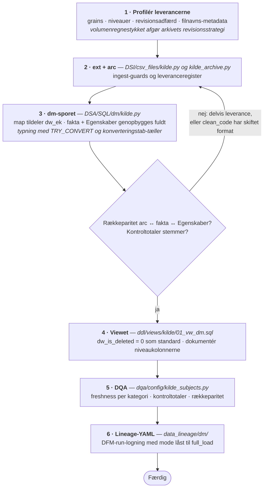

<!--
  SPDX-FileCopyrightText: 2026 Enversion Journl ApS
  SPDX-License-Identifier: AGPL-3.0-or-later

  This file is part of Healthpipe. See the LICENSE file in the project
  root for the full AGPL-3.0 license text.
-->

# 03c — DSA: fra arkiv til dm-skema

Dette kapitel dækker en tredje slags kilde: **færdigberegnede leverancer udefra**.
Typisk periodiske filleverancer fra en myndighed — SDS, SSI og lignende — hvor
tallene allerede er summeret, og leverandøren ejer beregningen. Vi henter
resultatet ind.

Kapitlet har to halvdele, og de er modnet forskelligt:

- **At hente leverancen ind** (`ext` → `arc`) er beskrevet ud fra **to**
  implementeringer: HAIBA (hospitalserhvervede infektioner, ugentlige CSV-snapshots
  fra SDS) og DRG (DRG-grupperet LPR, tar.bz2-snapshots fra SDS). De reglerne gælder
  enhver filleverance — også dem, der bagefter modelleres dimensionelt.
- **dm-mønstret selv** (`map` → fakta + `Egenskaber`) har indtil videre **én**
  implementering: HAIBA. Forvent, at den halvdel skal generaliseres, når kilde nummer
  to lander på sporet. Er du den, der onboarder den, så ret her, hvor HAIBA viser sig
  at være særtilfældet.

Forudsætter [02 — DSI: fra kilde til arkiv](02_DSI_kilde_til_arkiv.md).

## Er min kilde en dm-kilde?

Den hører til her, hvis de fleste af disse gælder:

- **Målene er allerede summeret ved kilden.** Der er ingen transaktion at drille ned
  i — rækken *er* tallet.
- **Grain er (periode × organisation × kategori)**, ikke en hændelse med identitet.
  Der er **ingen transaktions-id**; rækken identificeres af sine dimensionsværdier.
- **Leverancer er fulde snapshots**, ikke deltas — og leverandøren reviderer
  historik: sidste måneds tal kan ændre sig i denne uges fil.
- **Samme leverance kan bære flere aggregeringsniveauer** (både rækker per enhed og
  landstotaler i én fil).
- **Leverancemetadata står i filnavnet** (type, periode, leveringsdato), ikke i
  rækkerne.

Har rækkerne derimod en identitet — noget, der kan opdateres og genkendes igen —
hører kilden til i [03b](03b_DSA_arkiv_til_dimensionel_model.md). Aggregering, vi
selv kan lave, hører til i datamarterne — ikke i ingest-laget.

> **Modeksemplet er DRG.** Det er samme slags kilde som HAIBA — fulde
> filsnapshots fra SDS, med revisioner og genleverancer — men hver række *er* en
> kontakt med sin egen identitet, ikke et færdigsummeret tal. DRG er derfor
> modelleret dimensionelt: `pre_stg` → `stg` → `map` → `fct.DRGKontakt` med
> tilhørende dims og bridges. **Kildens form afgør altså ikke sporet; rækkens grain
> gør.** Ingest-reglerne nedenfor gælder alligevel for DRG.

## Hvorfor ikke bare en almindelig fact?

Fordi data allerede er modelleret. Leverandøren har lavet aggregeringen, og rækkerne
kommer ind på præcis det grain, de skal rapporteres på. Der er derfor ikke noget at
modellere — kun nogle fælles nøgler at koble på.

Det er, hvad dm-sporet gør: det kobler de fælles dimensioner på (Borger,
Organisation, Dato), og derefter er tallene klar til at blive udstillet eller til at
arbejde videre med i en datamart. `pre_stg`- og `stg`-lagene har ingen opgave her og
springes over:

```
ext ──▶ arc ──▶ map (tildeler dw_ek) ──▶ dm.<X> (fakta)
                                     └─▶ dm.<X>Egenskaber
                                            │
                                            ▼
                                        DSO ──▶ vw_dm.<X>
```

## Mønstret: fakta + Egenskaber

Parret er en **transaktionsdimension**:

- **`dm.<X>`** bærer kun DW-nøgler og typede mål.
- **`dm.<X>Egenskaber`** bærer kildens beskrivende kolonner 1:1, på den samme
  `dw_ek_<X>`.
- Nøglen `dw_ek_<X>` tildeles append-only i `map.<X>` per CleanCode. Her betjener
  map-tabellen altså en **fact**, ikke kun dimensioner.

Splittet gør to ting for dig.

Kildens egne værdier ligger urørt i `Egenskaber`-tabellen. Du kan altså rette og
forbedre nøgleopslagene på faktasiden — flere organisationer opløst, en ny
dato-dimension — uden at det, leverandøren faktisk sendte, ændrer sig.

Og slår et opslag fejl, koster det ikke tallet. Kan organisationen fx ikke findes i
SoR, lander faktarækken alligevel, blot med `-1` på den nøgle, mens den rå
organisationskode fra leverancen står på `Egenskaber`-siden. Målingen er der, og man
kan bagefter se, hvad der ikke kunne slås op — i stedet for at rækken forsvinder.

Parringen er i øvrigt ikke forbeholdt dm-sporet. DRG bruger den samme konstruktion
på den dimensionelle side: `fct.DRGKontakt` og `dim.DRGKontaktEgenskaber` deler
`dw_ek_DRGKontakt` fra `map.DRGKontakt`, så facten holdes fri for tekstkolonner. Se
[transaktionsdimension vs. egenskabsdimension](../implementation/data_lineage_guide.md#transaktionsdimension-vs-egenskabsdimension).

## Regler for at hente en filleverance ind

Disse regler gælder **uanset hvilket spor** kilden ender på — de er lige så
relevante for DRG på det dimensionelle spor som for HAIBA på dm-sporet. Begge
implementeringer findes i `DSI/csv_files/`.

### I arkivet

1. **Vælg revisionsstrategi eksplicit, og skriv valget ned.** Leverandøren
   reviderer historik, så arkivet skal kunne svare på *hvad vidste vi hvornår?*

   | Model | Hvordan | Vælg når |
   |---|---|---|
   | **Upsert + revisionslog** | MERGE på den naturlige nøgle; ændrede målværdier kopieres til en sidetabel før overskrivning | Leverancerne er store og for det meste uændrede |
   | **insert_only-snapshots** | Hver leverance tilføjes med sin leveringsdato; aftageren vælger snapshot | Leverancerne er små, eller aftagerne har reelt brug for "som leveret dato X" |

   Lav volumenregnestykket først: rækker per leverance × leverancer per år × år med
   opbevaring.

2. **Før et leveranceregister.** Du skal kunne svare på to spørgsmål: hvornår fik vi
   sidst en leverance for denne kategori (freshness), og har vi allerede set en nyere
   end den, der ligger nu? Uden det sidste kan en forsinket fil blive MERGE'et oven
   på nyere data.

   Begge implementeringer har en kontroltabel til det — `meta.HAIBALeverance` og
   `meta.DRGLeverance` — som holder, hvilken leverance arkivet står på per kildetabel.

3. **Aflæs leverancemetadata fra filnavnet én gang**, ind i en dedikeret kolonne ved
   `ext`. Ingen downstream-kode må gen-parse filnavne.

4. **Er der flere filer for samme gruppe, er den nyeste autoritativ.** Filer hober
   sig op på drevet, og kadencen kan skifte uden at det betyder noget for indholdet.
   Skriv reglen ned, så en genleverance ikke bliver en dublet.

### Ingest-guards

Med fuldt snapshot og delete detection slået til får alt, der mangler i `ext`, soft
delete i arkivet. Derfor disse guards:

5. **En manglende sti er en hård fejl, ikke en tom leverance.** Er drevet ikke
   monteret, eller er stivariablen ikke sat, skal kørslen fejle. "Kan ikke læse
   drevet" og "ingen nye leverancer" må ikke ligne hinanden.

6. **En kategori med leverancer, men uden brugbar fil, skal få kørslen til at
   fejle.** En tom eller ødelagt fil må ikke slette den kategoris historik. En
   kategori helt uden filer er derimod en ægte udfasning og skal kunne flyde igennem.

7. **Rækkedrift:** en fil, der er skrumpet langt under sin arkiverede historik, er
   en afbrudt overførsel — ikke en lille leverance. Fejl før MERGE'en.

   Sender leverandøren selv rækketal med (DRG får en eksportlog per leverance), så
   afstem mod dem efter arkiveringen. Et afvig er en leverancedefekt og skal fejle.

8. **Validér nøglekolonners bredde, før de rammer arkivet.** En for lang værdi i en
   nøglekolonne afbryder ellers hele MERGE'en med en trunkeringsfejl. Afvis og tæl
   per kolonne, og **log aldrig selve værdien** — leverancerne kan bære CPR. Kun
   filnavne, antal og datoer hører i logs og rapporter.

9. **Ukendte kolonner skal fejle højlydt.** Leverandøren ændrer skema uden varsel;
   kolonner, der forsvinder uden en fejlbesked, bliver til forkerte KPI'er, som
   ingen opdager.

## Regler i dm-laget

Fra her er kapitlet skrevet ud fra HAIBA alene.

10. **Fuld rebuild, ikke MERGE.** Hver kørsel er `TRUNCATE` +
    `INSERT ... WITH (TABLOCK)` fra `arc`. Leverancer er komplette snapshots, så en
    rebuild er altid konsistent med arkivet — og `dw_ek` er stabil, fordi
    map-tabellen er append-only.

11. **Typning sker i rebuild'en**, ikke i et stg-lag:
    `TRY_CONVERT(<type>, NULLIF(src, ''))` med en **tæller af konverteringstab pr.
    kolonne**. Arkivet forbliver utypet tekst, så et formatskifte fra leverandøren
    dukker op som et talt tab i stedet for en NULL, ingen opdager.

12. **`dw_is_deleted` bæres med, filtreres aldrig væk i dm.** Soft deleted rækker
    er sporet af, hvad leverandøren har trukket tilbage. Derfor får dm-tabellerne
    et view, hvor `dw_is_deleted = 0` er standardfiltret (`vw_dm.*`); sporet kan
    fortsat læses direkte fra dm-tabellerne.

13. **Personidentifikatorer når aldrig dm.** Bærer kildens grain et CPR-nummer eller
    lignende, lever det kun i map-tabellens CleanCode og i `arc` — begge interne til
    staging og aldrig synkroniseret. Personen bæres videre som sin `dw_ek_*`, så der
    ikke er behov for adgangsbegrænsning på DSO.

## Aggregeringsniveauer uden dobbelttælling

Blandede niveauer i samme tabel betyder, at en nøgen `SUM()` over det hele er forkert
per konstruktion. Den sikre læsning skal derfor være standarden:

- Filtrér soft deleted rækker fra i dm-tabellens view.
- Bær niveaukolonnen (regionskode, markør for landstotal, rolle) hele vejen, og
  dokumentér i lineage-filen, hvordan den skal bruges i en forespørgsel. Overvej
  views per niveau, hvis aftagerne bliver ved med at snuble i det.

> **Eksempel (HAIBA):** `vw_dm.HAIBA_*` filtrerer `dw_is_deleted = 0`.
> Regionskoderne 8888/9999 markerer landsaggregater, hvis SOR-nøgle er
> `-1`-sentinelen — summerer man uden at filtrere på regionskode, dobbelttæller man
> nationalt.

## Fem faldgruber, alle observeret i praksis

1. **Blandede grains i samme fil → dobbelttælling ved SUM.** Find niveaukolonnerne
   under profileringen, og bær dem hele vejen til aftageren. Ryd dem aldrig væk.
2. **Leverandøren reviderer historik → "seneste snapshot" ≠ "det vi rapporterede
   sidste måned".** Det er derfor arkivet skal have en eksplicit revisionsstrategi.
   Over for en revisor er en revisionslog eller snapshots de eneste holdbare svar.
3. **Leverandøren roterer, hvilke filer og typer der leveres.** Detektér skema på
   headeren, ikke på en hardkodet typeliste. Lad kategorier udfases. Hardkod aldrig
   forventede kategorier i freshness-tjek.
4. **Leverancemetadata kun i filnavnet → aflæs det én gang, ved `ext`.**
5. **Kontroltotaler afslører en delvis leverance.** En kort fil parser fint.
   Kryds-tjek totaler, der kan udledes internt — men **kun** når begge sider kommer
   fra samme leveringsdato. Leverandørens filfamilier leveres rutinemæssigt i utakt,
   og en sammenligning på tværs af leverancer er en permanent falsk alarm.

## Sådan onboarder du en ny dm-kilde



1. **Profilér leverancerne:** grains, niveauer, revisionsadfærd, filnavns-metadata,
   tegnsæt, og volumenregnestykket til arkivstrategien.
2. **ext + arc** med ingest-guards og leveranceregistret.
3. **dm-sporet:** `map` tildeler nøgler, faktatabellen og `Egenskaber`-tabellen
   genopbygges fuldt, fælles dimensioner slås op med `-1`-sentinel, og
   konverteringstab tælles.
4. **Viewet**, der gør den sikre læsning til standarden (`dw_is_deleted = 0`),
   og en beskrivelse af niveaukolonnerne i lineage-filen.
5. **DQA:** freshness per kategori (uden fast kategoriliste), kontroltotaler (kun
   leveranceafstemt), rækkeparitet fakta↔arc og fakta↔Egenskaber, tegnsætssanitet.
6. **Lineage-YAML** per dm-tabel i `data_lineage/dm/`, og DFM-run-logning med mode
   låst til `full_load` (dm ejer intet checkpoint — en fuld rebuild har ingen
   delta-position; leverancens watermark ligger i leveranceregistret).

## Orkestrering

Del **INGEST** (extract + arkiv) fra **PUBLISH** (dm + DSO-sync), når rebuild'en
afhænger af nøgler, som en anden pipeline slår op i mellemtiden — og lad en sensor
bede om publiceringen, når en ny leverance er landet.

> **Eksempel (HAIBA):** `haiba_ingest_job` kører dagligt kl. 05:00; den natlige
> DFM-kæde projicerer nye borger-stubs; `haiba_publish_sensor` beder derefter om
> `haiba_publish_job`, som genpubliceres de følgende nætter, mens antallet af
> borgere, der endnu ikke kunne slås op, falder.

## Indbyggede guards i rebuild'en

Rebuild'en fejler hårdt ved: manglende rækkeparitet mellem arc, fakta og
Egenskaber, og ved en tom faktatabel selvom kilden har rækker. Den advarer, hvis en
kørsel tildeler nye nøgler til mere end en tærskelværdi af kildens rækker — et ændret
CleanCode-format ville ellers give hele historikken nye nøgler — uden en fejlbesked.

## Skabeloner

Ingest — begge er værd at læse, de løser samme problem på to kildeformer:

| Fil | Bruges til |
|---|---|
| `DSI/csv_files/haiba.py` | Extract af CSV-leverance, inkl. guards (læs modulets docstring) |
| `DSI/csv_files/haiba_archive.py` | Arkiv med revisionslog og leveranceregister |
| `DSI/csv_files/_sds_tar.py` | Fælles streaming af SDS' tar-leverancer: `ExtWriter`, eksportlog, `ext`-DDL |
| `DSI/csv_files/drg.py` | Extract af tar-leverance streamet fra drev, eksportlog-afstemning, breddevalidering |
| `DSI/csv_files/drg_archive.py` | Arkiv med årsafgrænset delete detection |

dm-laget:

| Fil | Bruges til |
|---|---|
| `DSA/SQL/dm/haiba.py` | dm-rebuild: map, fakta, Egenskaber, typning, tællere |
| `dqa/config/haiba_subjects.py` | DQA-konfiguration for en dm-kilde |
| `infrastructure/ddl/views/haiba/01_vw_dm.sql` | `vw_dm.*`-views |

## Videre herfra

- Ud til DSO-databasen: [04 — DSO](04_DSO_sync_til_DSO.md)
- Dokumentation: [05 — Udfyld dokumentation](05_udfyld_dokumentation.md)

Uddybende (på engelsk):
[kpi_aggregat_data_guide.md](../implementation/kpi_aggregat_data_guide.md) — den
engelske originaludgave; [sql_etl_guide.md, afsnittet The Datamart Path
(dm)](../implementation/sql_etl_guide.md#the-datamart-path-dm) — lagene i HAIBA-kæden
tabel for tabel.
