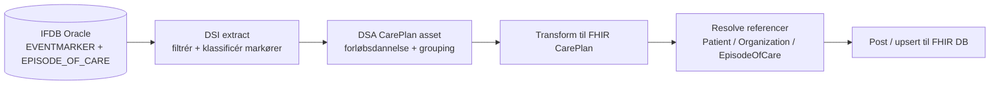
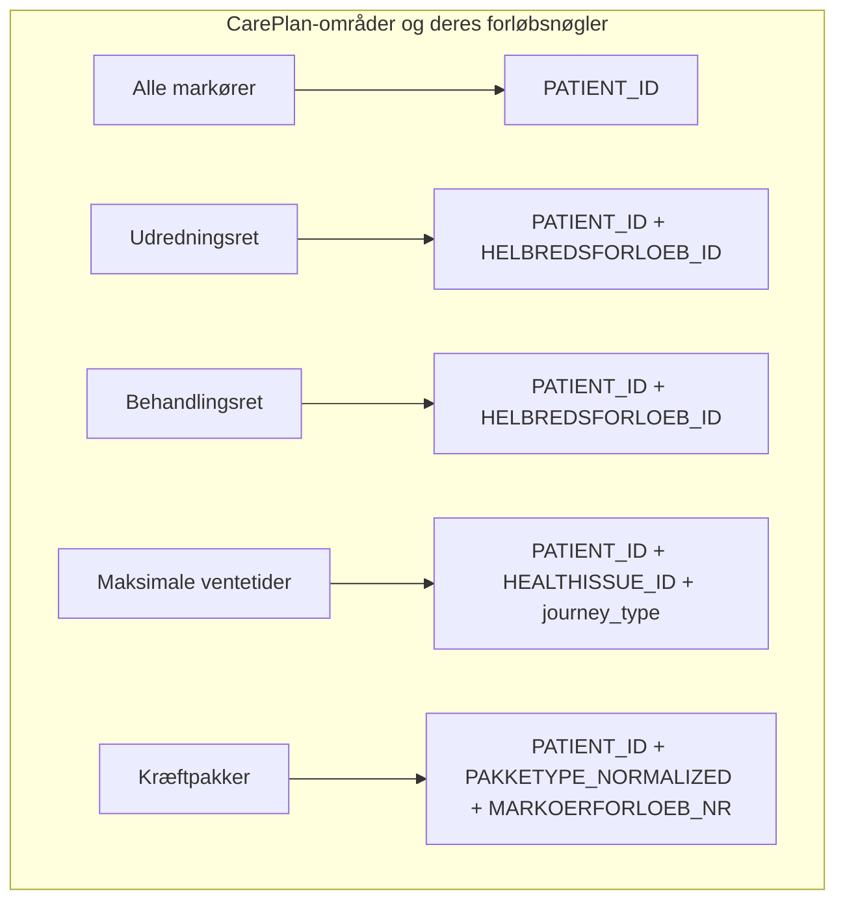
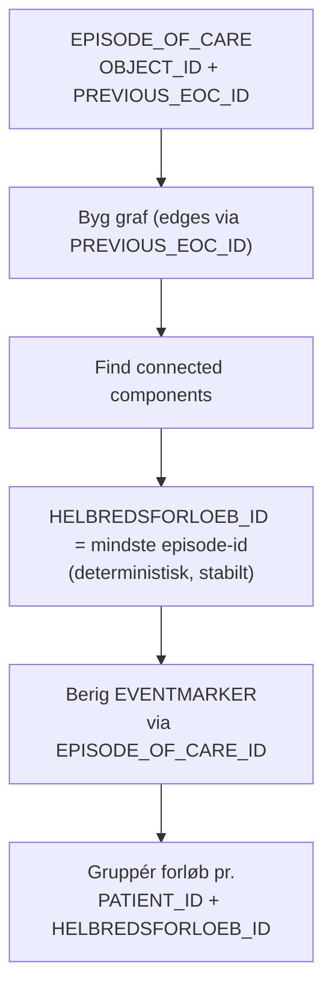
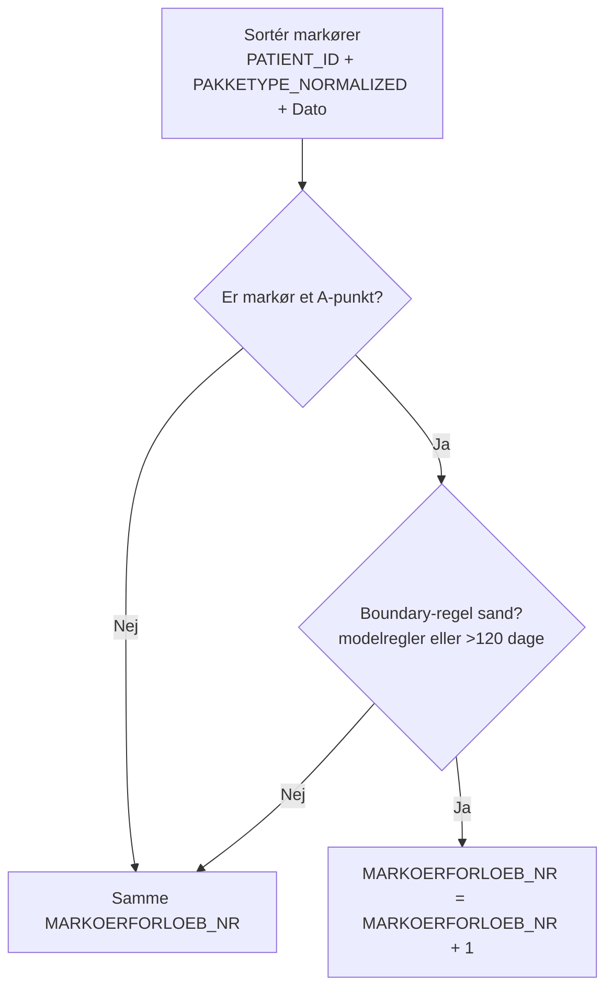

<!--
  SPDX-FileCopyrightText: 2026 Enversion Journl ApS
  SPDX-License-Identifier: AGPL-3.0-or-later

  This file is part of Healthpipe. See the LICENSE file in the project
  root for the full AGPL-3.0 license text.
-->

### Overblik: Patientrettigheder som FHIR CarePlan

Dette dokument giver et **kort, implementeringsnært overblik** over hvordan patientrettighedsområderne er modelleret som **FHIR `CarePlan`** i Healthpipe-platformens ETL – med fokus på **forløbsdannelse** og på at **koble de rette markører** (rækker i IFDB `EVENTMARKER`) på de dannede forløb.

**Afgrænsning**

- Vi har primært haft fokus på at **danne forløb** og **tilknytte markører** til forløbene som `CarePlan.activity[]`.
- Beregninger (ventedage/varigheder/målopfyldelse), rapporter og business-opgørelser ligger typisk **udenfor** disse CarePlan-assets (ofte som “post-FHIR” logik eller i andre datalag). Vidensartiklerne beskriver disse bredere perspektiver – her beskrives kun den del vi faktisk implementerer i CarePlan-flowet.

---

### Relevante komponenter i kodebasen

**Extract (DSI)**

- `etl/DSI/oracle/ifdb.py` — IFDB-extracts inkl. eventmarker (fx `extract_eventmarker_alle_markoerer_*` via factory)
- `etl/utils/eventmarker_utils.py` — fælles SQL/delta-hjælpere til EVENTMARKER-udtræk

**CarePlan transform + post (DSA)**

- `etl/DSA/FHIR/CarePlan/CarePlan_IFDB.py` — Alle markører (aktiv implementering)

**Fælles hjælpelogik**

- `etl/DSA/FHIR/utils/helbredsforloeb.py` (dannelse af `HELBREDSFORLOEB_ID` fra `EPISODE_OF_CARE`)

---

### Fælles mønster (Extract → CarePlan)

**Typisk delta-strategi**

- For “daglig/månedlig” kørsel finder extract-laget **patienter med ændringer** i partition-vinduet og henter derefter **alle** relevante markører for de patienter (ikke kun de ændrede rækker). Det gør forløbsdannelsen deterministisk og korrekt.

---

### Forløbsnøgler (hvad grupperer vi efter?)

| Område | Primær forløbsdannelse (grouping key) | CarePlan-identifikator (konceptuelt) |
|---|---|---|
| Alle markører | `PATIENT_ID` | `PATIENT_ID_alle_markoerer` |
| Udredningsret | `PATIENT_ID` + `HELBREDSFORLOEB_ID` (+ journey nr.) | `PATIENT_ID_HELBREDSFORLOEB_ID_JOURNEYNR` |
| Behandlingsret | `PATIENT_ID` + `HELBREDSFORLOEB_ID` (+ journey nr.) | `PATIENT_ID_HELBREDSFORLOEB_ID_JOURNEYNR` |
| Maksimale ventetider | `PATIENT_ID` + `HEALTHISSUE_ID` + `journey_type` (+ nr.) | `PATIENT_ID_HEALTHISSUE_ID_TYPE_NR` |
| Kræftpakker | `PATIENT_ID` + `PAKKETYPE_NORMALIZED` + `MARKOERFORLOEB_NR` | `PATIENT_ID_PAKKETYPE_NR` |

---

### Alle markører (”alle_markoerer”)

**Hvad er det?**

- Området indeholder **alle markører** – dvs. alle rækker i IFDB `EVENTMARKER` (typisk `DELETED=0`) – uden domænespecifik filtrering.

**Forløbsdannelse**

- **1 CarePlan pr. `PATIENT_ID`**
- Alle patientens markører bliver `CarePlan.activity[]` (sorteret på tidspunkt)

**Hvorfor findes det?**

- Det giver en “komplet timeline” pr. patient og muliggør **post-FHIR** filtrering/analyse uden at skulle genudtrække.

#### Lineage og DSO-tabeller

- **DSO-tabel (aktiviteter)**: `fhir.CarePlan_Activity`
- **Lineage-fil**: `etl/data_lineage/fhir/fhir_careplan_activity.yml`
- **Key/grain** i lineage: én række pr. markør i IFDB `EVENTMARKER` (`ifdb_eventmarker_id`)

Den tilhørende lineage-YAML dokumenterer fuld teknisk mapping fra kilde (`IFDB.EVENTMARKER`)
til hver kolonne (fx `patient_id`, `markoerkode`, `activity_timestamp`) og viser, hvordan
CarePlan-aktiviteterne kan spores tilbage til kildesystemet. Dette kontraktdokument fokuserer
på forretningsforståelsen (hvad en markør/aktivitet betyder og hvordan den bruges i
patientrettighedsforløb), mens lineage-filen er den autoritative tekniske reference.

---

### Helbredsforløb (fælles for udredningsret og behandlingsret)

I national monitorering kobles markører sammen på **helbredsforløb**. I IFDB ligger koblingen implicit i `EPISODE_OF_CARE.PREVIOUS_EOC_ID`.

Vigtigt: Vidensartiklerne omtaler ALAA01/ALAA03 som relevante reference-typer, men denne implementering behandler **alle** `PREVIOUS_EOC_ID`-links som helbredsforløb-links. **Der er dog "hashede" eller lign. `PREVIOUS_EOC_ID`-værdier i IFDB, hvor vi ikke kan skabe referencerne**.

---

### Område 1: Udredningsret

**Forløbsdannelse**

- Gruppér markører pr. **(`PATIENT_ID`, `HELBREDSFORLOEB_ID`)**.
- Der kan dannes **flere udredningsforløb** på samme helbredsforløb, men kun **sekventielt**: når et forløb slutter og der senere kommer en ny start, dannes et nyt forløb (journey nr. sikrer unikhed).

**Start og slut (kort)**

- **Start**: første markør klassificeret som **“henvist til udredning”** (`MARKER_CLASSIFICATION="start"`).
- **Sluttype-prioritet**: *udredning slut* > *afbrudt* > *omvisitering*.
- Ved flere slutmarkører af samme type vælges **den sidste** registrering.
- **Omvisitering** kan kun afslutte, hvis der **ikke** registreres andre relevante markører indenfor **3 dage** efter omvisitering.

**Resultat i FHIR**

- Én `CarePlan` pr. udredningsforløb, med alle relevante markører som `activity[]`.

#### Lineage og DSO-tabeller

Udredningsret DSO-tabeller og lineage-filer er endnu ikke implementeret. Denne sektion beskriver
forløbslogikken og forretningssemantikken; implementering afventer fremtidig udvikling.

---

### Område 2: Behandlingsret

**Forløbsdannelse**

- Gruppér markører pr. **(`PATIENT_ID`, `HELBREDSFORLOEB_ID`)** (samme helbredsforløb-logik som udredningsret).
- Der kan dannes **flere behandlingsforløb** på samme helbredsforløb (sekventielt) – nyt forløb efter afslutning + ny start.

**Start og slut (kort)**

- Start kan komme fra to “start-typer”:
  - **Henvist til behandling** (`start_henvist`, fx `AFV01E*`, `AJK01A`)
  - **Udredning slut/tilbud** (`start_udredning_slut`, fx `AFX01A*`, `AFB??C1`)
- Hvis både “udredning slut” og “henvist” findes, **tælles der fra udredning slut** (foretrækkes som periodestart).
- Slut vælges som **første** forekomst med prioritet: *behandling start* > *afbrudt* > *omvisitering*.
- **Omvisitering** kan kun afslutte, hvis der **ikke** registreres andre relevante markører indenfor **3 dage** efter.
- Special-case: `AFX01A3` kan danne et **0-dages forløb** hvis der tidligere på samme helbredsforløb findes “henvist til udredning” (forudsætning for 0-dags).

**Resultat i FHIR**

- Én `CarePlan` pr. behandlingsforløb, med markører som `activity[]`.

#### Lineage og DSO-tabeller

Behandlingsret DSO-tabeller og lineage-filer er endnu ikke implementeret. Kontrakten her fokuserer på
forløbsdannelsen og anvendelsen; implementering afventer fremtidig udvikling.

---

### Område 3: Maksimale ventetider

**Forløbsdannelse**

- Gruppér markører pr. **(`PATIENT_ID`, `HEALTHISSUE_ID`)**, hvor `HEALTHISSUE_ID` er **sygdomsforløb**.
- For hvert sygdomsforløb kan der dannes op til **tre** CarePlans (ét pr. type):
  - **udredning**
  - **behandling**
  - **efterbehandling**

**Start og slut (kort)**

- For hver type bruges **første startmarkør** → **første slutmarkør** (efter start).
- Der dannes kun forløb når både start og slut findes (**kun “færdige” forløb**).
- Hvis der ligger en **abort-markør mellem start og slut**, fravælges forløbet.

**Post-FHIR noter (bevidst afgrænsning)**

- Markører for **samtykke** (`AFV01C8`/`AFV01C9`) inkluderes som aktiviteter til senere beregninger.
- Matching-regler om “samme hospital/overafdeling” for visse forløb implementeres **ikke** i ETL’et; CarePlan indeholder i stedet metadata/extensions til senere filtrering.

#### Lineage og DSO-tabeller

Maksimale ventetider DSO-tabeller og lineage-filer er endnu ikke implementeret. Denne kontrakt beskriver
forretningssemantikken; implementering afventer fremtidig udvikling.

---

### Område 4: Kræftpakker

**Forløbsdannelse**

- Markører filtreres til kræftpakke-koder (AFA/AFB/AFD) og grupperes på:
  - **`PATIENT_ID` + `PAKKETYPE_NORMALIZED` + `MARKOERFORLOEB_NR`**
- `PAKKETYPE_NORMALIZED` normaliserer `AFB14/AFB15/AFB32` → `AFB13`.

**Forløbsnummer (MARKOERFORLOEB_NR) – essens**

- Markører sorteres pr. patient+pakketype, og `MARKOERFORLOEB_NR` øges når et nyt “A” vurderes at starte et nyt forløb baseret på:
  - modelafhængige “A-efter-afslutning”-regler (AFA/AFB/AFD),
  - samt en tidsgrænse i koden på **120 dage** fra forløbets første markør til et nyt A (afvigelse ift. 150 dage beskrevet i vidensartiklen).

**Resultat i FHIR**

- Én `CarePlan` pr. kræftpakke-forløb (patient+pakketype+nr.), hvor alle markører i forløbet ligger som `activity[]`.

#### Lineage og DSO-tabeller

Kraeftpakker-domænets DSO-tabeller og lineage-filer er fjernet (legacy). Se `fhir.CarePlan` og `fhir.CarePlan_Activity` for den aktive implementering.
