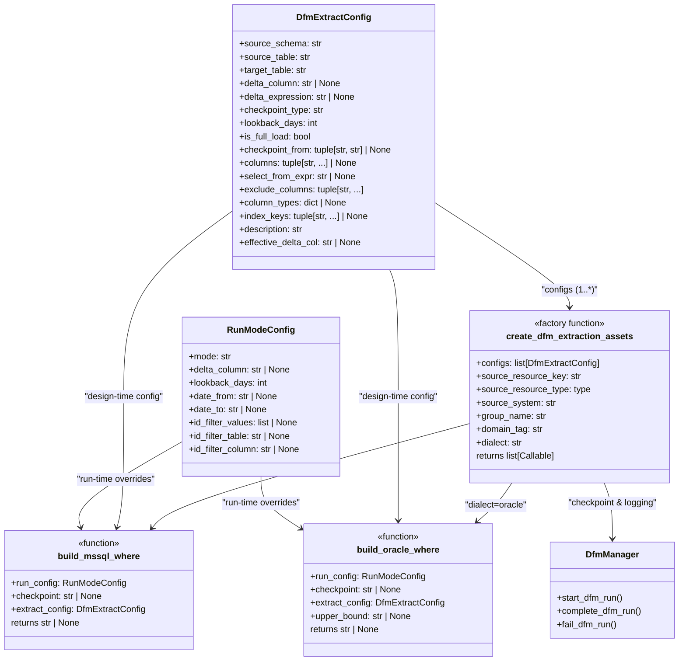
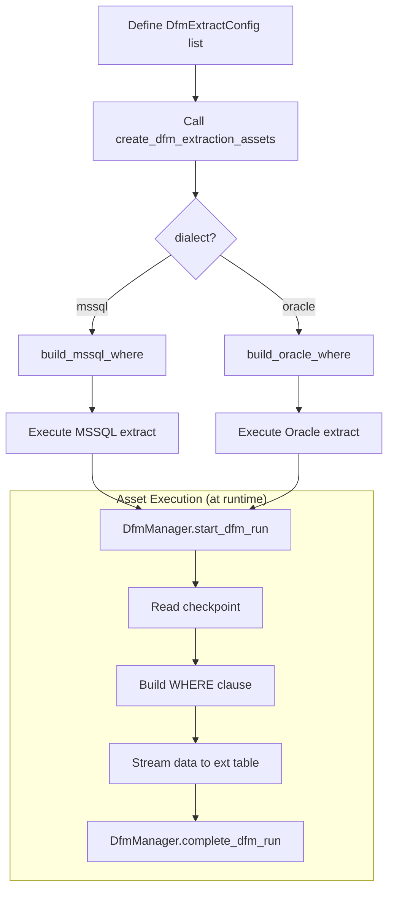

<!--
  SPDX-FileCopyrightText: 2026 Enversion Journl ApS
  SPDX-License-Identifier: AGPL-3.0-or-later

  This file is part of Healthpipe. See the LICENSE file in the project
  root for the full AGPL-3.0 license text.
-->

# DFM Extract Factory Pattern

The DFM Extract Factory generates Dagster assets for data extraction using DFM (Data Flow Management) checkpoint-based delta loading. It replaces hand-written extract assets with declarative configuration, supports multiple SQL dialects, and integrates with `RunModeConfig` for ad-hoc overrides.

## Architecture



## Flow Diagram



## How to Use

### 1. Define Extract Configs

Create a `DfmExtractConfig` per source table. Each config declares *what* to extract without any SQL dialect specifics:

```python
from DSI.connectors.extract_config import DfmExtractConfig

MY_CONFIGS = [
    # Delta extract (datetime checkpoint)
    DfmExtractConfig(
        source_schema="dbo",
        source_table="orders",
        target_table="orders_mysource_dfm_new",
        delta_column="modified_date",
        checkpoint_type="datetime",
        checkpoint_from=("arc", "orders_mysource_dfm_new"),
        description="Orders from MySource (delta via modified_date).",
    ),
    # Delta extract (integer checkpoint with lookback)
    DfmExtractConfig(
        source_schema="fact",
        source_table="Invoices",
        target_table="invoices_mysource_dfm_new",
        delta_expression="GREATEST([dw_audit_insert], [dw_audit_update])",
        checkpoint_type="int",
        lookback_days=2,
        checkpoint_from=("arc", "invoices_mysource_dfm_new"),
        description="Invoices (delta via audit-MAX, 2d lookback).",
    ),
    # Full-load extract (no checkpoint)
    DfmExtractConfig(
        source_schema="dbo",
        source_table="categories",
        target_table="categories_mysource_dfm_new",
        is_full_load=True,
        checkpoint_from=None,
        description="Categories reference table (full load).",
    ),
]
```

### 2. Generate Assets with the Factory

```python
from core.resources import MySourceMSSQLResource
from DSI.connectors.factory import create_dfm_extraction_assets

my_extract_assets = create_dfm_extraction_assets(
    configs=MY_CONFIGS,
    source_resource_key="mysource_mssql",
    source_resource_type=MySourceMSSQLResource,
    source_system="MySource",
    group_name="dfm_new_extract",
    domain_tag="finance",
    dialect="mssql",
)
```

### 3. Register in `__init__.py`

```python
from my_module.extract_configs import my_extract_assets

all_assets = [*my_extract_assets, ...]
```

## Key Parameters

| Parameter | Purpose |
|-----------|---------|
| `source_resource_key` | Dagster resource key for the source DB connection |
| `source_resource_type` | Python class of the resource (for typed injection) |
| `source_system` | Label stamped on metadata and used in DfmManager |
| `group_name` | Dagster asset group name |
| `domain_tag` | Domain tag for filtering in the UI |
| `dialect` | `"mssql"` or `"oracle"` — selects WHERE builder + executor |
| `retry_policy` | Optional Dagster RetryPolicy |

## DfmExtractConfig Fields

| Field | Required | Description |
|-------|----------|-------------|
| `source_schema` | Yes | Schema in the source database |
| `source_table` | Yes | Table in the source database |
| `target_table` | Yes | Target `ext.*` table name |
| `delta_column` | * | Simple column name for delta filter |
| `delta_expression` | * | Complex SQL expression for delta filter |
| `checkpoint_type` | No | `"datetime"` (default) or `"int"` |
| `lookback_days` | No | Extra days subtracted from checkpoint |
| `is_full_load` | No | If True, skips all WHERE filtering |
| `checkpoint_from` | No | `(schema, table)` — where to read the checkpoint |
| `columns` | ** | Explicit column list (required for Oracle) |
| `select_from_expr` | No | Full SELECT+FROM override (Oracle only, see below) |
| `upper_bound_column` | No | Column the flow-start ceiling filters on; defaults to the delta column (see below) |
| `flow_start_from` | No | `(schema, table)` — where to read the upper-bound value at runtime (see below) |
| `column_types` | No | Column→type mapping for cross-platform DDL |
| `index_keys` | No | Columns for post-load clustered index |

\* One of `delta_column` or `delta_expression` required unless `is_full_load=True`.
\*\* Required for Oracle dialect.

### upper_bound_column (ceiling column)

`upper_bound_column` names the column the flow-start ceiling filters on. It defaults to the delta column, which is what every IFDB extract uses:

```sql
WHERE IFDB_MODIFICATION_DATETIME > TO_DATE('2026-10-05 09:20:11', 'YYYY-MM-DD HH24:MI:SS')
  AND IFDB_MODIFICATION_DATETIME <= TO_DATE('2026-10-05 13:34:23', 'YYYY-MM-DD HH24:MI:SS')
```

The archive merge sets its checkpoint to the ceiling the extract read, and the next run compares that checkpoint with the delta column. The ceiling, the delta column and the upper-bound column must therefore follow one clock. A ceiling column on another clock than the delta column splits or repeats the source's load cycles; `tests/unit/test_ifdb_delta_ceilings.py` rejects it for IFDB. Most IFDB extracts set `upper_bound_column` to their delta column anyway, because DQA's archive reconciliation (`dqa/config/arc_subjects.py`) reads it to bound its own window.

### flow_start_from (upper-bound value source)

When the extract needs a flow-start ceiling, set `flow_start_from` to tell the factory WHERE to read the upper-bound value from at runtime. The factory reads `dfm.get_checkpoint(schema, table)` and passes it as `upper_bound` to the WHERE builder (delta mode only). IFDB has two ceilings, one per clock; pick the one that matches the delta column:

- `IFDB_TRANSFER_CEILING` (`dfm.ifdb_transfer_ceiling`) for columns IFDB stamps when it transfers the row: `IFDB_MODIFICATION_DATETIME`, `OPDATERET_TID`, `UPDATE_TIME`.
- `IFDB_EPJ_CEILING` (`dfm.ifdb_flow_start`) for tables that only carry the EPJ modification time (`MODTIDSPUNKT`, `REFERRAL_DATE`).

The factory records the value it read under the config's `used_ceiling_key` (`dfm/<target_table>_flow_start` in `meta.DFMState`), in every mode. A delta archive's `flow_start_key` must be that key, so the archive checkpoint is the ceiling this extract applied, not one a later flow start wrote.

```python
ENCOUNTER_EXTRACT_CONFIG = DfmExtractConfig(
    source_schema="IFDB",
    source_table="ENCOUNTER",
    target_table="ifdb_encounter",
    delta_column="IFDB_MODIFICATION_DATETIME",
    upper_bound_column="IFDB_MODIFICATION_DATETIME",
    flow_start_from=IFDB_TRANSFER_CEILING,
    checkpoint_type="datetime",
    checkpoint_from=("arc", "ifdb_encounter"),
    columns=ENCOUNTER_COLUMNS,
    column_types=ENCOUNTER_COLUMN_TYPES,
    index_keys=("OBJECT_ID",),
    description="IFDB Encounter (delta on IFDB_MODIFICATION_DATETIME).",
)
```

This replaces the need for hand-written assets that manually read the ceiling with `dfm.get_checkpoint`. Currently used only for the IFDB source pattern.

**Note:** `flow_start_from` is only supported for the Oracle dialect. MSSQL extracts do not use the flow-start upper-bound pattern.

### select_from_expr (custom SELECT+FROM for JOINs)

When an extract needs data from related source tables (e.g. delete flags, lookup values), set `select_from_expr` to replace the auto-generated `SELECT ... FROM ...` entirely. The WHERE clause from checkpoint/RunModeConfig is appended to it.

```python
DfmExtractConfig(
    ...,
    select_from_expr=(
        "SELECT t.*, CASE WHEN d.order_id IS NOT NULL THEN 1 ELSE 0 END AS dw_is_deleted "
        "FROM IFDB.ORDERS t "
        "LEFT JOIN IFDB.DELETION_LOG d ON d.order_id = t.order_id"
    ),
    columns=("ORDER_ID", "AMOUNT", "dw_is_deleted", ...),
)
```

**Current support:** Oracle dialect only. For MSSQL sources that need JOINs at extract time, use hand-written assets (the `MssqlExtractor` builds its own query internally).

### Oracle-specific: column_types and index_keys

For Oracle→MSSQL cross-platform extracts, the factory creates the `ext.*` table with properly sized columns instead of `NVARCHAR(MAX)` when `column_types` is provided. This is critical for MERGE performance, since SQL Server cannot index `NVARCHAR(MAX)` columns. After loading, a clustered index is created on `index_keys` columns.

Oracle NUMBER values are normalized via `stringify_oracle_value()` in `DSI/connectors/oracle/models.py`. This ensures integer-valued numerics (e.g. `float(99276330680.0)`, `Decimal('99276330680.0')`) are stored as `"99276330680"` rather than `"99276330680.0"`, preventing ID mismatches in downstream NVARCHAR joins.

### Example: Oracle (IFDB) extract with the factory

```python
from core.resources import IFDBOracleResource
from DSI.connectors.extract_config import DfmExtractConfig
from DSI.connectors.factory import create_dfm_extraction_assets

ENCOUNTER_COLUMN_TYPES = {
    "OBJECT_ID": "NVARCHAR(50) NOT NULL",
    "PATIENT_ID": "NVARCHAR(50) NULL",
    # ... all columns with sized types
}
ENCOUNTER_COLUMNS = tuple(ENCOUNTER_COLUMN_TYPES.keys())

IFDB_EXTRACT_CONFIGS = [
    DfmExtractConfig(
        source_schema="IFDB",
        source_table="ENCOUNTER",
        target_table="ifdb_encounter",
        delta_column="IFDB_MODIFICATION_DATETIME",
        checkpoint_type="datetime",
        checkpoint_from=("arc", "ifdb_encounter"),
        columns=ENCOUNTER_COLUMNS,
        column_types=ENCOUNTER_COLUMN_TYPES,
        index_keys=("OBJECT_ID",),
        upper_bound_column="IFDB_MODIFICATION_DATETIME",
        flow_start_from=IFDB_TRANSFER_CEILING,
        description="IFDB Encounter (delta on IFDB_MODIFICATION_DATETIME).",
    ),
    DfmExtractConfig(
        source_schema="IFDB",
        source_table="LOCATION",
        target_table="ifdb_location",
        is_full_load=True,
        checkpoint_from=("arc", "ifdb_location"),
        columns=LOCATION_COLUMNS,
        column_types=LOCATION_COLUMN_TYPES,
        index_keys=("OBJECT_ID", "PERIOD_START"),
        description="IFDB Location (full load).",
    ),
]

ifdb_extract_assets = create_dfm_extraction_assets(
    configs=IFDB_EXTRACT_CONFIGS,
    source_resource_key="ifdb_oracle",
    source_resource_type=IFDBOracleResource,
    source_system="IFDB",
    group_name="ifdb_archive",
    domain_tag="ifdb",
    dialect="oracle",
    deps=["staging_infra_ifdb_archive", "dfm_ifdb_flow_start"],
)
```

The factory handles the DfmManager lifecycle, flow-start upper bound reading (via `flow_start_from`), Oracle→MSSQL streaming with `stringify_oracle_value` normalization, ext table DDL with typed columns, and post-load index creation — all driven by the config alone. The `dfm_ifdb_flow_start` asset (which queries Oracle `JOB_LOG`) remains hand-written since it has unique logic not covered by the extract pattern.

## RunModeConfig Overrides

At runtime, every generated asset accepts a `RunModeConfig` that can override the default delta behavior:

| Mode | Behavior |
|------|----------|
| `delta` | Default: uses checkpoint + WHERE `col > checkpoint` |
| `full_load` | Forces no WHERE clause (re-extract everything) |
| `period` | Uses `date_from`/`date_to` for explicit date range |
| `ids` | Filters by specific IDs via `id_filter_values` or `id_filter_table` |

## File Locations

| File | Purpose |
|------|---------|
| `DSI/connectors/extract_config.py` | `DfmExtractConfig` dataclass |
| `DSI/connectors/factory.py` | `create_dfm_extraction_assets()` factory + dialect executors |
| `DSI/connectors/mssql/dfm_sql_builders.py` | `build_mssql_where()` — T-SQL WHERE builder |
| `DSI/connectors/oracle/models.py` | `stringify_oracle_value()`, `iter_rows_as_dict_batches()` — shared Oracle utilities |
| `DSI/oracle/ifdb_extract.py` | `build_oracle_where()`, IFDB column defs, `DfmExtractConfig` instances, `dfm_ifdb_flow_start` asset, factory call |
| `DSI/mssql/extract/extract_configs.py` | ILS + KMD UdData `DfmExtractConfig` instances + factory calls |
